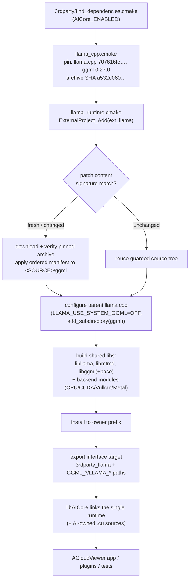

# llama.cpp — single source owner for AICore's embedded ggml runtime

Status on 2026-10-24: **every task re-anchors its numeric baseline on the
0.27 embedded ggml**. The 0.21.0 standalone ggml entry and `3rdparty/ggml/`
have been **removed** (the fingerprint-vs-0.21 comparison was a migration
bridge, not a correctness anchor; correctness is owned by the official
reference gates of each task). The split-K bridge patch `0013` was reverted
with it. 本地 LLM/VLM 已有公共 `llm` task、catalog 和 worker，并在正式
`build_app` 上完成 CPU/CUDA/Vulkan 各 12/12 developer 场景复验。
Metal、完整真实模型/release A/B 和 OCR 发布门仍开放；局部通过不等于完整验收。

## 1. What this directory is

ACloudViewer's AI inference runtime (`libAICore`) needs one ggml with
task-specific custom operators. Historically ggml was vendored standalone
(`3rdparty/ggml`, embedded ggml **0.21.0**). This directory introduces a
llama.cpp-based source owner: **one pinned llama.cpp archive**, whose embedded
ggml (**0.27.0**) carries the same AICore operator patches, rebuilt as shared
llama + mtmd + ggml libraries. AICore links that single runtime; llama/mtmd
back the `llm` task (`aicore/llm_capi.h`) behind the same public C ABI rules.

The design contract is short:

- **One source owner per build.** The llama entry creates only
  `ext_llama` and exports `3rdparty_llama` (mtmd + llama + embedded ggml).
  旧 `ext_ggml` entry 已移除；冻结旧构建仅作为历史对照。
  Persistent source-identity receipts bind build/install prefixes to
  source owner + archive SHA.
- **Patches, never in-place edits.** Every change to the fetched ggml tree is
  an ordered unified-diff patch applied at ExternalProject fetch time.
- **ABI stays closed.** Plugins consume public `core/AICore/include/aicore/*`
  headers. Qt, STL, OpenCV, exceptions and ggml types never cross the ABI.
- **Promotion is evidence-gated.** Deleting the baseline entry requires the
  complete backend/model regression; build support alone certifies nothing.

## 2. Directory layout

| Entry | Responsibility |
|---|---|
| [`llama_cpp.cmake`](llama_cpp.cmake) | Source revision/SHA pin, embedded ggml version, manifest selection (CPU/CUDA/Vulkan/combined), llama/mtmd exports, owner target `_GGML_OWNER_TARGET=ext_llama` |
| [`llama_runtime.cmake`](llama_runtime.cmake) | Shared `ExternalProject_Add` implementation: unique-source guard, prefix lock, patch replay, byproducts, install and ggml exports |
| [`cmake/backends.cmake`](cmake/backends.cmake) | Backend discovery, compile options, SAM3D dependency closure (CUTLASS/PyTorch headers, spconv) |
| [`cmake/patches.cmake`](cmake/patches.cmake) | Content-signature computation, owner-scoped invalidation, patch command (idempotent replay) |
| [`llama-patches/`](llama-patches) | 唯一正式补丁目录：CPU/CUDA/Vulkan/combined manifests 与重放 runner；旧 `ggml-patches/` 已删除 |
| [`sam3d/`](sam3d) | SAM3D operator support sources (spconv 2.3.8, CUTLASS closure) consumed by the embedded build |
| [`experimental/`](experimental) | 隔离验证 driver ([`CMakeLists.txt`](experimental/CMakeLists.txt)) 与真实算子/checker probes；不再拥有生产补丁 |
| [`scripts/`](scripts) | `audit_llama_migration.py` — read-only source merge audit against the pristine archive |
| [`validation/`](validation/README.md) | Historical verification receipts (JSON). Never build inputs; bytes and historical input hashes are preserved |
| [`KERNEL_AUDIT.md`](KERNEL_AUDIT.md) | Operator-by-operator comparison against the pinned revision and the remaining numerical gates |
| [`README.md`](README.md) | This document |

## 3. Architecture

### 3.1 Source ownership and build flow



Key properties of the flow:

- **Persistent source identity.** Before any download, patch or install, a
  receipt check binds the build/install prefix to (source owner, archive SHA).
  A different owner or archive in the same prefix fails at configure time; a
  short prefix lock serializes concurrent configures. Reconfiguring the same
  identity is a no-op and never deletes an existing installation.
- **Patch content signature.** The patch runner hashes patch bytes *including
  their paths*. Unchanged signature → idempotent replay detection; changed
  signature → that owner's generated source/build/stamp directories are
  invalidated and everything replays from the pristine archive (twice-replay
  must produce identical trees). Relocating patch inputs therefore changes the
  signature by design.
- **Runtime implementation.** `llama_runtime.cmake` closes backend selection,
  pins, module installation and owner-scoped invalidation. 冻结对照的历史输入
  不随当前重配置修改。
- **No hidden inference layer.** The export surface is CMake targets and paths
  only. AICore builds its own task graphs; llama/mtmd are runtime libraries
  consumed only by the `llm` task, which owns its model/projector catalog,
  template/image contract and upstream-tool acceptance gates.

### 3.2 唯一补丁所有者

正式入口为 `llama_cpp.cmake → llama-patches/<backend>-manifest.yaml`，
runner 为 `llama-patches/apply_ggml_patches.py`。旧 `ggml-patches/` 与
`experimental/patches/` 不再是源码输入；历史收据中的旧路径只描述当时构建。

manifest 依次应用 CPU/common、所选 GPU 算子、ABI/dispatch 适配及单点修复。
`0017` 修复 F16 POOL_2D workgroup/local-size 元数据；`0018` 让 Vulkan
DW debug checker 的 CPU clone 保留可选 bias。二者仅进入 Vulkan/combined
manifest，四套 CPU/CUDA/Vulkan/combined 完整链的 pristine forward、reverse
和幂等重放已通过，收据为 `build_app/Testing/0018-pristine-replay.json`。

补丁目录路径及内容参与 signature；改动会使该 owner 从 pinned archive 重建。
冻结构建不重配置、不手改 extracted tree。重放通过只证明补丁可应用；算子、
真实模型、独立真值及受控性能必须分别验收。

### 3.3 Backend selection

| Platform | Backend manifests | Notes |
|---|---|---|
| CPU only | `manifest.yaml` | Default validation profile; `GGML_CPU_ALL_VARIANTS=ON` required to match the frozen baseline |
| CUDA | `llama-patches/cuda-manifest.yaml` | Ordered: CPU/common → CUDA operators → dispatch API adaptation → attention-helper linkage; full SAM3D closure (`GGML_USE_SAM3D_OPS=ON`) |
| Vulkan | `llama-patches/vulkan-manifest.yaml` | 33-file port (0005) plus later fixes (0008–0010, 0011) |
| CUDA + Vulkan | `llama-patches/cuda-vulkan-manifest.yaml` | Same source tree; both file sets verified equal to their separate replays |
| Metal | `llama-patches/metal-manifest.yaml` | Explicit opt-in (`LLAMA_METAL_MIGRATION_VALIDATION=ON`, Apple hosts); production promotion blocked until macOS compile + inference validation |
| Other backends (SYCL, OpenCL, …) | — | Fail explicitly; never silently disabled |

AICore's CUDA/Vulkan/Metal inference backends are controlled by
`AICore_USE_*` options (independent of the application's `BUILD_CUDA_MODULE`);
the root `CMakeLists.txt` enables the CUDA language for AICore-owned `.cu`
sources when `AICore_USE_CUDA=ON` and `BUILD_CUDA_MODULE=OFF`.

## 4. Source pin and upgrade path

The pin lives in [`llama_cpp.cmake`](llama_cpp.cmake): llama.cpp revision
`707616feb5f379e99ff7442680a55b4a1704c7c9` (llama 0.7.0-dev, ggml 0.27.0),
archive SHA-256 `a532d0601f65cee41446cfbdc6872b98e689aa727eb366c6b6a61a70e9965759`.

To upgrade or change patches:

1. Update the pin or patch files (never the fetched tree).
2. Reconfigure so the content signature invalidates the owner; replay the
   ordered manifest from the pristine archive **twice** — the second pass must
   detect "already applied" and leave the tree identical.
3. Run the public contract tier, all affected task/model numerical checks, and
   a same-host controlled performance A/B against the frozen baseline.
4. Keep build and install prefixes separate from the frozen baseline.

AICore and Python consumers follow `GGML_DEPENDENCY_TARGET` /
`GGML_EXTERNAL_TARGET`; benchmark flag discovery follows `GGML_BUILD_DIR`.
RAM and YOLO inspect the exported dependency build directory for assets.

## 5. Validation ladder and current gate status

Run the narrowest checks first, then the real matrix:

```sh
# 无模型公共 ABI/lifecycle 契约；模型 tier 单独执行
cmake --build build_app --target aicore-contract-tests -j4
ctest --test-dir build_app -L capi -LE model --output-on-failure -j1

# complete catalog-derived task/model matrix (developer evidence)
python3 core/AICore/scripts/validate_all.py \
  --build build_app --backend cuda --full \
  --output build_app/Testing/aicore_validation.json

# controlled performance A/B against the frozen baseline
python3 core/AICore/scripts/validate_all.py \
  --build build_app --backend cuda --full --profile release \
  --baseline-build <baseline-build-dir> --output .../ab.json

# read-only source merge audit
python3 3rdparty/llama/scripts/audit_llama_migration.py \
  --baseline /path/to/pristine-ggml-0.21.0 \
  --patched /path/to/0.21.0-after-manifest \
  --llama /path/to/pinned-llama.cpp \
  --repo . --revision 707616feb5f379e99ff7442680a55b4a1704c7c9 \
  --catalog /path/to/catalog.jsonl --output /path/to/audit.json
```

(`test_catalog_dump_urls --json` supplies the catalog JSONL. Audit exit 0 means
a source merge only — never inference validation.)

### Complete model regression scope

The original production gate covers **556 catalog rows / 526 unique files
across 22 tasks**, including F32, mixed precision and every pipeline consumer.
On 2026-10-22 the user waived expensive large-model full gates for this
migration (SAM3D/TRELLIS/MapAnything/LingBot full flows, SAM3 large variants,
RAM-family F32, large YOLO/ReID/relation variants) — those rows are recorded as
user-accepted compatibility assumptions in
[`validation/regression-waiver-policy.json`](validation/regression-waiver-policy.json)
(344 rows / 326 files remain measured; 212 / 200 waived). OCR is excluded from
the waiver. Unpublished OCR candidates additionally require their own
exact-SHA gates; see
[`OCR_RELEASE_GATES.md`](../../plugins/core/Standard/qAnyLabeling/OCR_RELEASE_GATES.md).

### Current gate status

当前正式模块复验收据位于 `build_app/Testing/`：
- `production-contract-ctest.log`：无模型 C ABI 契约 39/39，通过且无 skip。
  本次恢复的源码检查：C ABI 覆盖 913/913、全仓 strict plugin boundary、17 项 source-owner
  CMake 契约、123 项 runner 测试及自动化 L1/L2/L5 197 项通过；不替代正式重建或 release。
  `shared-owner-acceptance/attribute-probe-resume-v3/receipt.json` 记录真实公共属性错误参照
  负例复跑 PASS、输入 unchanged；这是原属性门未被概率相等绕过的证据。
- `ocr-dw-formal-ctest.log`：OCR DW 消费者 CPU/CUDA/Vulkan 3/3。
- `formal-gates-resume/dw-{CPU,CUDA0,Vulkan0}/summary.json`：CPU 1152、
  各 GPU 1728 个布局/舍入/bias case 全部逐位相等，max error 为 0，
  F16 oracle 零失败；三个独立进程退出码均为 0。
- `pool-formal-Vulkan0.log`：48/48；CPU 24/24。原正式 CUDA AVG 的解析式门
  失败。`0019` 修正逐元素缩放引入的抵消残差，隔离候选在含 scalar/warp 的
  80 个 case 全部通过，原门未修改；收据为 `pool-expanded-{red,green}/`。
  四套链的 pristine/reverse/幂等重放见 `pool-average-candidate/receipt.json`。
  正式模块尚未重建，真实消费者与 release A/B 仍须验证。后续
  `owned-measured-profile-coordinator/pool-formal-before-{cpu,cuda,vulkan}.log` 使用
  同一维护中 oracle 直接加载正式 `build_app/bin`：CPU 40/40、Vulkan 80/80 PASS，
  CUDA 80 case 中 27 FAIL，证明正式 CUDA 仍未闭合；不替换隔离 GREEN 或放宽原门。
- `ocr-production-recheck-{cuda,vulkan}.json`：每后端 4/4 developer 场景，
  包括 F16/Q8 的 50 张 SROIE 页面及原 Paddle 检测图；原 source-GT 门通过。
  检测图的概率差异是诊断指标，本轮 source GPU audit/性能采样不构成 release 资格。
- `llm-production-full-{cpu,cuda,vulkan}.json`：正式公共 ABI 每后端 12/12
  developer 场景通过，原上游文本门保持。`formal-gates-resume/llm-release-vulkan/report.json`
  的 12/12 release 场景及受控 A/B 为 PASS（三进程、两次 warmup、十次 forward）。
  CUDA candidate 12/12 通过，但 release 总 verdict 为 FAIL：冻结 baseline 四行
  greedy text 失配，另有 newspaper 256m Q8/F16 的 p95 回归 +17.37%/+33.00%；
  原失败收据保持不变。`llm-cuda-tail-controlled-recheck/report.json` 使用原 release
  采样复验两行：candidate 2/2、原上游文本门通过，但 Q8 p95 仍回归 +8.28%
  （135.653 → 146.888 ms），总 FAIL；F16 的原 p95 回归未在该两行复验重现。
  该收据不关闭原完整 CUDA FAIL 或冻结 baseline 的四行文本失配。
  `llm-raw-tail-ocr-conv112/report.json` 追加同一 raw consumer 的 current/frozen
  两行受控 A/B：每模型每侧 3 进程、2 warmups、10 measured，共 30 个原始样本；
  正确性通过，本次未重现原聚合 p50/p95 回归。旧报告仍保留 FAIL：runner 曾误将
  `prefill_samples_ms/6` 的单索引样本加入性能门。该缺陷和零样本丢失均已
  RED→GREEN；后续 local-only catalog 前置检查专项亦 RED→GREEN，123 项 runner 测试通过；
  raw 数组仍完整保存，原 p50/p95 门不变。新收据 `llm-raw-tail-pathfix/report.json`
  使用同一 raw consumer/current-frozen 依赖闭包和原 3×2×10 协议，两行总门 PASS；
  每模型每侧 30 个 measured 样本的真实回归测试通过。
  首轮 Nsight 四份 profile 因旧 CUDA runtime 缺 `cudaLaunchKernelExC` 没有真实 CUDA kernel，
  原 FAIL 保留。build-local loader 修复后的四份
  `shared-owner-acceptance/llm-profile-{current-q8,frozen-q8,current-f16,frozen-f16}-loaderfix/routes.json`
  区分主 consumer 与 pristine reference child；current/frozen F16 主 GEMM 分别出现 h1688/s1688
  路由，与 0015 的 owner-scoped F16-output 条件一致。profile 含 load/warmup/recreate/cancel，
  不是 measured-only 性能证据；没有证明路由差异导致原尾延迟回归。
  后续真实 NVTX 负例 `llm-nvtx-red-v4.log` 定位到诊断器把负返回值当作未记录，
  跳过 pop，导致范围混入后续生命周期。最小 ctypes 实测 push/pop 返回 -1，
  Nsight 仍记录事件；修复为成对调用，并用真实事件数量/持续时间验证。
  `llm-nvtx-paired-{current,frozen}-v6/` 的 CPU 真实 probe/trace 各两个完整范围通过，
  未混入 warmup/recreate/cancel；不重建冻结库。主 consumer measured-only CUDA
  选择器的瞬态 SQLite 正例/缺范围负例与真实 CPU 范围共 3 项 RED→GREEN，
  收据 `llm-measured-selection-{red-v2,green}.log`；恢复执行后的真实 CPU 范围与瞬态
  选择共 3 项再次通过，模型前后哈希校验全程使用 1 MiB 缓冲。
  瞬态选择测试不是 CUDA 推理/性能证据，instrumented 时延不进入 release。
  这不撤销原完整 CUDA/CPU FAIL，也不证明 0015 的尾延迟根因已闭合。
  CPU 最终 `formal-gates-resume/llm-release-cpu/report.json`：candidate 正确性/稳定性
  12/12，但 6 个场景共 10 项性能超门，总 FAIL（Q8 poem e2e p50 +24.67%）。
  前后产物身份 unchanged，两侧均选择 haswell ISA；不得将它称为 CPU release PASS。
  后续同一 raw current/frozen、原 3×2×10 完整 CPU 复验
  `llm-raw-full-cpu-pathfix/report.json`：两侧正确性/稳定性各 12/12，但 5 个场景
  6 项性能超门，总 FAIL（256m newspaper Q8 e2e p95 +15.33%）。它保留全部 measured
  样本，不撤销原完整 CPU FAIL，也不证明 CPU 尾部归因已闭合。
  `llm-cpu-attribution-resume-v2.json` 只读审计这 12 行/720 次 measured forward：原采样
  产物身份匹配、输入/输出可比、逐进程样本完整；六项原失败原样保留。六个分析器行为测试
  RED→GREEN，包括过期产物拒绝。两侧 Haswell 编译/ISA/OpenMP 参数相同；llama/mtmd
  的 232/69 个源码文件全部相同，CPU 69 文件仅 `ops.cpp` 的 DW bias 分支不同。
  不能据此断言整个 CPU 调用链或性能相同。冻结库对自身的原 3×2×10 单行
  `llm-cpu-frozen-aa-resume-v1/report.json` PASS，审计亦通过；它是 A/A 诊断，不是新 baseline
  或 candidate release。完整 `llm-cpu-complete-post-aa-resume-v1/report.json` A/B 已结束：两侧
  各 12/12 正确且稳定，原 3×2×10 下仍有三项性能 FAIL：500M newspaper Q8/F16 decode p50
  分别 +11.08%（95.540 → 106.126 ms）、+6.60%（159.743 → 170.288 ms）；256M newspaper
  Q8 e2e p95 +5.20%（1988.381 → 2091.838 ms）。
  `llm-cpu-complete-post-aa-attribution-v1.json` 审计全部 720 次 measured、产物身份与编译参数
  通过，三项原失败保留；这不撤销旧六项 FAIL，也不证明 CPU release 或因果归因已闭合。
  后续 `llm-cpu-complete-flags-closure-v3.json` 扩至 ggml/include 23 个及 ggml/src 的 719 个
  C/C++/头文件：scheduler、allocator、threading 字节相同，共有层仅新增 epilogue/DW bias API。
  分模块 flags 审计明确 Haswell/ggml-base 相同、AICore 不同（AVX2、frounding-math 与宏）；
  raw probe 的 RPATH/依赖检查亦显示不同 AICore/CVCore 依赖闭包。两项新增 flags 负例
  RED→GREEN，分析器共 8/8；不是性能因果证明。非特权 CPU 采样被本机 perf paranoid=4
  拒绝（`nsys status --environment`），没有调整系统设置或降低原门。
  后续 `llm-flags-{control,frozenopts}-ab-v2/report-cpu.json` 两轮各三场景，均绑定原冻结
  baseline、原 3×2×10，合计 360 measured forward；两侧正确且稳定、执行身份 unchanged。
  相同 current 链接闭包下补编 llm/paddle_graph/attribute 三 TU，仅改 CXX_FLAGS、不改宏/includes：
  control 保留 5 项性能 FAIL；冻结 flags 仍有 500M Q8/F16 decode p50 +8.65%/+6.11%
  （105.298→114.402、184.010→195.252 ms）两项 FAIL。两份 attribution 审计通过，46 项
  原产物保护前后 PASS；装配/原 baseline 保护三行为 RED→GREEN。换 flags 未关闭原门，
  不从两轮时延差作单因素因果结论，不修改生产 flags、不把局部诊断称为完整 release。
  随后真实旁置 `.so` 负例定位到隔离 builder 把 shell 的 `\$ORIGIN` 转义带入 ELF；修正
  argv 转换后该负例 RED→GREEN，分析器/装配 10 项及 baseline 保护两项 PASS。
  `llm-origin-probe-v3/standalone-cpu.json` 在清除 LD_LIBRARY_PATH 后真实 CPU 推理 PASS；
  这是独立加载资格，不是性能因果或 release，不覆盖原 v2 产物/失败收据。
  `llm-raw-full-cuda-pathfix/report.json` 同协议完整复验：candidate 正确性/稳定性
  12/12，冻结 baseline 四行文本失配保持；500m newspaper F16 e2e p95 +5.71%
  （248.876 → 263.095 ms）超原双门，总 FAIL。前后执行产物 unchanged。
  四份新的 measured CUDA profile 首轮因独立装配缺 Qt imageformats 路径，在 JPEG
  解码前失败；`owned-measured-profile-coordinator/` 原失败保留，不能用于归因。
  补齐 Qt plugin 路径后的 `owned-measured-profile-pluginfix/` 在任务开始前因外部
  GPU consumer 被拒绝，finally 已恢复原 OCR，无新 trace/probe/routes 资格。
  `owned-measured-profile-pluginfix-wait/status.json` 已接回外部 GPU 空闲后串行执行的
  窄任务分支（`--jobs-only`），该分支不等待/重建原 OCR，亦不能与正式重建选项混用；
  两个新增回归 RED→GREEN。原 continuum 的队列后重建身份保持，正式库、冻结库和输入未修改。
  该等待器随后完成四份 probe（均 rc=0、10 个 NVTX 范围），四份 routes 仍 FAIL：真实
  SQL 每范围 522 个同线程 API、0 个 kernel 节点。`nsys profile --help` 明确本机默认
  `--cuda-graph-trace=graph` 不采集 graph 节点；不是执行线程分叉的证据。
  原失败保留，`owned-measured-profile-nodefix-wait/` 的 node 粒度重采现已结束：四份
  probe/routes 共 8/8 PASS，SmolVLM-256M 的 40 个完整 measured 范围均有真实主 consumer
  kernel 与同线程 API；每范围 API 为 522。恢复回归 `llm-measured-nodefix-resume-v1.log`
  为 4/4 PASS，仍排除 load/warmup/recreate/cancel/reference child，生产 CUDA Graphs 不关闭。
  这些收据只具 profiling 资格，不撤销完整 CPU/CUDA FAIL，也不能直接归因 500M 的 p95；
  对应 `owned-measured-500m-nodefix-wait/` 已完成：首次因外部 GPU consumer 拒绝并恢复
  OCR，第二次四份 500M probe/routes 共 8/8 PASS，额外 40 个范围通过同一真实回归。
  500M F16 主 GEMM current/frozen 分别为 h1688/s1688；instrumented e2e p95 为
  172.421877/183.116541 ms。这是对应模型的路由诊断，不是无插桩 3×2×10 release A/B，
  不撤销原 500M p95 FAIL，不宣称路由差异已经解释 CPU 或 CUDA 的完整性能回归。
- `formal-gates-resume/yolo26n-{cpu,cuda,vulkan}/report.json`：正式九行
  CPU/CUDA 各 2/3，Vulkan 1/3；Q8 三后端及 Vulkan F16 仍失败。
  隔离收据 `yolo-pool-ready/Testing/official-*.json` 保留。Q8 权重注入官方 PyTorch
  的量化-only 最大分数误差为 `0.145950`，超过原 `0.02` 门；不改门限。
  恢复后 `yolo-quantization-attribution-resume-v2.json` 以 pinned source/checkpoint、同一
  decoded image 在 CPU 重新注入真实 GGUF，204 个参数映射核验、F32 导出逐位相等，
  F16/Q8 权重量化分数误差分别为 0.00776911/0.14595002，Q8 原门仍 FAIL。
  该证据确认存储量化本身已超门，不排除 task 执行另有附加误差，不授权替换原资产。
  `yolo-quantization-execution-cpu-resume-v3.json` 进一步复用公共 CPU ABI、显式 mode 1：
  F32/F16/Q8 同权重执行附加分数误差分别为 0.00001210/0.00696164/0.02269834，
  相对独立 checkpoint 总误差分别为 0.00001210/0.01473075/0.12325168，Q8 仍 FAIL。
  source/checkpoint/GGUF/runtime 前后 SHA 相同，逐框误差和十次原始样本保留。
  新行为实际 RED→GREEN；这不是三进程冻结 release A/B，也不能将两个最大误差相减归因。
  后端选择与独立误差记录的真实 CPU 测试 RED→GREEN，恢复参数套件 3/3 通过。
  `yolo-quantization-execution-{cuda,vulkan}-resume-v4.json` 补齐显式 mode 1 的六行归因：
  F32/F16 各两行 PASS；Q8 CUDA 同权重分数误差 0.18532050、总误差 0.18347186，并缺四框，
  Vulkan 同权重误差 0.00550228、总误差 0.15145230、五框匹配，原总门均 FAIL。
  全部十次重复稳定、资产前后 SHA 不变；不能把 CUDA 缺框归为只有存储量化。
  当前源码表明两 GPU 都在 host 展开 Q8 为 F16，不把旧 CUDA igemm 注释当根因。
  `owned-yolo-q8-optrace-llm-scope-v1/coordinator-2/` 已结束：LLM CUDA arithmetic scope
  11/11 PASS（全部 0 changed elements）；这不是原上游文本或 release p95 资格。初次
  optrace 因 executable 所在目录缺 backend modules 退出 77，原收据保留；改到模块旁后的
  `owned-yolo-q8-optrace-resume-v2/coordinator-1/` 两项完成 162/162、0 null，均 rc=1：
  CPU→CUDA 首次超诊断范围 op61（PSA，rel=0.01642），Vulkan→CUDA 为 op149（conv，
  maxdiff=1.0625），最终 raw maxdiff 分别 5.8140/0.8125。keep_all_ops 白盒收据不替代公共库。
  `owned-yolo-q8-public-lifecycle-v1/coordinator-1/` 新公共 ABI 回归取得真实 RED：同一
  candidate-v5/Q8/像素，CUDA 冷加载五框，经过 F32/F16 切换后 Q8 只剩一框，重新创建
  context 仍一框，各 context 十二轮全稳定；Vulkan 同测试 PASS。禁用 IGEMM 的窄诊断
  `owned-yolo-q8-public-lifecycle-noigemm-v1/` PASS，证明分歧位于该缓存路径，不是 PyTorch
  注入或只有权重量化误差。CUDA 旧计划只验证地址/几何/类型，没有消费 task 已写入的
  单调 plan_owner_id。新增 `0020-acv-cuda-igemm-plan-owner.patch` 只进入 CUDA/combined，
  补身份检查并移除失效 NHWC 副本；原正式树只读 apply --check 通过。
  `yolo-igemm-owner-candidate-v1/` 的 CPU/CUDA/Vulkan/combined 四链正反向与幂等重放、单 TU
  编译已通过。原链接闭包缺 80 个对象，现从 verified combined replay 及同一 pinned llama
  parent 完整重建隔离 CUDA backend；继承原 CUDA 11.8、ISA、Graphs 和算术选项，构建
  已成功。最终 `receipt.json` 的 module SHA 为 `4b6ad3c8...`，全部保护身份 unchanged；
  `oracle-build-receipt.json` 将同一二进制 SHA `900a4a2f...` 装配到 RED/GREEN 模块目录。
  `owned-yolo-igemm-owner-green-v1/coordinator-3/` 已完成：同一 oracle 的 RED rc=1、GREEN
  rc=0，公共 CUDA/Vulkan 的 Q8→F32→F16→Q8/再建 context 生命周期 PASS；后续
  `owned-llm-flags-attribution-v2/coordinator-1/` 的同一 CPU 生命周期亦 PASS，三后端齐全。
  前两次插入拒绝及 finally 恢复收据保留。`yolo-quantization-execution-cuda-ownerfix-v5.json` 的 Q8
  五框匹配、十次稳定，同权重执行附加分数误差降至 0.0021265149，独立 checkpoint 总误差
  仍为 0.1480765343，超原 0.02 门、FAIL；不能把编排 rc=0 当作精度 PASS。
  资产/runtime 前后 SHA unchanged；未改模型、原门、正式库或冻结基线。隔离模块也包含
  0019，不能替代 pool 正式重建门。
  `yolo-q8-single-tensor-sensitivity-resume-v1.json` 逐个在临时 PyTorch 内存中恢复 F16
  参数，全部单 tensor 方案均未过原 0.02 门。最佳 `op.109.w` 分数误差为
  0.03684449196，仍 FAIL；逐轮与全部试验结束后的 Q8 baseline 恢复、资产前后 SHA
  均验证。它是固定单图权重量化反事实，不是已写入模型、原生、留出或 release 资格。
  指定恢复组合的真实参数/未知 tensor 拒绝两测试 RED→GREEN；后续三个组合
  `op.109.w` + `op.110.w/op.107.w/op.20.w` 的误差分别为
  0.04792762/0.08504459/0.08508769，均 FAIL，证明单 tensor 改善不具可加性。
  用户明确只使用原冻结基线；其数值 FAIL 导致的 release veto 保持，不另建替代基线。
  未融合 ADD 窄化 F32 bias 已由真实 GGUF 的 GPU RED（0 与预期 0.25）证明；
  task lowering 修复的隔离候选在 CPU/CUDA/Vulkan 边界 GREEN，收据为
  `yolo-bias-{red,green}/status.json`。候选 Vulkan F16 的官方分数误差为
  `0.0238298178`，仍超原 `0.02` 门；Q8 仍失败，正式模块尚未重建。
  原生 F16 累加/写出/融合 epilogue 的 14 个独立 case 在两 GPU 均通过
  (`pool-conv-red-recheck/conv-*.log`)，不能将 cooperative F16 accumulator
  归因为原生路径缺陷。新 op0 replay 发现中间 cast 输入已被复用；
  `yolo-replay-op0/` 的数值收据不具备资格，`yolo-pinned-replay-op0/` 已显式
  拒绝失效输入。测试现以 scheduler callback 在该层完成时捕获源/输出；
  `yolo-captured-replay-op0/` 通过原 image 的 F16 cast 断言，两 GPU 相对 double
  oracle 的最大误差均为 0.015625；`yolo-captured-replay-op149/` 两侧均为
  0.00390625。合法 replay 不等于整模型精度门通过，禁止从旧失效输入推导修复。
  独立 CPU PyTorch `yolo26-checkpoint-precision-ablation-v5.json` 保留九种消融：
  F16 卷积 I/O、F32 bias/accumulator 的分数误差 0.006639；分开 DW 卷积/ADD
  写出分别为 0.010879/0.011908；全部参数/激活 F16 为 0.039233。消融不修改
  原 F32 参照，也不证明 Vulkan 剩余误差全部来自 DW 或新生产模式已被接受。
  新计算时 PSA `MUL_MAT` replay 收据为 `yolo-attention-matmul-{0,1}/`：
  第一处 F16×F16 的 double oracle 最大误差从 0.00905514 降至 3.81e-6，
  第二处 F16×F32 从 0.0110331 降至 0.000771284；只请求 F32 accumulator，
  不改变 operand/storage 路径。公共 opaque options 增加 upstream/F32 两模式，
  默认仍 upstream，非法值/NULL 返回 -1；真实 ABI 与图传播测试 RED→GREEN。
  `yolo-attention-official-matrix/` 是两模式、三后端、三量化的独立官方整模型
  收据（每行一进程、两 warmups、十 forwards）：F32 两模式全部通过；F16
  的 CUDA/CPU 两模式通过，Vulkan 原模式 0.0238298 FAIL、F32 累加模式
  0.0122409 PASS（原分数门 0.02，五框均匹配、稳定）。Q8 两模式三后端仍
  全部 FAIL；逐框原始误差保留，不以局部改进代替 release 冻结性能 A/B。
  `yolo-attention-release/{cpu,cuda,vulkan}/report.json` 均完整结束：candidate F32/F16
  2/3、Q8 FAIL，冻结 baseline 0/3 FAIL，性能比较被 baseline status veto。
  冻结 Vulkan F32 分数误差 0.0908023715 超原 0.005 门；总 release FAIL。
  冻结 CPU F32 三进程均输出五个匹配框、稳定，但最大分数误差固定为 0.1101961732；
  该侧正常执行后因原数值门退出 1，不是缺少 attention API 或 loader 崩溃。
  不修写冻结 baseline，不改变默认 upstream，也不把 ABI 通过称为性能通过。
- `formal-gates-resume/yolo11s-{cpu,cuda,vulkan}/report.json`：本地未发布
  YOLO11s 在正式模块各 3/3，通过原 F32/F16/Q8 逐框门；仅证明该 checkpoint
  和固定输入，不证明完整家族或已发布 catalog。
- PULC exact person/vehicle：`g8-pulc-native-graphs/native-{cpu,cuda,vulkan}/report.json`
  共 18 行，F32/F16 各候选门通过，Q8 两模型在三后端都失败。独立同存储权重
  ONNX 归因见 `g8-pulc-native-graphs/stored-attribution/report.json`：Q8 原始
  权重量化误差 0.02084890/0.04891500，原生相对同权重参照最大附加误差
  不超过 1.55e-6；原 0.02 门不变。仅固定真实图片、OCR test adapter 数据面，
  不是公共 PULC task/API/catalog、完整数据集或 release A/B 支持。
  后续 `precision-sensitivity/report.json` 的隔离 Q8 存储候选保留 person 的
  `conv2d_4.w_0`、vehicle 的 `conv2d_4.w_0/conv2d_12.w_0` 为 F16，仍分别有
  1601536/1568768 个 Q8 元素。候选 `native-*-q8-candidate/report.json` 三后端
  各六行候选门通过，Q8 最大误差约 0.01444/0.00667；这是固定单图选出的
  存储候选，不是 untouched holdout 或 release，旧 Q8 失败和资产均未替换。
  冻结上述候选后，`holdout-cpu/report.json` 在未参与选择的 11 张真实图片上
  执行原预处理、独立 ONNX 和原生完整图，66 行中 F32/F16 44 行通过，Q8
  仅 4/22 通过，整体 FAIL（person 最大误差 0.0855134，vehicle 0.0764870）。
  同存储参照附加误差及逐输出/属性差异保留，候选权重和策略未重新校准。
  留出揭示单图策略不具泛化资格；这些图片无属性 dataset GT，亦非 release 证明。
  后续真实公共 `attribute` C ABI/task 已实现，图解释器提升到 `common/paddle_graph`，
  OCR 保留兼容 using，table 直接消费 common owner；feed/fetch metadata 专项
  RED→GREEN。person/vehicle F32/F16 的 CPU/CUDA/Vulkan 公共输出、属性、stride、
  结果独立所有权和 live-context shutdown 通过。`pulc-public-holdout-{cpu,cuda,vulkan}/`
  各 66 行，均为 F32/F16 44/44、Q8 4/22（总 48/66 FAIL），原门和候选 SHA 不变。
  公共本地 F32 recipe/cache API 与 qAnyLabeling picker/worker 已接通；维护中的 F32 C ABI
  E2E 与真实 UI 的属性保存、replace、模型切换、stale 拒收和基础 teardown 在 CPU/CUDA/Vulkan
  通过，基础 table E2E 也在三后端通过（未配置 layout page，不称为 layout→table 验收）。
  首轮隔离 CUDA loader FAIL 与修复后 PASS 分别保留在 `shared-owner-gpu-coordinator/`
  和 `shared-owner-gpu-loaderfix-coordinator/`。公共 probe 追加 pinned source identity/全部属性门，
  “数值通过但属性失配”真实负例 RED→GREEN。
  初次 `attribute-common-runner-cpu/report.json` 0/6 FAIL 因 stdout/report 的 json0/json1
  双来源与裸指标歧义；隔离场景改用完整 json0 路径，配置回归 RED→GREEN，旧收据不改。
  `attribute-common-runner-{cpu,cuda,vulkan}-pathfix/report.json` 各 4/6：F32/F16 PASS，
  原 Q8 误差约 0.020849/0.048915 仍超 0.02、FAIL，原门/候选字节不变。
  现有 `ANYLABEL_INFER` 的 attribute TASK/schema/local recipe/cache 已接通；真实插件注册的
  CPU/CUDA/Vulkan 两模型、两图、阈值不受 confidence 影响、错误 manifest 测试通过，
  GPU 收据为 `shared-owner-acceptance/attribute-batch-{cuda,vulkan}-v2/receipt.json`。
  这是隔离插件/公共 task 的 F32 基础批处理，不是正式重建、Q8、live/cancel 或 release 资格。
  新维护中窗口验收 `shared-owner-acceptance/attribute-ui-lifecycle-{cpu,cuda,vulkan}-v1/`
  三后端通过两图 Auto Run、取消丢弃在途结果/不调度下一图、取消后重跑、源图/模型 stale、
  真实无效模型错误恢复及推理中销毁窗口。源码、消费者、模型前后 SHA 一致；未改生产逻辑，
  这不是 live frame、跨平台 installer、正式库或 release 精度/性能资格。GPU 空档调度已恢复 OCR。
  下载 catalog/published digest、独立属性 dataset GT、完整 live/cancel/UI 自动化与 release
  仍开放，不虚构发布 URL。原 Linux `automation-l3-schema-resume.log` 的 16 PASS/1 FAIL
  保留；实际配置 PLUGIN_STANDARD_QMAPANYTHING=OFF。原队列全部结束后正常启用并构建
  QMAPANYTHING_PLUGIN，`mapanything-consumer-{configure,build}-v1.log` 成功；
  `automation-l3-schema-formal-green-v1.log` 现为全部 17 schema PASS、无 skip。
  不替代跨平台 installer、packaged GUI L4 或独立模型 release 证据。
  官方 PA100K 归档经独立预记录 size/MD5 校验，539463680 bytes，SHA-256 为
  `65e2ab37519aacf307c8c0ce04c6ab8edac3b4199e0448d4de625cfd60cd5cc0`，收据
  `pulc-pa100k-source-v1/dataset-identity.json`。仅提取 val/test 各 10000 张及 26 维 GT，
  未消费训练集，真值 SHA 为 `pulc-pa100k-gt-v1/dataset-identity.json` 所列两值。
  下载、拒绝旧路径覆盖、固定 GT 准备及路径穿越负例回归通过；完整相关套件 10 项中
  7 PASS/3 个未请求 GPU/public-receipt 分支 SKIP。公共 CPU 原始三量化的真实 GT 两图
  数据面新增回归 RED→GREEN；`pulc-pa100k-val-cpu-v1/report.json` 已完成完整 val
  10000 图、三量化、两次逐图 forward。F32 10000/10000 PASS，最大概率误差
  3.93391e-6；F16 9969/10000，最大误差 0.00992972 未超 0.01，但 31 图属性失配，
  仍 FAIL；Q8 2707/10000，最大误差 0.27434349，仍 FAIL。source/GGUF/runtime/GT
  前后 SHA unchanged，30000 行 GT/source/候选误差与逐属性正确计数完整保留。
  原概率/全部属性/稳定性门不变，计数改善不抵消其他属性回退，不引入事后 dataset 门。
  `pulc-pa100k-test-cpu-resume-v2/report.json` 的独立 test 10000 图亦已完成：F32
  10000/10000 PASS，max 4.64916e-6；F16 9955/10000，45 图属性失配、max 0.00989395；
  Q8 2497/10000，max 0.34178510，仍 FAIL。两 split 共 20000 图/60000 行，逐图重复
  全稳定；完整性/重复行/伪 PASS/属性失配审计四测试 RED→GREEN。审计收据
  `pulc-pa100k-{val-cpu-v1,test-cpu-resume-v2}-audit.json`：Q8 概率失败分别
  7275/7480 图，属性失配 867/820 图，集合交叠不能相加；存储误差失败数同为
  7275/7480，最大同权重执行附加误差 3.40e-6/3.87e-6。F16 的同权重附加误差
  亦为数个 e-6，未把总误差与存储误差的最大值相减。首次 loader 失败保留；
  两 split 结果不是三后端、正式消费者或 release 性能资格。VeRi 由用户申请后提供。
  VeRi 官方文档要求申请访问，未代替用户接受条款或制造 vehicle GT。
- OCR conv112 F16 存储候选（仅 `conv2d_112.w_0` 为 F32，SHA
  `804a564ad2db0fbd2b95325c167b854a4cba18c36889aab16e51c6ae2a7c0c83`）的
  实际同权重反事实恢复 val_img_59 检测匹配 3/4；原 50 页三后端和独立 SROIE
  50 页三后端均通过原 source-GT delta 门（0.005），收据分别为
  `ocr-conv112-pages-candidate-cpu/`、`llm-raw-tail-ocr-conv112/ocr-conv112-{cuda,vulkan}/`
  与 `ocr-conv112-holdout-sroie-{cpu,cuda,vulkan}/`。原 detector 50 页 RED 保留；
  这些是候选页面精度证据，不是 source-speed/release 性能或正式资产提升。
  后续 `conv112-release-cuda/report.json` 使用同一候选 SHA、冻结库、960 输入和原
  3×2×10 release 协议，source-speed 与受控 A/B 总 PASS；只覆盖所列两张 graph
  参照输入。`conv112-release-vulkan/report.json` 总 FAIL：第三次候选 source p95
  为 8.16 ms 对 2.666369 ms，超原 5% 且 3 ms 的双门；原失败保留。
  CPU release `conv112-release-cpu/report.json` 两侧数值通过，p95 +14.88%
  （74.48 → 85.56 ms）超原双门、总 FAIL。Vulkan 同协议尾部复验
  `conv112-release-vulkan-tail-recheck/report.json` 仍 FAIL：baseline attempt 1、candidate
  attempt 3 被外部 GPU 活动导致的 preflight timeout 拒绝，各只有 1/2 fixture；不是测得的
  source-speed FAIL。成功进程 source_performance_pass=1 不补齐失败进程的资格，baseline
  veto 与总 FAIL 保留；不替换原首轮性能 FAIL，不把重复测量当作因果修复。公共资产、默认值
  与 digest 未提升。最新 `conv112-release-vulkan-preflight-recheck-v2/report.json` 总 FAIL：
  candidate `[1,1,1]`、baseline `[1,1,1]`，覆盖不全/外部 GPU 审计失败与真实超门分开记录。
  candidate attempt 1 fixture 0 的 source GPU 审计合格，p95 5.31 对 2.105774 ms，
  同时超过原 5%/3 ms 双门；attempt 2 preflight timeout。attempt 3 fixture 0 虽 source-speed
  PASS，但 native GPU 审计失败、fixture 1 source 未合格；baseline 前两次 timeout，第三次
  source 审计失败。末次单 log 5.35/7.80 对 baseline 4.30/5.03 ms 不是合格完整 A/B，
  不把所有 FAIL 归为外部污染，也不撤销首轮 FAIL。
- `shared-owner-candidate-v5/receipt.json`：隔离合并 attribute/common/OCR/table 与
  YOLO attention 的最新 TU；正式库、CMakeCache、标准 manifest 和冻结库 SHA unchanged。
  该隔离收据生成时正式 OCR 队列仍运行，不能用隔离候选替代正式重建/最终验收。
  原 OCR 全量队列现已完整结束。`ocr-production-full-cuda/report.json` 的 168 场景仍总 FAIL：
  原数值/source-GT/timeout 门未闭合，且 runner `validate_all.py` 前后身份变化被拒绝。
  `ocr-production-full-vulkan/report.json` 完成 168 场景、执行产物 unchanged，总 FAIL，
  七个失败场景涉及 tiny Q8 rec/label/XFUND/orientation、tiny F16 label、public/heldout en Q8。
  `passes_source_gt_gate=0` 是 candidate 相对独立 source 的 GT delta 超过 0.005，
  不是 source 自身质量失败。tiny F16 label 的 hmean/e2e CER/e2e WER delta 为
  0.005540/0.006178/0.009804；tiny Q8 label WER/e2e WER 为 0.009804，XFUND Q8
  WER 为 0.018738，public/heldout en Q8 WER 为 0.006834/0.006208，均保留 FAIL。
  CER 改善不抵消 WER 回退；历史 exact-file 四行“delta 全过/零迁移回归”的错误归因
  已在 `plugins/core/Standard/qAnyLabeling/OCR_RELEASE_GATES.md` 按原收据纠正。
  orientation 两失败在文本断言，不是 angle/score/rotation 断言；wrapper rc=0 不绕过
  failures=2。tiny Q8 rec 四 fixture 完整、stored max_diff=1.317e-5，但 source benchmark
  分支仍以原 max_diff/argmax 置 rc=1；developer audit=0 不单独触发该分支 veto。
  未修改量化诊断/benchmark gate 的不一致或原 FAIL。原两份完整收据 SHA 已由
  `owned-validation-continuum/status.json` 固定。原编排的正式重建/补丁重放、三项契约及
  三后端 attribute e2e/batch/UI、table、pool 均已 rc=0。pool CPU 40/40、CUDA/Vulkan
  各 80/80、零失败，正式库 SHA `7b5b28b7...`，冻结库与标准 manifest 保护通过。
  所列 complete=true 不代表六项全部闭合；原完整矩阵、独立精度和 release FAIL 保留。
  table 真实 demo/OCR 消费者通过，但日志明确可选 layout 页未配置、组合检查 skipped。
  正式 Vulkan `conv112-release-formal-vulkan-v3/report.json` 已结束、总 FAIL：candidate
  `[0,0,1]` / 原冻结 baseline `[0,1,0]`，每进程均 2/2 fixture，主输入 GPU audits 全合格。
  baseline attempt 2 p95 6.43 对 source 3.277795 ms；candidate attempt 3 p50 5.76 对
  source 2.430157 ms，绝对差 3.152205 / 3.329843 ms，均超原 5%/3 ms 双门。
  不归为 preflight timeout；成功进程和聚合字段不撤销失败进程，保护收据 unchanged。
  后续 loader 取证纠正 v3/v4 身份：当前 `.so` 被当测试导入 baseline，加上 runner
  resolve probe symlink，两侧实际加载当前 backend modules。原冻结 ggml 不含当前 probe
  的 DW bias API，不能混装；相邻 module 与 resolved 路径真实 RED 均保留。
  最终只复制各侧原 probe 字节与其 owner modules，`conv112-original-consumer-green-v3.log`
  的真实 CPU 加载通过，不重建/补符号到冻结库。v5
  `conv112-release-formal-vulkan-v5-original-owner/report.json` candidate `[0,0,0]` /
  baseline `[0,0,1]`，2/2 fixture 完整、主输入 audits 全合格，总 FAIL：baseline 第三
  进程 p95 5.39 对 source 2.225544 ms，绝对差 3.164456 ms，原双门/baseline veto 保留。
  原 baseline probe SHA `0be29828...` 未变；v3/v4 不再称为合格原 baseline A/B。
  新正式 LLM CPU 三行 `llm-raw-formal-ab-v1/report-cpu.json` 两侧全部 rc=77，指定的
  独立 upstream 工具不可用，无 measured 推理或性能比较资格；原性能 FAIL 保留。
  参照恢复在独立目录进行，不修改冻结 baseline、不混用生产补丁库。
  `owned-yolo-formal-lifecycle-v1/` 的正式公共生命周期三后端 PASS；
  `yolo-owner-formal-oracle-cuda-v1.log` 的当前正式 CUDA module owner oracle rc=0。
  orientation 同权重诊断 exporter 真实 RED→GREEN，新增 native 方法前 OCR owner 套件 75 PASS；
  `orientation-stored-{cpu,cuda}-v1/` 与 native 三后端记录均定位到倒置 word_1（index=1）：
  独立 source=LNIO，存储 Q8/native=LNIOF，两次重复一致。原独立文本门仍实际 FAIL，
  .9 门下 native-stored 文本无附加失配、产物 unchanged；threshold=1 的文本不与 .9
  真值比较。这不是其他数据集、完整任务正确性或 release 性能资格。
- `check_capi_coverage.py`：913/913；插件 boundary strict PASS；common runner
  123 项测试通过（包含测试预期错误路径和原 duplicate ZIP 警告）；source-owner
  CMake 17 项已复验通过。既有正式 contract 24/24 通过（缺失的新 attribute 正式
  binary 未计入）；自动化 POSIX 插件路径漏 lib 前缀专项 2 项 RED→GREEN，完整
  初次 L1/L2/L5 选择为 109 PASS、87 SKIP，后续发现 CLI/MCP 已安装但 CLI 因
  `click.argument(help=...)` 导入失败，旧检测将损坏误归类为未安装；安装入口门控
  专项 RED→GREEN，真实失败收据 `owned-automation-installed-cli.log` 保留。
  经用户授权局部修复 CLI-Anything 的单处非法参数，CLI 39/39 与本仓库 L1/L2/L5
  197/197、零跳过 PASS（`cli-advancing-front-green.log`、`owned-automation-cli-fixed.log`）。
  CLI 基于 `6dc0bf036c72d709799ae120857e200905ad0296` 的未提交修复；不称为上游已发布、
  installed-plugin L3 或 packaged GUI L4 资格。

**Complete regression: NOT closed.** 下列冻结收据是历史记录，不能替代上述当前模块
或将已撤销的 split-K 假设当作当前根因。历史收据位于
`build_llama_production_20261023/Testing/` (persistent):

| Receipt | Verdict | Detail |
|---|---|---|
| `llama-cuda-envfix-rerun.json` + `llama-cuda-tablefix-rerun.json` (2026-10-23 late) | **PASS 5/5** | The five environment-class CUDA failures were repaired and rerun: rfdetr, ocr-rec, anycalib (Qt 5.15 loader failure → the runner now fronts `/opt/qt515/lib`; also the anycalib/rc=127 repro), tagging RAM (missing `AICORE_TEST_RAM_UPSTREAM`), table SLANet (missing Paddle `--reference` args). The original 19-scenario CUDA report's remaining open rows are the fingerprint/timing items below |
| `llama-regression-vulkan-release.{json,md,log}` | FAIL (open rows) | **Repaired by `0013-acv-vulkan-splitk-m-gate.patch` (2026-10-23 late, registered in the combined and Vulkan manifests)**: root cause proven statically — upstream 0.27 dropped the `m >= pipeline->wg_denoms[0]` condition from `ggml_vk_guess_split_k`, so small-M matmuls (DA3 DPT resize chain, LoMa/RMBG heads) started splitting K and flipped the accumulation order vs the frozen baseline. After the rebuild: depth fingerprint + e2e regression gone, ALIKED p50 regression gone, reid fingerprint gone, and the 15-scenario OCR bitwise regression still passes. Remaining open rows: lightglue/rmbg fingerprint (separate root cause, needs per-op attribution), tagging RAM e2e +7.7% (same delta on CUDA — a shared 0.21→0.27 cost regression, not Vulkan-specific), relation baseline fail (pre-existing checkpoint accuracy) |
| `llama-regression-cuda-post0013.json` (2026-10-23 night, 19-scenario CUDA after the 0013 rebuild) | **PASS 18/19** | Only relation fails, and its baseline fails identically (pre-existing Q8 checkpoint-accuracy miss; not migration-introduced). Non-blocking rows: depth/loma/rmbg CUDA fingerprints still drift vs the 0.21 baseline (CUDA-side kernel-dispatch counterpart of the migration drift, needs its own attribution), and sam3 pvs p95 +41% is a tail-only outlier (median unchanged) |
| `llama-vulkan-splitk-verify.json` (2026-10-23 late) | depth/aliked/reid PASS; lightglue/rmbg fingerprint FAIL; RAM timing FAIL | Post-fix confirmation run for the first 0013 revision (global gate) on the six previously failing rows |
| CUDA Graphs enabled + detector CUDA speed gate (2026-10-24 late) | **q8_0 PASS on both backends** | `-DGGML_CUDA_GRAPHS=ON` added to the llama owner's CMake args (CMake-args-only: patch signature untouched, no pristine replay; per-graph compatibility check falls back to plain launches, replay is numerics-neutral — max_diff bit-identical with pre-graphs runs). CUDA detector release recheck: repaired q8_0 p50 8.23 ms vs source 6.28 (+1.95 ms, inside the 3 ms floor) **PASS**; f16 p50 8.21 PASS with this round's source p50 (12.5) flagged as an outlier to re-verify. Det q8_0 now passes the source-speed gate on CUDA and Vulkan; f16 Vulkan remains open. Cold-download verification closed on the same round: `validate_all.py` now honors `CLOUDVIEWER_DATA_ROOT` (aligning with the C++ data-root override) and an isolated empty root downloaded + SHA-verified the ch Q8 det+rec models and all four fixtures; the OCR family was already fully registered in `asset_digests.h`. Receipts: `Testing/ocr-cudagraphs-recheck/` |
| `reanchor-matrix-cuda.{json,md}` (2026-10-24, developer profile, no baseline) | **PASS 18/19** | First full 0.27-anchored selected matrix (19 scenarios, both attempts per row). Only relation fails — the pre-existing Q8 checkpoint-accuracy miss (candidate outputs bitwise-equal to the pinned upstream ggml). All former fingerprint-gate rows (depth/loma/rmbg CUDA) are green under the 0.27-anchored semantics, confirming those drifts were migration-bridge artifacts, not correctness defects |
| `reanchor-matrix-vulkan.{json,md}` (2026-10-24, developer profile, no baseline) | **PASS 17/19** | Same 0.27-anchored selected matrix on Vulkan. Two fails, both attributed: yolo26n (0.27 Vulkan-vs-CPU op divergence, first divergence localized at user-op 34 by the fixed optrace tool — see the row below) and relation (pre-existing checkpoint accuracy, fails identically on CUDA) |
| `reanchor-four-rows.json` (2026-10-24, developer profile, no baseline) | depth/aliked PASS; yolo FAIL | Post-re-anchor verification of the rebuilt 0001–0012-only library. **yolo attribution corrected**: the parity error digits are bit-identical with and without the split-K gate (score median err 0.198346, center 3.144173 px in both builds), so the yolo26n Vulkan-vs-CPU divergence is **independent of `0013`/split-K routing** — it is a real Vulkan-vs-CPU op divergence in the yolo26 graph on 0.27, reproduced bit-for-bit. `--profile release` now requires a baseline, so 0.27-anchored runs use the developer profile until a first 0.27 reference build is accepted |
| build_app migration recovery + `llama-patches` rename (2026-10-24 late) | **full GUI build green** | The `build_app` tree was still bound to the retired `ext_ggml` owner; the identity guard refused configure exactly as designed. Recovery followed the guard's own contract: clear both owner markers, remove the old owner's installed artifacts from the shared `external/` prefix (ggml/llama/mtmd files only; ceres/eigen/etc. untouched), drop the old chain scratch dirs and stale `GGML_*` cache entries, and re-bind. `make -j6` then built the full GUI against the 0.27 llama chain (`libggml-base.so.0.27.0`, marker `ext_llama`), with only an unrelated Python-pybind strip hiccup on the first pass (re-run green). In the same round the patch directory was formally renamed `experimental/patches` → `3rdparty/llama/llama-patches` (git mv), the patch runner moved in, the retired 0.21 `ggml-patches` chain was deleted (no build consumer; 8 reference sites updated), and the cmake contract tests pass 17/17. The version labels in `llama_cpp.cmake` now carry a comment explaining that upstream llama.cpp vendors ggml in-repo with no official (llama, ggml) version pair — one pinned archive pins both |
| Qt runtime resolution hardening (2026-10-24) | PASS | `validate_all.py` now resolves the probe's Qt runtime directory from the binaries' own DT_RUNPATH/LC_RPATH (`embedded_qt_library_dir`, Linux/macOS/Windows fallbacks) instead of relying only on the build machine's CMakeCache — DT_RUNPATH is not transitive, so `libAICore`'s Qt dependency previously fell through to a host Qt with mismatched symbol versions. Runner tests 112 passed; cmake contracts 17 passed; no hardcoded machine paths in `core/AICore/scripts` (scan clean); the four migrated families' documentation links (63 URLs in qDA3/qFreeSplatter MODEL_CARDs) now point at HuggingFace as well |
| `yolo26n-optrace.log` (2026-10-24) | FIRST DIVERGENCE localized | The existing optrace bisection tool (white-box `test_yolo_world_optrace`, built into the production tree for this run) compared all 137 user-ops of yolo26n-q8_0 CPU-vs-Vulkan on the same letterboxed input: ops 0–33 sit at the normal Q8-vs-CPU reorder level (rel 1e-4…1e-3), **user-op 34 (conv) is the first out-of-band row (rel 1.8e-2, maxdiff 0.10, big_errs=0)**, and the error then propagates through the network (ops 132–135: maxdiff 5.6–14.3, big_errs 3k–21k) into the score/center parity miss (0.198/3.14 px). Next step: inspect user-op 34's conv geometry (kernel/stride/weight dtype) and the matching Vulkan pipeline (im2col+mul_mat F16 vs direct conv) for an accumulation-shape bug. Note: this first run compared 137/162 ops before the tool segfaulted — superseded by the fixed-tool row below (162/162 + shapes). |
| `ocr-det-vk-jobs.nsys-rep` (2026-10-24) | superseded | nsys 2022.4.2 records only API/pipeline events for Vulkan. **Correction of an earlier session note**: ggml-vulkan 0.27 DOES ship per-node GPU timestamps — `GGML_VK_PERF_LOGGER=1` (query pool per graph, op-aggregated stderr report). The "missing ggml-side per-op timing" claim was a false-negative grep; the detector hotspot was subsequently quantified with it (see the row below) |
| `det-vulkan-stage-f16.log` + `det-vulkan-perflogger-f16.log` (2026-10-24) | hotspot quantified | det F16 Vulkan decomposed: upload 0.99 ms / **compute 10.90 ms** / readback 0.37 ms; inside compute (618 nodes): IM2COL 48× = 2.83 ms, MUL_MAT f32 48× ≈ 3.2 ms, ADD 92× = 1.67 ms, CONV_2D_DW 0.60 ms; ~2.5 ms dispatch/sync overhead. The graph-builder history constrains safe levers: every direct-conv variant was faster but changed F32 summation order and regressed page transcriptions 98 → 67 rows — im2col+GEMM stays the transcription-parity route; safe candidates (exact bias-ADD epilogue fusion, bitwise-validated per-shape im2col elimination) are multi-day kernel work. The Vulkan detector source-speed gate stays **open** (honest): 10.90/11.49 ms vs Paddle CUDA 5.70 ms |
| `yolo26n-optrace.log` (2026-10-24, fixed tool) | op 34 identified | The optrace segfault was a null deref of `output_proto` for detect-only models (no mask head) after the full comparison — fixed; stdout is now unbuffered and every op line survives a crash. All 162/162 user ops compare: **first divergence = user-op 34, conv ne=[40,30,128]** (the stride-16 P3 neck level), rel 1.8e-2, then propagates to the detect head (final output rel 2.3e-2, maxdiff 43.7). Root cause localized: the Vulkan session dequantizes Q8_0 weights to f16 at load and runs the yolo_merged fused direct-conv shader, while CPU keeps im2col+Q8-GEMM — two different accumulation orders for the same op (op 34: K=1152, M=1200, N=128). Experiments confirm it is graph-lowering-level, not shader-pipeline-level: GGML_VK_DISABLE_F16=1 and GGML_VK_DISABLE_COOPMAT=1 both leave op 34's rel bit-identical (1.806e-02, maxdiff 0.1008). The parity-gate direction for yolo26n therefore follows the 0.27-anchoring semantics: anchor detection quality on the official reference (COCO-style detection metrics) instead of CPU bit-level parity, or make the direct-conv shader's accumulation order match the CPU GEMM (performance trade-off to be measured) |
| `hf-migration-receipts.json` + `hf-family-receipts.json` (2026-10-23/24) | PASS 52/52 | Task-family HF migration complete: the four families containing >1 GB files (DA3, FreeSplatter, LoMa, AnyCalib) now host **all 44 catalog rows** on HuggingFace (`Asher-1/DA3_GGUF`, `FreeSplatter_GGUF`, `LoMa_GGUF`, `AnyCalib_GGUF`), SHA-256 verified before upload and remote-size checked afterwards; catalog dump confirms 0 family rows on GitHub (210 HF / 346 GitHub overall, SHA diff vs pre-migration = 0). 166 rows already lived on HF before; no remaining GitHub row exceeds 1 GB |
| `llama-cuda-im2col-repaired-probes.{json,md}` (6-scenario post-fix A/B) | 5 PASS / 1 FAIL | PASS: RF-DETR nano, OCR Chinese recognizer, SLANet (p50 20.06 ms vs ~20.95 baseline — former latency/peak-memory regression absent), AnyCalib, RAM++. FAIL: relation Q8 (pre-existing, see above) |
| `ocr-im2col-85e55y1b/im2col-model-regression.json` | PASS | 30 CUDA rows bitwise identical before/after the CUDA im2col patch |
| `ocr-im2col-85e55y1b/release-cuda-det-{f16,q8_0}.json` | PASS | CUDA detector source-speed gate passes after exact-gather scheduling + copy elision |
| `ocr-im2col-85e55y1b/vulkan-im2col-model-regression.json` | PASS | 15 Vulkan rows bitwise identical after the Vulkan sibling patch |
| `ocr-im2col-85e55y1b/release-vulkan-det-{f16,q8_0}.json` | FAIL | Vulkan detector source-speed gate: p50 12.1 ms vs Paddle ~6 ms; residual localized to Vulkan dense-conv graph execution |

旧 baseline entry 已移除；完整发布验收仍开放（以下迁移 fingerprint 项是
历史对照，不是当前独立精度门）：

1. Vulkan matrix: lightglue/rmbg fingerprint attribution (0013 did not cover
   them) and the shared RAM +7.7% cost regression — Vulkan per-op timing to
   localize, then uninstrumented gate verification.
2. CUDA matrix: depth/loma/rmbg fingerprint changes (CUDA-side counterpart of
   the migration drift; CUDA does not use the Vulkan split-K gate, so its own
   kernel-dispatch change must be profiled), GKD/LoMa timing failures.
3. Complete catalog-derived `--full` matrix on every required backend without
   `--allow-incomplete`, with upstream accuracy, stability and controlled A/B.
4. Metal port: macOS compilation, MSL execution and inference validation.
5. Local LLM/VLM: implemented as the `llm` task
   ([`core/AICore/docs/llm_vlm_task_design.md`](../../core/AICore/docs/llm_vlm_task_design.md)).
   当前正式三后端各 12/12 developer 已通过；Vulkan release A/B PASS，
   CUDA release FAIL（冻结真值与 p95 项），CPU release 最终正确性 12/12，
   但 10 项性能超门、总 FAIL。
   Its gate is greedy-text equality with pristine upstream `llama-mtmd-cli` /
   `llama-completion` built from the same pinned archive
   (`core/AICore/tests/llm/prepare_upstream_reference.py`) on CPU/CUDA/Vulkan,
   plus the upstream `tests.sh` newspaper acceptance.

## 6. Evidence index

Historical receipts (bytes preserved, never rewritten):
[`validation/`](validation/README.md).

| Receipt | Records |
|---|---|
| `migration-evidence.json` | First CPU source-owner experiment: 40-patch chain replay, three-way merge inventory (119 files), contract tier 36/36, loader traces |
| `cuda-rebase-evidence.json` | CUDA chain rebase to 0.27, build/linkage and dynamic relocation checks |
| `vulkan-rebase-evidence.json` | Vulkan 33-file port, installed runtime, 158 retained-output OCR checks |
| `dual-gpu-evidence.json` | Combined CUDA+Vulkan build, 316 input comparisons, shared ggml base |
| `cuda-native-stride-evidence.json` | SAM3 F16 GEMM output-stride defect and the `0006` fix (single/batch/broadcast F16/F32 oracle) |
| `resource-migration-evidence.json` | Resource relocation into `3rdparty/llama`; 158-check CUDA OCR regression |
| `source-owner-guard-evidence.json` | Persistent source-identity guard: prefix binding, switch failures, safe reconfigure |
| `relocated-patch-replay-evidence.json` | Baseline manifest replay from the relocated patch directory produces the identical preserved 0.21 tree |
| `cmake-entry-evidence.json` | CMake entry state before the persistent guard |
| `all-model-regression-scope.json` | Full-catalog scope accounting (556/526/22) |
| `regression-waiver-policy.json` | Per-task waiver rows and identities |
| `full-model-regression-evidence.json` | 2026-10-21/22 complete-regression progress (**in progress**, not PASS) |
| `validation/README.md` | Receipt conventions |

Related living documents: [`KERNEL_AUDIT.md`](KERNEL_AUDIT.md) (operator
decisions and remaining numerical gates),
[`OCR_RELEASE_GATES.md`](../../plugins/core/Standard/qAnyLabeling/OCR_RELEASE_GATES.md)
(OCR per-file release gates), `.agents/skills/ggml-upgrade/SKILL.md`
(upgrade A/B protocol), `.agents/skills/acloudviewer-aicore-plugin/SKILL.md`
(integration contract).

## 7. Reproduce the isolated validation driver

The standalone driver (used for all migration evidence) configures the same
ExternalProject outside the application build:

```sh
cmake -S 3rdparty/llama/experimental -B build_llama_experiment \
  -DCMAKE_BUILD_TYPE=Release
cmake --build build_llama_experiment --parallel 4
ctest --test-dir build_llama_experiment --output-on-failure
```

- `-DLLAMA_SOURCE_ARCHIVE=/path/to/downloaded.tar.gz` reuses a local archive
  (pinned SHA still mandatory).
- `-DGGML_USE_CUDA=ON -DGGML_USE_SAM3D_OPS=ON` selects the CUDA migration
  manifest with the complete SAM3D closure; `-DGGML_USE_VULKAN=ON` selects the
  Vulkan manifest; both together select the combined manifest.
- Metal validation is opt-in on Apple hosts
  (`-DLLAMA_METAL_MIGRATION_VALIDATION=ON`).
- The driver enforces `GGML_CPU_ALL_VARIANTS=ON` and production hidden-visibility
  flags so measurements stay comparable to the frozen baseline.
- Fourteen configure contracts cover ownership, disabled inference, manifest
  selection, unported-backend rejection, stable signatures, patch-content
  invalidation scoped to the selected owner, source switches across configures,
  shared-prefix collisions, unidentified installations, archive changes and
  missing Vulkan dependencies.

This driver is validation scaffolding; the application's production owner is
`3rdparty/find_dependencies.cmake → llama_cpp.cmake`.

## 8. Historical context (compressed)

- **2026-10-20 integration audit**: both entries share one
  `ExternalProject_Add` implementation; the production archive was ggml
  (`ext_ggml`) and the candidate llama (`ext_llama`); same-configure inclusion
  fails; pin-file edits participate in automatic CMake regeneration.
- **2026-10-21 resource relocation**: the shared runtime helper, all original
  patch files and SAM3D sources moved here with bytes preserved; fresh CPU and
  CUDA builds passed their contracts; 158-check CUDA OCR regression bitwise
  equal.
- **2026-10-21/22 full-model regression in progress**: RF-DETR 44-model numeric
  fingerprints baseline-identical on both GPUs; timing failures diagnosed
  against warmup/protocol and CPU-variant build mismatches (superseded reruns
  retained); CUDA graph capture re-enabled for pure standard-op graphs via
  ordered patch; SAM3 F16 stride defect fixed by `0006`.
- **2026-10-23**: production source ownership switched to the llama entry;
  CUDA/Vulkan im2col scheduling repairs landed as ordered patches
  (`0011-acv-cuda-im2col-spatial-blocks`,
  `0011-acv-vulkan-im2col-spatial-blocks`) with CUDA speed gates passing,
  Vulkan outputs bit-preserved and the Vulkan detector speed gate still open.
  The 12 historical evidence receipts in `validation/` keep their original
  input hashes; the earlier source-pin JSON was replaced by CMake constants.

The pinned upstream references:

- [Pinned source](https://github.com/ggml-org/llama.cpp/tree/707616feb5f379e99ff7442680a55b4a1704c7c9)
- [Multimodal contract](https://github.com/ggml-org/llama.cpp/blob/707616feb5f379e99ff7442680a55b4a1704c7c9/docs/multimodal.md)
- [mtmd library](https://github.com/ggml-org/llama.cpp/blob/707616feb5f379e99ff7442680a55b4a1704c7c9/tools/mtmd/README.md)
