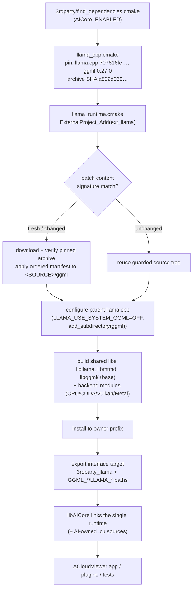

# llama.cpp — single source owner for AICore's embedded ggml runtime

Current status (2026-10-28): **complete llama integration qualification remains open**.
Each task must pass its independent numeric gates; embedded ggml 0.27 does not
reset original gates or frozen performance baselines. The standalone 0.21.0 entry
and `3rdparty/ggml/` were removed; historical fingerprints are migration evidence,
while each task's official reference gates still own independent correctness.
The split-K bridge patch `0013` was reverted
with it. The local LLM/VLM public `llm` task, catalog and worker are implemented;
historical developer checks cover 12 scenarios on each CPU/CUDA/Vulkan backend.
The original frozen production build remains read-only evidence for performance
A/B; retiring a source entry does not authorize replacing or deleting it.
Metal, complete release A/B and current OCR qualification remain open.

Latest scoped continuation: qAnyLabeling main config now passes against
`cd26942a007b6ce7bd521de801a6cfd455d7fd9b`; the plugin/test consumers rebuilt
at `-j4` and the full registered suite passes 39/39. The approved provider
extension/version corrections and six fresh Chat/VQA source comparisons are
recorded in the owning [OCR ledger](../../plugins/core/Standard/qAnyLabeling/OCR_RELEASE_GATES.md).
They do not close full-window or native-platform gates. The additional v4
`Testing/cpu-capital-isolated-v3/report.json` still FAILs the original release
protocol: Q8 capital e2e p95 +12.66% (187.389 -> 211.106 ms), with all 451
snapshot names SHA-verified before/after but a concurrent external OpenPCDet
benchmark observed. The original F16 +8.77%, complete three-backend FAILs and
original OCR gates remain unchanged; no model, baseline or threshold is reset.

The later original full CPU replay
`build_llm_validation_snapshot_20261028_v4/Testing/cpu-full-quiet-v4/report.json`
completes all 12 rows at 3x2x10/threads=4: correctness/stability is 12/12,
but overall FAIL remains (500M F16 describe decode p50 3992.051 -> 4215.381 ms,
+5.59%). All 451 snapshot names pass before/after verification. The host trace
also includes a busy clangd process; the launcher name is not evidence of a
quiet host or a confirmed code cause. Earlier FAILs remain unchanged.

Four additional existing current-upstream comparators pass in
`build_app/Testing/qal-v11-{cuboid,document,shape_batch,tagging}.json`.
The recorded Chat v10 artifacts also match their before-run checksums.
The user deferred new rendering tests in favor of the original matrix.
OCR v2 freezes 503 names and finishes the original full168 with 39 PASS,
129 FAIL, zero skips; its after SHA/protected-receipt checks pass. GDB identifies
compiled tensor data offset 0xf8 versus loaded ggml offset 0x258. The existing
private consumer has now rebuilt at -j4; DW bias and a real F32 rec fixture pass
(max_diff=0.000007, argmax match, slot reuse). This is not complete accuracy.
V3 uses the clean original 745f6c35 OCR reference, retaining all 48 models,
241 input assets and original sampling/gates. Its private probe passes load
but skips backend discovery because this snapshot omitted executable-directory
module aliases. Preserve v3; the new v4 preparer adds internal aliases only.
The existing PPOCR pipeline/rich/table comparisons pass with matching native
probe SHA values; pointcloud has five v11 and three corrected-launcher v12
passes. Its render v12 fails before capture on libLLVM-12's unresolved
ffi_type_sint32@LIBFFI_BASE_7.0, with a process-local libffi replay queued.
No package, Qt renderer, original pixel/numeric gate, model or baseline changes.
All original OCR accuracy/source-speed/baseline and native-platform gates remain.

The user subsequently approved a bounded `LLM_GENERATE` automation adapter in
qAnyLabeling, reusing the public LLM C ABI and existing batch/schema/CLI/RPC/MCP
chain. Six actual Python discovery tests went RED to GREEN, followed by
209/209 backend/CLI/MCP regression tests in `llm-harness-regression-v3.log`.
Actual native HELP and MCP schema REDs confirm the binary lacks LLM_GENERATE.
The adapter source, plugin/CMake registration and RPC whitelist are now written;
22 focused source/registry/tool contracts and the strict plugin boundary pass.
The memory-checked -j2 scoped build and real CPU model tests are queued, not
completed. No complete automation or release PASS follows from discovery.
Original OCR v3 last reaches 119/168, with no final report yet. Direct report
inspection separates F16 `val_img_59.jpg` detector geometry (source/native
matches 3/2) from Q8 fixed-GT `val_img_337.jpg` case errors (`SpoOn`/`SOup` for
`Spoon`/`Soup`). Original GT, IoU, metrics and frozen baseline remain unchanged.
Recent available memory is 22-23 GiB, swap use 6.3-6.4 GiB and total OCR group
RSS about 1.16 GiB. The schema-test-only build waits under the same lock, uses
-j1 and checks memory/compiler activity after acquiring it; other heavy tasks
remain serial and other sessions are not stopped. See the owning OCR ledger
for limits, queued checks and retained failures.

### 2026-10-29 completeness observation

Current local RelateAnything HEAD 537f48f and previously synchronized 14c9744
have identical trees. Current `build_app` backend symbols contain DW7, but
relation host direct-bias/GELU hints and upstream CUDA ADD/GELU fusion are not
fully integrated; see [RELATEANYTHING_SYNC.md](RELATEANYTHING_SYNC.md).
This is a source-completeness finding, not a new port or release approval.

Original OCR v3 reaches 128/168, with final verdict and identity-after still
pending. Fresh Python/backend/CLI/MCP regression is 209/209, source integration
contracts 22/22 and OCR/relation policy checks 40 tests plus 67 subtests; strict
plugin boundaries pass. Native LLM schema/model/RPC builds remain queued.
The requested local -j2/autogen=2 limit has not yet been configured (current
metadata still reports autogen=16). About 34 GiB available memory, 5.9 GiB swap
used and 1.05 GiB OCR group RSS are observations, not OOM or performance proof.
An external compilation overlaps OCR; this session starts no competing heavy
task. Original models, thresholds, baseline and historical FAILs stay intact.
The user subsequently approved bounded RelateAnything host/CUDA-fusion changes.
Only the seven trace modes, 256 numeric cases and isolated test-only queue are
written; the original lock still prevents real RED/production work. Original
OCR now reaches 130/168, with its final verdict/identity-after still pending.
See the synchronization owner above for the exact approved scope and queue.

## 1. What this directory is

ACloudViewer's AI inference runtime (`libAICore`) needs one ggml with
task-specific custom operators. Historically ggml was vendored standalone
(`3rdparty/ggml`, embedded ggml **0.21.0**). This directory introduces a
llama.cpp-based source owner: **one pinned llama.cpp archive**, whose embedded
ggml (**0.27.0**) carries the same AICore operator patches, rebuilt as shared
llama + mtmd + ggml libraries. AICore links that single runtime; llama/mtmd
back the `llm` task (`aicore/llm_capi.h`) behind the same public C ABI rules.

The design contract is short:

- **One source owner per build.** The llama entry creates only
  `ext_llama` and exports `3rdparty_llama` (mtmd + llama + embedded ggml).
  The old `ext_ggml` entry was removed; frozen old builds remain historical comparisons.
  Persistent source-identity receipts bind build/install prefixes to
  source owner + archive SHA.
- **Patches, never in-place edits.** Every change to the fetched ggml tree is
  an ordered unified-diff patch applied at ExternalProject fetch time.
- **ABI stays closed.** Plugins consume public `core/AICore/include/aicore/*`
  headers. Qt, STL, OpenCV, exceptions and ggml types never cross the ABI.
- **Promotion is evidence-gated.** Deleting the baseline entry requires the
  complete backend/model regression; build support alone certifies nothing.

## 2. Directory layout

| Entry | Responsibility |
|---|---|
| [`llama_cpp.cmake`](llama_cpp.cmake) | Source revision/SHA pin, embedded ggml version, manifest selection (CPU/CUDA/Vulkan/combined), llama/mtmd exports, owner target `_GGML_OWNER_TARGET=ext_llama` |
| [`llama_runtime.cmake`](llama_runtime.cmake) | Shared `ExternalProject_Add` implementation: unique-source guard, prefix lock, patch replay, byproducts, install and ggml exports |
| [`cmake/backends.cmake`](cmake/backends.cmake) | Backend discovery, compile options, SAM3D dependency closure (CUTLASS/PyTorch headers, spconv) |
| [`cmake/patches.cmake`](cmake/patches.cmake) | Content-signature computation, owner-scoped invalidation, patch command (idempotent replay) |
| [`llama-patches/`](llama-patches) | Sole formal patch directory: CPU/CUDA/Vulkan/combined manifests and replay runner; old `ggml-patches/` removed |
| [`sam3d/`](sam3d) | SAM3D operator support sources (spconv 2.3.8, CUTLASS closure) consumed by the embedded build |
| [`experimental/`](experimental) | Isolated validation driver ([`CMakeLists.txt`](experimental/CMakeLists.txt)) and real operator/checker probes; no production patch ownership |
| [`scripts/`](scripts) | `audit_llama_migration.py` — read-only source merge audit against the pristine archive |
| [`validation/`](validation/README.md) | Historical verification receipts (JSON). Never build inputs; bytes and historical input hashes are preserved |
| [`KERNEL_AUDIT.md`](KERNEL_AUDIT.md) | Operator-by-operator comparison against the pinned revision and the remaining numerical gates |
| [`README.md`](README.md) | This document |

## 3. Architecture

### 3.1 Source ownership and build flow



Key properties of the flow:

- **Persistent source identity.** Before any download, patch or install, a
  receipt check binds the build/install prefix to (source owner, archive SHA).
  A different owner or archive in the same prefix fails at configure time; a
  short prefix lock serializes concurrent configures. Reconfiguring the same
  identity is a no-op and never deletes an existing installation.
- **Patch content signature.** The patch runner hashes patch bytes *including
  their paths*. Unchanged signature → idempotent replay detection; changed
  signature → that owner's generated source/build/stamp directories are
  invalidated and everything replays from the pristine archive (twice-replay
  must produce identical trees). Relocating patch inputs therefore changes the
  signature by design.
- **Runtime implementation.** `llama_runtime.cmake` closes backend selection,
  pins, module installation and owner-scoped invalidation. Historical inputs of
  the frozen comparison are not changed by current reconfiguration.
- **No hidden inference layer.** The export surface is CMake targets and paths
  only. AICore builds its own task graphs; llama/mtmd are runtime libraries
  consumed only by the `llm` task, which owns its model/projector catalog,
  template/image contract and upstream-tool acceptance gates.

### 3.2 Single patch owner

The formal entry is `llama_cpp.cmake -> llama-patches/<backend>-manifest.yaml`,
with runner `llama-patches/apply_ggml_patches.py`. Old `ggml-patches/` and
`experimental/patches/` are no longer source inputs; old receipt paths describe
historical builds only.

Manifests apply CPU/common, selected GPU operators, ABI/dispatch adaptations and
focused fixes in order. `0017` fixes F16 POOL_2D workgroup/local-size metadata;
`0018` preserves optional bias in the Vulkan DW debug checker's CPU clone.
Both belong only to Vulkan/combined manifests. Pristine forward, reverse and
idempotent replay passed for all four CPU/CUDA/Vulkan/combined chains; receipt:
`build_app/Testing/0018-pristine-replay.json`.

Patch paths and content participate in the signature; changes rebuild that owner
from the pinned archive. Never reconfigure frozen builds or hand-edit extracted
trees. Replay proves applicability only; operators, real models, independent
truth and controlled performance require separate qualification.

### 3.3 Backend selection

| Platform | Backend manifests | Notes |
|---|---|---|
| CPU only | `manifest.yaml` | Default validation profile; `GGML_CPU_ALL_VARIANTS=ON` required to match the frozen baseline |
| CUDA | `llama-patches/cuda-manifest.yaml` | Ordered: CPU/common → CUDA operators → dispatch API adaptation → attention-helper linkage; full SAM3D closure (`GGML_USE_SAM3D_OPS=ON`) |
| Vulkan | `llama-patches/vulkan-manifest.yaml` | 33-file port (0005) plus later fixes (0008–0010, 0011) |
| CUDA + Vulkan | `llama-patches/cuda-vulkan-manifest.yaml` | Same source tree; both file sets verified equal to their separate replays |
| Metal | `llama-patches/metal-manifest.yaml` | Explicit opt-in (`LLAMA_METAL_MIGRATION_VALIDATION=ON`, Apple hosts); production promotion blocked until macOS compile + inference validation |
| Other backends (SYCL, OpenCL, …) | — | Fail explicitly; never silently disabled |

AICore's CUDA/Vulkan/Metal inference backends are controlled by
`AICore_USE_*` options (independent of the application's `BUILD_CUDA_MODULE`);
the root `CMakeLists.txt` enables the CUDA language for AICore-owned `.cu`
sources when `AICore_USE_CUDA=ON` and `BUILD_CUDA_MODULE=OFF`.

## 4. Source pin and upgrade path

The pin lives in [`llama_cpp.cmake`](llama_cpp.cmake): llama.cpp revision
`707616feb5f379e99ff7442680a55b4a1704c7c9` (llama 0.7.0-dev, ggml 0.27.0),
archive SHA-256 `a532d0601f65cee41446cfbdc6872b98e689aa727eb366c6b6a61a70e9965759`.

To upgrade or change patches:

1. Update the pin or patch files (never the fetched tree).
2. Reconfigure so the content signature invalidates the owner; replay the
   ordered manifest from the pristine archive **twice** — the second pass must
   detect "already applied" and leave the tree identical.
3. Run the public contract tier, all affected task/model numerical checks, and
   a same-host controlled performance A/B against the frozen baseline.
4. Keep build and install prefixes separate from the frozen baseline.

AICore and Python consumers follow `GGML_DEPENDENCY_TARGET` /
`GGML_EXTERNAL_TARGET`; benchmark flag discovery follows `GGML_BUILD_DIR`.
RAM and YOLO inspect the exported dependency build directory for assets.

## 5. Validation ladder and current gate status

Run the narrowest checks first, then the real matrix:

```sh
# Model-free public ABI/lifecycle contracts; run the model tier separately
cmake --build build_app --target aicore-contract-tests -j4
ctest --test-dir build_app -L capi -LE model --output-on-failure -j1

# complete catalog-derived task/model matrix (developer evidence)
python3 core/AICore/scripts/validate_all.py \
  --build build_app --backend cuda --full \
  --output build_app/Testing/aicore_validation.json

# controlled performance A/B against the frozen baseline
python3 core/AICore/scripts/validate_all.py \
  --build build_app --backend cuda --full --profile release \
  --baseline-build <baseline-build-dir> --output .../ab.json

# read-only source merge audit
python3 3rdparty/llama/scripts/audit_llama_migration.py \
  --baseline /path/to/pristine-ggml-0.21.0 \
  --patched /path/to/0.21.0-after-manifest \
  --llama /path/to/pinned-llama.cpp \
  --repo . --revision 707616feb5f379e99ff7442680a55b4a1704c7c9 \
  --catalog /path/to/catalog.jsonl --output /path/to/audit.json
```

(`test_catalog_dump_urls --json` supplies the catalog JSONL. Audit exit 0 means
a source merge only — never inference validation.)

### Complete model regression scope

The original production gate covers **556 catalog rows / 526 unique files
across 22 tasks**, including F32, mixed precision and every pipeline consumer.
On 2026-10-22 the user waived expensive large-model full gates for this
migration (SAM3D/TRELLIS/MapAnything/LingBot full flows, SAM3 large variants,
RAM-family F32, large YOLO/ReID/relation variants) — those rows are recorded as
user-accepted compatibility assumptions in
[`validation/regression-waiver-policy.json`](validation/regression-waiver-policy.json)
(344 rows / 326 files remain measured; 212 / 200 waived). OCR is excluded from
the waiver. Unpublished OCR candidates additionally require their own
exact-SHA gates; see
[`OCR_RELEASE_GATES.md`](../../plugins/core/Standard/qAnyLabeling/OCR_RELEASE_GATES.md).

### Current integration assessment (2026-10-27, continued 2026-10-28)

Integration is **not fully qualified**. This continuation changes Qt-layer
compatibility and propagates runtime-copy failures; it does not change model
bytes, numerical thresholds, the frozen baseline or historical FAIL receipts.

- Real Linux Qt 5.10.1 and Qt 6.5.3 SDKs are available for focused consumer
  builds. Shared helpers, canvas/navigation, OCR document, table and rich-text
  tests are exercised against those SDKs, separately from the Qt5.15 app build.
  Fractional event coordinates, UUID formatting, UTF-8 streams, optional palette
  roles/formats and atomic non-overwrite archive creation use `QtCompat.h`.
  Older Qt still has plain-text Markdown import; basic format export is not
  complete Markdown/code/math parity.
- `build_app/Testing/llama-copy-owner-green-v2.log`: 23 checks (17 source-owner
  plus six executed runtime-copy/install tests) pass. Tests cover current
  Linux/macOS aliases, Windows DLL filenames, CPU variants, missing mtmd/GPU,
  paths with spaces and hard failure on unsuccessful copies. Filename-layout
  tests are not native Windows/macOS build or package qualification.
- `llm-raw-formal-cpu-ref-v2/report-cpu.json` is an effective three-scenario
  original-baseline A/B at revision `e659cd3b`: both sides complete 3x2x10,
  correctness/stability pass, but the overall verdict remains **FAIL**.
  256M Q8 decode p50 is 97.441397 -> 104.047370 ms (+6.7794%, +6.606 ms).
- `llm-raw-formal-cuda-ref-v3/report-cuda.json` passes only its three selected
  newspaper scenarios (500M F16, 256M Q8/F16), at the same older revision.
  It does not overwrite the original full CUDA baseline's four text failures
  or establish a current-HEAD full release.
- Native Windows/macOS compile/install/relocation and Apple-device Metal
  execution are still required. The Metal migration guard remains enabled.
  No commit, publication, model replacement or build-directory cleanup occurs.
- Continuation (2026-10-28): the first current-HEAD formal full rebuild is
  green (`continuation-formal-build-v2.log`) after the semantic test target
  started owning its QtCompat include path (RED kept in
  `continuation-formal-build-v1.log`). Focused Qt5.15 rows pass 6/6; the
  Qt5.10.1/Qt6.5.3 SDK matrices rebuild and pass 7/7 each once the SDK's own
  runtime is pinned (`continuation-qt510-ctest-v1.log` keeps the host-Qt5.15
  library mismatch as a diagnostic). Re-verified without skips: C ABI coverage
  913/913 + strict plugin boundary, capi ctest 40/40, runner 123, cmake
  source-owner contracts 23, CLI L1/L2/L5 197, installed-plugin L3 schema 17.
  That round's `continuation-ocr-picker-green-v1.log` and the 38-item suite are
  historical receipts: at the time the test still required a single F32 for
  source/v5/v6 and did not cover the complete published quantization set. It was
  wrong to call those catalog rows validation-only and to hide F16/Q8 behind a
  plugin allowlist. The current picker has removed the allowlist, families come
  from the public presets, and the quantizations and URLs of published files come
  from the public catalog; a local F32 fallback is allowed only when the catalog
  entry is missing.
  `ocr-picker-catalog-red-v1.log` really reproduces the lost source-rec F16/Q8;
  after the fix `ocr-picker-catalog-green-v2.log` passes both items, verifying per
  preset that the file sets are equal and free of duplicates.
  `ocr-picker-catalog-suite-v3.log` re-runs 38/38 with the original attribute F32
  assets; passing does not imply complete model accuracy, speed or UI
  qualification.
  The `continuation-cvpluginapi-ctest-v1.log` failure in the asset-less
  environment is still retained.

### 2026-10-28: boundaries of the current evidence re-verification

- The current ACloudViewer HEAD is
  `a624587d7af8f6b11c44339de55cdc0f8b85d860` with uncommitted modifications in
  the work tree. This round's `llm-current-probe-build-v1.log` built the official
  `test_llm_probe`; no model, patch, original gate or frozen build was changed.
- The frozen AICore, raw probe and CUDA/Vulkan module SHA values agree with the
  old receipts; the `build_llama_upstream_ref` referenced by the old complete
  report does not currently exist. The existing independent reference is
  `framework-references/llama-formal-pristine-v1`, whose revision stamp equals
  the pin, with no missing symbols under `ldd -r` and CUDA0/Vulkan0 really
  enumerated. It is not a frozen performance baseline.
- `llm-current-full-preflight.log` verified 10 model/projector files and one
  input offline and expanded all 12 original rows of 3x2x10 with threads=4;
  `--list` performs no inference and is not a release PASS. An external
  Bazel/PCL compilation was still running, with the wait recorded in
  `llm-external-build-wait-v1.log`; no controlled speed re-verification may be
  claimed under that load.
- Added this round: the model-independent capi
  `evidence-continuation-capi-contract-v2.log` is 40/40 and the two qOCR sibling
  items pass; the broad capi run's 16 skips and the missing attribute
  asset/reference failure are retained, and after fully injecting the original
  reference the single E2E item passes, with no 80/80 claimed.
  The latest upstream document 8 and RAM 16 cases pass, while the config/render
  comparisons still really FAIL.
- Quiet waiting once completed three compiler-free checks, but a new round of
  external compilation had already started before sampling, and the complete LLM
  A/B was not launched at that time. The frozen key-artifact SHA values are
  recorded in `llm-original-artifact-sha-v1.log`, and the earlier
  library/probe/plugin/manifest SHA values in
  `evidence-continuation-artifact-sha-v1.log`.
- The later `llm-current-full-cuda-v1/report.{json,md}` really completed the
  original complete 12 rows at 3x2x10 with threads=4; candidate
  correctness/stability is 12 PASS but the overall verdict is **FAIL**. All four
  original frozen baseline rows (500M Q8 describe, 256M Q8/F16 describe, Qwen Q8
  poem) have text gates at rc=[1,1,1], and there is also a candidate
  `CMakeCache.txt` identity veto with `unchanged=false`.
  `llm-current-full-cuda-v1-host-v2.log` records the external Bazel plus four
  additional compiler PIDs; this cannot be called complete controlled speed
  qualification, nor can those 12 PASS withdraw the original failures.
- The CUDA before `libAICore.so` SHA is
  `2c7cee1bbcf6f548e97f57beb4ab6c418557b56c0ddc56f794b6d290a933f0fe`
  and the probe is
  `04e2731ffadebd4469c7b26e66d0a59cc6c4dbaba75916aa0e83874b50d4e8c6`.
  The runner persisted neither an after identity nor a transitive loader trace,
  and the only change path detected is the cache.
  The earlier `7b5b28b7…` cannot be called the pre-execution library for that run,
  and a library swap during sampling must not be claimed from its difference.
  After the report ended, the library was updated again to
  `d11d2dcc97e0f990a53ddf95b91f55decba386eba32c0b54c2f1075cba7ca3e6`
  (mtime 13:08:11); every later matrix records its identity independently and does
  not mix candidates.
- The continued CPU/Vulkan offline `--list` each verified the same 10
  model/projector files and one input; the original baseline and the two pinned
  references stay unchanged. After the external compiler exited and the current
  hashes matched twice, CPU `llm-current-full-cpu-v2/` started sampling the
  original complete 12 rows; during the run the library changed again to
  `9e23f7fb287dedfb1765a6e7f53df097c7761377a13fb095e38f64bab52f2935` and then to
  `922a68a53d02f7e46a6f7f5c091c8ca2c487adef48bd6cfafcfdc4cb33aa0701`
  (mtime 13:26:24). SIGINT was sent only to this side's runner, and the rc=0 of
  the first three rows on each side plus the fourth row's
  KeyboardInterrupt/original probe output are retained; there is no complete
  report and Vulkan was never started.
  Another process was then really confirmed to be running
  `AICore bench_openpcdet_perf -j6` in the shared build tree; the current runner
  SHA is also
  `20702c6f223b8e86f6f0c5d73b84bc8e078183c6b545c57d2c77641738bee252`,
  different from the CUDA execution identity. A momentary compiler-free window
  cannot freeze shared artifacts; a later run needs an isolated candidate or
  coordination with the writer. This side did not build, change inference
  sources/patches/thresholds, or overwrite other concurrent work.
- Linux build, contract, schema and partial relocation evidence is not equal to a
  complete installer, a clean machine, or all L4/live/UI acceptance. The native
  macOS/Windows/Metal gates remain open; the original CPU/CUDA release FAILs are
  not withdrawn by the preflight or picker passes above.

### 2026-10-28: independent candidate snapshot (user authorized)

`build_llm_validation_snapshot_20261028_v4/snapshot-receipt.json` has frozen 262
sources and 451 copies/aliases (249 unique files, about 3.2 GB), reusing the
official copy owner without modifying ELF/RPATH. The main probe/reference loader
and the SHA values of all copies were re-checked and pass; the Qt mixed-loading
and missing-symbol failures of the system's old cudart during preparation are
retained. The v3 catalog failed because of 33 empty OpenPCDet digests in a stale
binary; the header already has those entries, and only after rebuilding the
catalog consumer with `-j4` did the real `--json` return 0, after which v4 was
frozen -- without bypassing the catalog gate or changing models/digests.

The v4 runtime SHA is
`54d0db4db26d17571a8a0c7326c7e94969982229f3a27e179b6af3d9c943aa16`,
with runner `20702c6f…` and manifest `c0d03d46…`, and HEAD observed as
`660a39c2…` (not a commit from this side). The original baseline, the models and
the 3x2x10/threads=4 original dual gates stay unchanged; the three-backend queue
of the same original validator has all been executed, with all snapshot SHA
values additionally re-checked before and after each backend; the final CPU report
was generated at 16:04:44.
`Testing/{cuda,vulkan,cpu}-full-v1/report.{json,md}` each have 12 rows of
candidate correctness/stability PASS with no skips, but all three overall verdicts
are **FAIL**. The four original CUDA baseline rows are still rc=[1,1,1], and
there is also Qwen F16 capital e2e p95 +33.03%; the eight Vulkan and five CPU
performance alarms are still retained.
The CPU alarms still need an isolated re-measurement; a code regression must not
be concluded from contaminated sampling, nor may the original FAIL be withdrawn.
All three execution identities are unchanged, and after finishing, the SHA values
of all 451 names were re-checked and pass; this is not a host load lock. The
original host log records additional compilation overlapping the CUDA/CPU
sampling, in `llm-snapshot-full-three-backends-v1{,-host}.log`. External
Bazel/PCL compilation was observed again before the additional performance
re-measurement, and no new performance sampling was started under that load.
This round changed no model, threshold, inference code or patch.
The complete identities, failure numbers and qualification boundaries are in
[OCR_RELEASE_GATES.md](../../plugins/core/Standard/qAnyLabeling/OCR_RELEASE_GATES.md).
Freezing that environment is not a new baseline, a complete package, independent
accuracy for all tasks, or a release pass.

Only the fix of the existing qAnyLabeling render differences was authorized
afterwards: the original 36 drawing cases plus 8 regressions pass 44 each on
Qt5.10.1/Qt5.15.2/Qt6.5.3, the official plugin and the probe/canvas targets were
rebuilt, and the three canvas regressions and the strict boundary check pass; the
config comparison still FAILs (15 items), and the complete window/native
platforms are not closed.
The details are owned by the OCR release ledger above, and a drawing pass is not
treated as evidence of inference accuracy.

After the build exited, v4 `Testing/cpu-capital-isolated-v2/report.json`
re-measured the CPU capital F16/Q8 rows under the original release 3x2x10 with
threads=4 against the original baseline: candidate correctness/stability is 2
PASS and the overall verdict is still FAIL: F16 e2e p95 154.422 -> 167.962 ms
(+8.77%, +13.540 ms). The decode p50 +8.13% of the original complete report did
not trigger again this time; the old FAIL is retained and that decode regression
is not called confirmed.
The observation window had no additional compiler activity but was not a full
trace; the remaining performance failures still await an isolated
re-measurement. The SHA values of all 451 snapshot names were re-checked and
pass; this round changed no model, accuracy/performance gate, inference code or
frozen baseline.

### Historical gate evidence

The current official module re-verification receipts are in `build_app/Testing/`:
- `production-contract-ctest.log`: model-free C ABI contracts 39/39, passing with
  no skips.
  The source checks restored this time: C ABI coverage 913/913, the
  repository-wide strict plugin boundary, 17 source-owner CMake contracts, 123
  runner tests and 197 automation L1/L2/L5 items pass; this does not replace an
  official rebuild or release.
  `shared-owner-acceptance/attribute-probe-resume-v3/receipt.json` records a PASS
  of the real public attribute wrong-reference negative re-run with inputs
  unchanged; this is evidence that the original attribute gate was not bypassed by
  probability equality.
- `ocr-dw-formal-ctest.log`: OCR DW consumers CPU/CUDA/Vulkan 3/3.
- `formal-gates-resume/dw-{CPU,CUDA0,Vulkan0}/summary.json`: 1152 CPU and 1728
  per-GPU layout/rounding/bias cases are all bit-equal, max error is 0, the
  F16 oracle has zero failures, and all three independent processes exit 0.
- `pool-formal-Vulkan0.log`: 48/48; CPU 24/24. The analytic gate of the original
  official CUDA AVG fails. `0019` corrects the cancellation residual introduced
  by per-element scaling, and the isolated candidate passes all 80 cases
  including scalar/warp with the original gate unmodified; the receipts are
  `pool-expanded-{red,green}/`.
  The pristine/reverse/idempotent replay of the four chains is in
  `pool-average-candidate/receipt.json`.
  The official module has not been rebuilt yet, and the real consumers and the
  release A/B still have to be verified. The later
  `owned-measured-profile-coordinator/pool-formal-before-{cpu,cuda,vulkan}.log`
  loads the official `build_app/bin` directly with the same maintained oracle:
  CPU 40/40 and Vulkan 80/80 PASS, while 27 of the 80 CUDA cases FAIL, proving
  the official CUDA path is still not closed; this does not replace the isolated
  GREEN or relax the original gate.
- `ocr-production-recheck-{cuda,vulkan}.json`: 4/4 developer scenarios per
  backend, including the 50 SROIE pages of F16/Q8 and the original Paddle
  detection graph; the original source-GT gate passes.
  The probability differences of the detection graph are a diagnostic metric, and
  this round's source GPU audit/performance sampling does not constitute release
  qualification.
- `llm-production-full-{cpu,cuda,vulkan}.json`: the official public ABI passes
  12/12 developer scenarios per backend and the original upstream text gate
  holds. The 12/12 release scenarios and the controlled A/B of
  `formal-gates-resume/llm-release-vulkan/report.json` are PASS (three processes,
  two warmups, ten forwards).
  The CUDA candidate passes 12/12, but the overall release verdict is FAIL: the
  four frozen baseline rows mismatch on greedy text, and newspaper 256m Q8/F16
  show p95 regressions of +17.37%/+33.00%;
  the original failure receipts are unchanged.
  `llm-cuda-tail-controlled-recheck/report.json` re-verifies two rows with the
  original release sampling: candidate 2/2 and the original upstream text gate
  pass, but the Q8 p95 still regresses +8.28%
  (135.653 -> 146.888 ms), so the overall verdict is FAIL; the original F16 p95
  regression did not reproduce in that two-row re-verification.
  That receipt does not close the original complete CUDA FAIL or the four-row
  text mismatch of the frozen baseline.
  `llm-raw-tail-ocr-conv112/report.json` adds a controlled A/B of the
  current/frozen rows of the same raw consumer: 3 processes, 2 warmups and 10
  measured per model per side, 30 raw samples in total;
  correctness passes and the original aggregate p50/p95 regression did not
  reproduce this time. The old report still retains its FAIL: the runner had
  wrongly added the single-index samples of
  `prefill_samples_ms/6` to the performance gate. That defect and the
  zero-sample loss have both gone RED->GREEN; the later dedicated local-only
  catalog precondition check also went RED->GREEN with 123 runner tests passing;
  the raw arrays are still stored in full and the original p50/p95 gates are
  unchanged. The new receipt `llm-raw-tail-pathfix/report.json`
  uses the same raw consumer/current-frozen dependency closure and the original
  3x2x10 protocol, and both rows PASS their overall gate;
  the real regression test of 30 measured samples per model per side passes.
  The first four Nsight profiles had no real CUDA kernel because the old CUDA
  runtime lacked `cudaLaunchKernelExC`, and that original FAIL is retained.
  After the build-local loader fix, the four
  `shared-owner-acceptance/llm-profile-{current-q8,frozen-q8,current-f16,frozen-f16}-loaderfix/routes.json`
  distinguish the main consumer from the pristine reference child; the
  current/frozen F16 main GEMM show h1688/s1688 routing respectively, consistent
  with the owner-scoped F16-output condition of 0015. The profiles include
  load/warmup/recreate/cancel and are not measured-only performance evidence;
  they do not prove that the routing difference caused the original tail-latency
  regression.
  The later real NVTX negative case `llm-nvtx-red-v4.log` localized the
  diagnostic treating a negative return value as not recorded and skipping the
  pop, which let ranges leak into later lifecycles. A minimal ctypes measurement
  showed push/pop returning -1 while Nsight still recorded the events; the fix is
  paired calls, verified with the real event count/duration.
  The real CPU probe/trace of `llm-nvtx-paired-{current,frozen}-v6/` each pass
  two complete ranges with no warmup/recreate/cancel mixed in; frozen libraries
  are not rebuilt. Three items -- the transient SQLite positive case of the main
  consumer's measured-only CUDA selector, the missing-range negative case and the
  real CPU range -- went RED->GREEN, with receipts
  `llm-measured-selection-{red-v2,green}.log`; after execution resumed, the real
  CPU range and the transient selection passed again as 3 items, with the model
  before/after hash check using a 1 MiB buffer throughout.
  The transient selection test is not CUDA inference/performance evidence, and
  instrumented latency does not enter release.
  This does not withdraw the original complete CUDA/CPU FAIL, nor does it prove
  that the tail-latency root cause of 0015 is closed.
  The final CPU `formal-gates-resume/llm-release-cpu/report.json`: candidate
  correctness/stability 12/12, but 10 performance items across 6 scenarios exceed
  the gate, so the overall verdict is FAIL (Q8 poem e2e p50 +24.67%).
  The before/after artifact identities are unchanged and both sides selected the
  haswell ISA; this must not be called a CPU release PASS.
  The later complete CPU re-verification of the same raw current/frozen under the
  original 3x2x10, `llm-raw-full-cpu-pathfix/report.json`: both sides are 12/12
  for correctness/stability, but 6 performance items across 5 scenarios exceed
  the gate, so the overall verdict is FAIL (256m newspaper Q8 e2e p95 +15.33%).
  It retains every measured sample, does not withdraw the original complete CPU
  FAIL, and does not prove the CPU tail attribution is closed.
  `llm-cpu-attribution-resume-v2.json` is a read-only audit of those 12 rows and
  720 measured forwards: the original sampling artifact identities match, the
  inputs/outputs are comparable and the per-process samples are complete; the six
  original failures are retained as-is. Six analyzer behavior tests went
  RED->GREEN, including stale-artifact rejection. Both sides have identical
  Haswell compilation/ISA/OpenMP parameters; all 232/69 llama/mtmd source files
  are identical, and among the 69 CPU files only the DW bias branch of `ops.cpp`
  differs.
  The whole CPU call chain or its performance must not be asserted identical from
  that. The single original 3x2x10 row of the frozen library against itself,
  `llm-cpu-frozen-aa-resume-v1/report.json`, PASSes and its audit passes too; it
  is an A/A diagnosis, not a new baseline
  or a candidate release. The complete
  `llm-cpu-complete-post-aa-resume-v1/report.json` A/B has finished: both sides
  are 12/12 correct and stable, and under the original 3x2x10 three performance
  items still FAIL: 500M newspaper Q8/F16 decode p50 at
  +11.08% (95.540 -> 106.126 ms) and +6.60% (159.743 -> 170.288 ms); 256M
  newspaper Q8 e2e p95 +5.20% (1988.381 -> 2091.838 ms).
  `llm-cpu-complete-post-aa-attribution-v1.json` audits all 720 measured runs,
  the artifact identities and the compilation parameters and passes, with the
  three original failures retained; this does not withdraw the old six FAILs and
  does not prove that CPU release or causal attribution is closed.
  The later `llm-cpu-complete-flags-closure-v3.json` extends to 23 ggml/include
  and 719 ggml/src C/C++/header files: scheduler, allocator and threading are
  byte-identical, and the shared layer only adds the epilogue/DW bias API.
  The per-module flags audit states explicitly that Haswell/ggml-base are
  identical while AICore differs (AVX2, frounding-math and macros);
  the RPATH/dependency check of the raw probe also shows different AICore/CVCore
  dependency closures. Two new flags negative cases went
  RED->GREEN with the analyzer at 8/8; this is not proof of performance
  causality. Unprivileged CPU sampling was rejected by this host's perf
  paranoid=4 (`nsys status --environment`), and no system setting was adjusted
  and no original gate was lowered.
  The later `llm-flags-{control,frozenopts}-ab-v2/report-cpu.json` has two rounds
  of three scenarios each, both bound to the original frozen baseline and the
  original 3x2x10, for 360 measured forwards in total; both sides are correct and
  stable with execution identity unchanged.
  Recompiling the three llm/paddle_graph/attribute TUs under the same current
  link closure, changing only CXX_FLAGS and no macros/includes:
  control retains 5 performance FAILs, and the frozen flags still have two FAILs,
  500M Q8/F16 decode p50 +8.65%/+6.11%
  (105.298 -> 114.402 and 184.010 -> 195.252 ms). Both attribution audits pass and
  the 46 original-artifact protections PASS before and after; the three
  assembly/original-baseline protection behaviors went RED->GREEN. Changing flags
  did not close the original gate, no single-factor causal conclusion is drawn
  from the two rounds' latency difference, production flags are not modified, and
  a partial diagnosis is not called a complete release.
  A real side-loaded `.so` negative case then localized the isolated builder
  carrying the shell's `\$ORIGIN` escaping into the ELF; after fixing the
  argv conversion that negative case went RED->GREEN, with 10 analyzer/assembly
  items and two baseline protections PASS.
  `llm-origin-probe-v3/standalone-cpu.json` PASSes real CPU inference after
  clearing LD_LIBRARY_PATH;
  this is independent-loading qualification, not performance causality or
  release, and it does not overwrite the original v2 artifacts/failure receipts.
  `llm-raw-full-cuda-pathfix/report.json` re-verifies completely under the same
  protocol: candidate correctness/stability 12/12, the four-row text mismatch of
  the frozen baseline holds; 500m newspaper F16 e2e p95 +5.71%
  (248.876 -> 263.095 ms) exceeds the original dual gate, so the overall verdict
  is FAIL. The before/after execution artifacts are unchanged.
  The first round of the four new measured CUDA profiles failed before JPEG
  decoding because the isolated assembly lacked the Qt imageformats path; the
  original failure in `owned-measured-profile-coordinator/` is retained and
  cannot be used for attribution.
  After completing the Qt plugin path, `owned-measured-profile-pluginfix/` was
  rejected before the task started because of an external GPU consumer, the
  finally block restored the original OCR, and there is no new
  trace/probe/routes qualification.
  `owned-measured-profile-pluginfix-wait/status.json` has picked up the narrow
  task branch (`--jobs-only`) that runs serially after the external GPU became
  idle; that branch neither waits for nor rebuilds the original OCR and must not
  be mixed with the official rebuild options;
  its two new regressions went RED->GREEN. The post-queue rebuild identity of the
  original continuum holds, and the official library, the frozen library and the
  inputs were not modified.
  That waiter then completed four probes (all rc=0 with 10 NVTX ranges) while the
  four routes still FAIL: the real SQL shows 522 same-thread APIs and 0 kernel
  nodes per range. `nsys profile --help` states explicitly that this host's
  default `--cuda-graph-trace=graph` does not collect graph nodes; this is not
  evidence of execution-thread forking.
  The original failure is retained, and the node-granularity re-sampling of
  `owned-measured-profile-nodefix-wait/` has now finished: the four
  probes/routes are 8/8 PASS, and all 40 complete measured ranges of SmolVLM-256M
  have real main-consumer kernels and same-thread APIs, with 522 APIs per range.
  The resumed regression `llm-measured-nodefix-resume-v1.log`
  is 4/4 PASS, still excluding load/warmup/recreate/cancel/reference child, and
  production CUDA Graphs are not disabled.
  These receipts carry profiling qualification only; they do not withdraw the
  complete CPU/CUDA FAIL and cannot directly attribute the 500M p95.
  The corresponding `owned-measured-500m-nodefix-wait/` has finished: the first
  attempt was rejected by an external GPU consumer and restored the OCR, and the
  second produced four 500M probes/routes at 8/8 PASS, with 40 additional ranges
  passing the same real regression.
  The 500M F16 main GEMM is h1688/s1688 for current/frozen respectively;
  the instrumented e2e p95 values are 172.421877/183.116541 ms. This is routing
  diagnosis for that model, not an uninstrumented 3x2x10 release A/B;
  it does not withdraw the original 500M p95 FAIL and does not claim that the
  routing difference already explains the complete CPU or CUDA performance
  regression.
- `formal-gates-resume/yolo26n-{cpu,cuda,vulkan}/report.json`: the official nine
  rows are 2/3 each for CPU/CUDA and 1/3 for Vulkan; Q8 on all three backends and
  Vulkan F16 still fail.
  The isolated receipts `yolo-pool-ready/Testing/official-*.json` are retained.
  Injecting the Q8 weights into the official PyTorch gives a quantization-only
  maximum score error of `0.145950`, above the original `0.02` gate; the gate is
  not changed.
  After resuming, `yolo-quantization-attribution-resume-v2.json` re-injects the
  real GGUF on CPU with the pinned source/checkpoint and the same decoded image:
  204 parameter mappings are verified, the F32 export is bit-equal, and the
  F16/Q8 weight-quantization score errors are 0.00776911/0.14595002, so the
  original Q8 gate still FAILs.
  That evidence confirms storage quantization alone already exceeds the gate; it
  does not exclude additional error in task execution and does not authorize
  replacing the original assets.
  `yolo-quantization-execution-cpu-resume-v3.json` goes further, reusing the
  public CPU ABI with an explicit mode 1: the same-weight execution added score
  errors for F32/F16/Q8 are 0.00001210/0.00696164/0.02269834 and the total errors
  against the independent checkpoint are 0.00001210/0.01473075/0.12325168, so Q8
  still FAILs.
  The source/checkpoint/GGUF/runtime SHA values are identical before and after,
  and the per-box errors and ten raw samples are retained.
  The new behavior really went RED->GREEN; this is not a three-process frozen
  release A/B, and attribution must not be derived by subtracting the two maximum
  errors.
  The real CPU tests for backend selection and independent error recording went
  RED->GREEN, and the resumed parameter suite passes 3/3.
  `yolo-quantization-execution-{cuda,vulkan}-resume-v4.json` completes the
  six-row attribution with an explicit mode 1: two rows each PASS for F32/F16;
  Q8 CUDA has a same-weight score error of 0.18532050 and a total error of
  0.18347186 with four boxes missing, while Vulkan has a same-weight error of
  0.00550228, a total error of 0.15145230 and five matching boxes, so both
  original overall gates FAIL.
  All ten repetitions are stable and the asset SHA values are unchanged before
  and after; the missing CUDA boxes must not be attributed to storage
  quantization alone.
  The current sources show that both GPUs expand Q8 to F16 on the host, so the
  old CUDA igemm comment is not treated as the root cause.
  `owned-yolo-q8-optrace-llm-scope-v1/coordinator-2/` has finished: the LLM CUDA
  arithmetic scope is 11/11 PASS (0 changed elements everywhere); this is not
  original upstream text or release p95 qualification. The first optrace exited 77
  because the executable's directory lacked the backend modules and the original
  receipt is retained; after moving next to the modules,
  `owned-yolo-q8-optrace-resume-v2/coordinator-1/` completed both items at
  162/162 with 0 null, both rc=1: CPU->CUDA first exceeds the diagnostic range at
  op61 (PSA, rel=0.01642) and Vulkan->CUDA at op149 (conv, maxdiff=1.0625), with
  final raw maxdiff values 5.8140/0.8125. A keep_all_ops white-box receipt does
  not replace the public library.
  `owned-yolo-q8-public-lifecycle-v1/coordinator-1/`: the new public ABI
  regression obtained a real RED: with the same candidate-v5/Q8/pixels, CUDA cold
  load gives five boxes, after switching through F32/F16 Q8 keeps only one box,
  recreating the context still gives one box, and all twelve rounds per context
  are stable; the same test PASSes on Vulkan. The narrow diagnosis with IGEMM
  disabled, `owned-yolo-q8-public-lifecycle-noigemm-v1/`, PASSes, proving the
  divergence lives in that cache path rather than in the PyTorch injection or in
  weight-quantization error alone. The old CUDA plan verified only
  address/geometry/type and never consumed the monotonic `plan_owner_id` the task
  already writes. The new `0020-acv-cuda-igemm-plan-owner.patch` enters only
  CUDA/combined, adds the identity check and removes the stale NHWC copy; the
  original official tree passes read-only `apply --check`.
  For `yolo-igemm-owner-candidate-v1/`, forward/reverse and idempotent replay of
  the four CPU/CUDA/Vulkan/combined chains and the single-TU compilation have
  passed. The original link closure was missing 80 objects, so the isolated CUDA
  backend is now completely rebuilt from the verified combined replay and the same
  pinned llama parent; it inherits the original CUDA 11.8, ISA, Graphs and
  arithmetic options, and the build succeeded. The final `receipt.json` module SHA
  is `4b6ad3c8...` with every protected identity unchanged;
  `oracle-build-receipt.json` assembles the same binary SHA `900a4a2f...` into the
  RED/GREEN module directories.
  `owned-yolo-igemm-owner-green-v1/coordinator-3/` has finished: the same oracle
  gives RED rc=1 and GREEN rc=0, and the public CUDA/Vulkan Q8->F32->F16->Q8 /
  context-recreation lifecycle PASSes; the later same CPU lifecycle in
  `owned-llm-flags-attribution-v2/coordinator-1/` also PASSes, covering all three
  backends.
  The receipts of the first two insertion rejections and the finally-block
  restoration are retained. In `yolo-quantization-execution-cuda-ownerfix-v5.json`
  the Q8 five boxes match and are stable over ten repetitions, and the same-weight
  execution added score error drops to 0.0021265149, while the total error against
  the independent checkpoint is still 0.1480765343, above the original 0.02 gate
  and FAIL; an orchestration rc=0 must not be treated as an accuracy PASS.
  The asset/runtime SHA values are unchanged before and after; no model, original
  gate, official library or frozen baseline was changed. The isolated module also
  contains 0019 and cannot replace the official pool rebuild gate.
  `yolo-q8-single-tensor-sensitivity-resume-v1.json` restores F16 parameters one
  at a time in transient PyTorch memory; no single-tensor variant passes the
  original 0.02 gate. The best, `op.109.w`, has a score error of 0.03684449196 and
  still FAILs; the Q8 baseline restoration per round and after all trials and the
  asset SHA values before and after are all verified. It is a fixed single-image
  weight-quantization counterfactual, not written-model, native, hold-out or
  release qualification.
  The two real tests for specified restoration combinations and for rejecting
  unknown tensors went RED->GREEN; the three later combinations `op.109.w` +
  `op.110.w/op.107.w/op.20.w` have errors 0.04792762/0.08504459/0.08508769, all
  FAIL, proving that single-tensor improvements are not additive.
  The user explicitly uses only the original frozen baseline; the release veto
  caused by its numeric FAIL stands, and no substitute baseline is created.
  The unfused ADD narrowing an F32 bias was proven by a real-GGUF GPU RED (0
  versus the expected 0.25); the isolated candidate with the task-lowering fix is
  GREEN on the CPU/CUDA/Vulkan boundary, with receipts
  `yolo-bias-{red,green}/status.json`. The candidate Vulkan F16 official score
  error is `0.0238298178`, still above the original `0.02` gate; Q8 still fails and
  the official module has not been rebuilt yet.
  The 14 independent cases of native F16 accumulation/write-out/fused epilogue
  pass on both GPUs (`pool-conv-red-recheck/conv-*.log`), so a cooperative F16
  accumulator must not be blamed as a native-path defect. The new op0 replay found
  that the intermediate cast input had already been reused; the numeric receipt of
  `yolo-replay-op0/` is not qualifying and `yolo-pinned-replay-op0/` now rejects
  stale inputs explicitly. The test now captures source/output through a scheduler
  callback when that layer completes; `yolo-captured-replay-op0/` passes the F16
  cast assertion on the original image with a maximum error of 0.015625 against
  the double oracle on both GPUs, and `yolo-captured-replay-op149/` is 0.00390625
  on both sides. A legal replay does not equal passing the whole-model accuracy
  gate, and deriving a fix from old stale inputs is forbidden.
  The independent CPU PyTorch `yolo26-checkpoint-precision-ablation-v5.json`
  retains nine ablations: F16 convolution I/O with F32 bias/accumulator has a
  score error of 0.006639; separating the DW convolution / ADD write-out gives
  0.010879/0.011908; all parameters and activations in F16 give 0.039233. The
  ablations do not modify the original F32 reference and do not prove that the
  remaining Vulkan error comes entirely from DW or that the new production mode
  has been accepted.
  The PSA `MUL_MAT` replay receipts of the new computation are
  `yolo-attention-matmul-{0,1}/`: the first F16xF16 maximum error against the
  double oracle drops from 0.00905514 to 3.81e-6 and the second F16xF32 from
  0.0110331 to 0.000771284; only an F32 accumulator is requested, with no change
  to the operand/storage path. The public opaque options gained upstream/F32
  modes, the default is still upstream, and illegal values/NULL return -1; the
  real ABI and graph-propagation tests went RED->GREEN.
  `yolo-attention-official-matrix/` is an independent official whole-model receipt
  across two modes, three backends and three quantizations (one process, two
  warmups and ten forwards per row): both F32 modes pass everywhere; for F16 both
  modes pass on CUDA/CPU, while on Vulkan the original mode FAILs at 0.0238298 and
  the F32-accumulation mode PASSes at 0.0122409 (original score gate 0.02, all
  five boxes matching and stable). Both Q8 modes still FAIL on all three
  backends; the per-box raw errors are retained and a local improvement does not
  replace the frozen release performance A/B.
  `yolo-attention-release/{cpu,cuda,vulkan}/report.json` all completed: the
  candidate is 2/3 for F32/F16 with Q8 FAIL, the frozen baseline is 0/3 FAIL, and
  the performance comparison is vetoed by the baseline status.
  The frozen Vulkan F32 score error 0.0908023715 exceeds the original 0.005 gate;
  the overall release verdict is FAIL.
  The frozen CPU F32 emitted five matching boxes in all three processes and was
  stable, but the maximum score error is fixed at 0.1101961732; that side exited 1
  after normal execution because of the original numeric gate, not because of a
  missing attention API or a loader crash.
  The frozen baseline is not rewritten, the upstream default is not changed, and
  an ABI pass is not called a performance pass.
- `formal-gates-resume/yolo11s-{cpu,cuda,vulkan}/report.json`: the locally
  unpublished YOLO11s is 3/3 per backend in the official module and passes the
  original per-box F32/F16/Q8 gates; this proves only that checkpoint and those
  fixed inputs, not the complete family or the published catalog.
- PULC exact person/vehicle: `g8-pulc-native-graphs/native-{cpu,cuda,vulkan}/report.json`
  has 18 rows in total; F32/F16 pass their candidate gates while both Q8 models
  fail on all three backends. The independent same-stored-weight ONNX attribution
  is in `g8-pulc-native-graphs/stored-attribution/report.json`: the raw Q8 weight
  quantization errors are 0.02084890/0.04891500 and the native maximum added error
  against the same-weight reference is at most 1.55e-6; the original 0.02 gate is
  unchanged. This covers only fixed real images and the OCR test adapter data
  plane; it does not support a public PULC task/API/catalog, a complete dataset or
  a release A/B.
  The later isolated Q8 storage candidate in `precision-sensitivity/report.json`
  keeps person's `conv2d_4.w_0` and vehicle's `conv2d_4.w_0/conv2d_12.w_0` in F16
  and still has 1601536/1568768 Q8 elements respectively. The candidate
  `native-*-q8-candidate/report.json` passes six candidate-gate rows per backend
  on all three, with maximum Q8 errors of about 0.01444/0.00667; this is a storage
  candidate selected on a fixed single image, not an untouched holdout or a
  release, and the old Q8 failures and the assets were not replaced.
  After freezing those candidates, `holdout-cpu/report.json` runs the original
  preprocessing, the independent ONNX and the complete native graph on 11 real
  images that took no part in the selection: of 66 rows, 44 F32/F16 rows pass
  while Q8 passes only 4/22, so the overall verdict is FAIL (maximum error
  0.0855134 for person and 0.0764870 for vehicle).
  The added error against the same-stored reference and the per-output/per-
  attribute differences are retained, and the candidate weights and strategy were
  not recalibrated.
  The hold-out shows that a single-image strategy does not qualify for
  generalization; these images have no attribute dataset GT and are not release
  proof either.
  The real public `attribute` C ABI/task was subsequently implemented, the graph
  interpreter was promoted to `common/paddle_graph`, OCR keeps a compatibility
  using declaration and table consumes the common owner directly; the dedicated
  feed/fetch metadata work went RED->GREEN. The public person/vehicle F32/F16
  output, attributes, stride, independent result ownership and live-context
  shutdown pass on CPU/CUDA/Vulkan. `pulc-public-holdout-{cpu,cuda,vulkan}/` each
  have 66 rows at F32/F16 44/44 and Q8 4/22 (48/66 FAIL overall), with the
  original gates and the candidate SHA values unchanged.
  The public local F32 recipe/cache API is now wired to the qAnyLabeling
  picker/worker; the maintained F32 C ABI E2E and the real UI's attribute saving,
  replace, model switching, stale rejection and basic teardown pass on
  CPU/CUDA/Vulkan, and the basic table E2E also passes on all three backends (no
  layout page was configured, so this is not called layout->table acceptance).
  The first isolated CUDA loader FAIL and the PASS after the fix are retained in
  `shared-owner-gpu-coordinator/` and `shared-owner-gpu-loaderfix-coordinator/`
  respectively. The public probe gained pinned source identity and all attribute
  gates, and the real negative case "numerically passing but attribute mismatch"
  went RED->GREEN.
  The first `attribute-common-runner-cpu/report.json` was 0/6 FAIL because of the
  json0/json1 dual source of stdout/report and bare-metric ambiguity; the isolated
  scenario switched to the complete json0 path, the configuration regression went
  RED->GREEN and the old receipts were not changed.
  `attribute-common-runner-{cpu,cuda,vulkan}-pathfix/report.json` are 4/6 each:
  F32/F16 PASS while the original Q8 errors of about 0.020849/0.048915 still
  exceed 0.02 and FAIL, with the original gate and the candidate bytes unchanged.
  The attribute TASK/schema/local recipe/cache of the existing `ANYLABEL_INFER`
  are wired up; the real plugin registration's two models, two images,
  threshold-independent-of-confidence and bad-manifest tests pass on
  CPU/CUDA/Vulkan, with GPU receipts
  `shared-owner-acceptance/attribute-batch-{cuda,vulkan}-v2/receipt.json`.
  This is F32 basic batch processing of the isolated plugin / public task, not an
  official rebuild, Q8, live/cancel or release qualification.
  The new maintained window acceptance
  `shared-owner-acceptance/attribute-ui-lifecycle-{cpu,cuda,vulkan}-v1/` passes on
  all three backends for two-image Auto Run, cancellation discarding in-flight
  results without scheduling the next image, rerun after cancel, source-image/model
  stale, real invalid-model error recovery and destroying the window during
  inference. The sources, consumers and models have identical SHA values before
  and after; no production logic was changed, and this is not live-frame,
  cross-platform installer, official-library or release accuracy/performance
  qualification. OCR was restored in the GPU idle slot.
  The download catalog/published digest, an independent attribute dataset GT, the
  complete live/cancel/UI automation and release remain open, and no published URL
  is invented. The original Linux `automation-l3-schema-resume.log` 16 PASS/1 FAIL
  is retained; the actual configuration had PLUGIN_STANDARD_QMAPANYTHING=OFF. After
  the original queue fully finished, QMAPANYTHING_PLUGIN was enabled and built
  normally, and `mapanything-consumer-{configure,build}-v1.log` succeeded;
  `automation-l3-schema-formal-green-v1.log` is now all 17 schemas PASS with no
  skips.
  It does not replace a cross-platform installer, packaged GUI L4 or independent
  model release evidence.
  The official PA100K archive was verified against independently pre-recorded
  size/MD5 values, 539463680 bytes with SHA-256
  `65e2ab37519aacf307c8c0ce04c6ab8edac3b4199e0448d4de625cfd60cd5cc0`, receipt
  `pulc-pa100k-source-v1/dataset-identity.json`. Only 10000 val and 10000 test
  images plus the 26-dimension GT were extracted, the training set was not
  consumed, and the truth SHA values are the two listed in
  `pulc-pa100k-gt-v1/dataset-identity.json`.
  The download, the refusal to overwrite old paths, the fixed GT preparation and
  the path-traversal negative case all pass; of the 10 items in the complete
  related suite, 7 PASS and 3 unrequested GPU/public-receipt branches SKIP. A new
  real-GT two-image data-plane regression for the public CPU raw three
  quantizations went RED->GREEN; `pulc-pa100k-val-cpu-v1/report.json` has
  completed the complete val set of 10000 images, three quantizations and two
  per-image forwards. F32 is 10000/10000 PASS with a maximum probability error of
  3.93391e-6; F16 is 9969/10000 with a maximum error of 0.00992972 that does not
  exceed 0.01 but 31 images mismatch on attributes, so it still FAILs; Q8 is
  2707/10000 with a maximum error of 0.27434349 and still FAILs. The
  source/GGUF/runtime/GT SHA values are unchanged before and after, and the 30000
  GT/source/candidate error rows and per-attribute correct counts are retained in
  full.
  The original probability/all-attribute/stability gates are unchanged, an improved
  count does not offset other attribute regressions, and no post-hoc dataset gate
  is introduced.
  The independent test set of 10000 images in
  `pulc-pa100k-test-cpu-resume-v2/report.json` has also completed: F32 is
  10000/10000 PASS with max 4.64916e-6; F16 is 9955/10000 with 45 images
  mismatching on attributes and max 0.00989395; Q8 is 2497/10000 with max
  0.34178510 and still FAILs. The two splits total 20000 images and 60000 rows and
  the per-image repetitions are fully stable; the four audits for completeness,
  duplicate rows, fake PASS and attribute mismatch went RED->GREEN. Audit
  receipts `pulc-pa100k-{val-cpu-v1,test-cpu-resume-v2}-audit.json`: the Q8
  probability failures are 7275/7480 images respectively with 867/820 images
  mismatching on attributes, and the sets overlap so they must not be added; the
  storage-error failure counts are also 7275/7480 and the maximum same-weight
  execution added error is 3.40e-6/3.87e-6. The F16 same-weight added error is
  also a few e-6, and the maximum values of the total and storage errors were not
  subtracted. The first loader failure is retained; the two split results are not
  three-backend, official-consumer or release performance qualification. VeRi will
  be provided after the user applies for it.
  The official VeRi documentation requires an access request; the terms were not
  accepted on the user's behalf and no vehicle GT was fabricated.
- The OCR conv112 F16 storage candidate (only `conv2d_112.w_0` in F32, SHA
  `804a564ad2db0fbd2b95325c167b854a4cba18c36889aab16e51c6ae2a7c0c83`): the real
  same-weight counterfactual restores val_img_59 detection matching to 3/4; the
  original 50 pages on three backends and the independent SROIE 50 pages on three
  backends all pass the original source-GT delta gate (0.005), with receipts
  `ocr-conv112-pages-candidate-cpu/`,
  `llm-raw-tail-ocr-conv112/ocr-conv112-{cuda,vulkan}/` and
  `ocr-conv112-holdout-sroie-{cpu,cuda,vulkan}/`. The original detector 50-page RED
  is retained; these are candidate page-accuracy evidence, not source-speed /
  release performance or an official asset promotion.
  The later `conv112-release-cuda/report.json` uses the same candidate SHA, the
  frozen library, 960 inputs and the original 3x2x10 release protocol, and both
  source-speed and the controlled A/B PASS overall; it covers only the two listed
  graph reference inputs. `conv112-release-vulkan/report.json` FAILs overall: the
  third candidate source p95 is 8.16 ms against 2.666369 ms, above the original
  dual gate of 5% and 3 ms; the original failure is retained.
  The CPU release `conv112-release-cpu/report.json` passes numerically on both
  sides, but p95 +14.88% (74.48 -> 85.56 ms) exceeds the original dual gate, so it
  FAILs overall. The same-protocol Vulkan tail re-verification
  `conv112-release-vulkan-tail-recheck/report.json` still FAILs: baseline attempt 1
  and candidate attempt 3 were rejected by preflight timeouts caused by external
  GPU activity, with only 1/2 fixtures each; this is not a measured source-speed
  FAIL. A successful process with source_performance_pass=1 does not supply the
  qualification of the failed processes, the baseline veto and the overall FAIL
  stand; the original first-round performance FAIL is not replaced and repeated
  measurement is not treated as a causal fix. The public assets, defaults and
  digests were not promoted.
  The latest `conv112-release-vulkan-preflight-recheck-v2/report.json` FAILs
  overall: candidate `[1,1,1]` and baseline `[1,1,1]`, with incomplete
  coverage / external GPU audit failures recorded separately from real gate
  exceedances.
  Candidate attempt 1 fixture 0 passed the source GPU audit with p95 5.31 against
  2.105774 ms, exceeding both the original 5% and 3 ms gates; attempt 2 hit a
  preflight timeout. Attempt 3 fixture 0 PASSed source-speed but failed the native
  GPU audit and fixture 1's source did not qualify; the baseline timed out twice
  and failed the source audit on the third attempt. The final single log of
  5.35/7.80 against the baseline's 4.30/5.03 ms is not a qualified complete A/B;
  not all FAILs are attributed to external contamination and the first-round FAIL
  is not withdrawn.
- `shared-owner-candidate-v5/receipt.json`: an isolated merge of the latest
  attribute/common/OCR/table and YOLO attention TUs; the official library,
  CMakeCache, standard manifest and frozen library SHA values are unchanged.
  The official OCR queue was still running when that isolated receipt was
  generated, so an isolated candidate must not replace the official rebuild /
  final acceptance.
  The original complete OCR queue has now fully finished. The 168 scenarios of
  `ocr-production-full-cuda/report.json` still FAIL overall: the original
  numeric/source-GT/timeout gates are not closed and the runner
  `validate_all.py` identity change before/after was rejected.
  `ocr-production-full-vulkan/report.json` completed 168 scenarios with execution
  artifacts unchanged and FAILs overall, with seven failing scenarios covering
  tiny Q8 rec/label/XFUND/orientation, tiny F16 label and public/heldout en Q8.
  `passes_source_gt_gate=0` means the candidate's GT delta against the independent
  source exceeds 0.005; it is not a quality failure of the source itself. The tiny
  F16 label hmean / e2e CER / e2e WER deltas are 0.005540/0.006178/0.009804; tiny
  Q8 label WER / e2e WER are 0.009804, XFUND Q8 WER is 0.018738, and public/heldout
  en Q8 WER are 0.006834/0.006208, all retained as FAIL.
  A CER improvement does not offset a WER regression; the historical mistaken
  attribution of the four exact-file rows ("all deltas pass / zero migration
  regression") has been corrected against the original receipts in
  `plugins/core/Standard/qAnyLabeling/OCR_RELEASE_GATES.md`.
  The two orientation failures are in the text assertion, not in the
  angle/score/rotation assertions; a wrapper rc=0 does not bypass failures=2. The
  four tiny Q8 rec fixtures are complete with stored max_diff=1.317e-5, but the
  source benchmark branch still sets rc=1 from the original max_diff/argmax; a
  developer audit=0 does not by itself trigger that branch's veto.
  Neither the inconsistency of the quantization diagnosis / benchmark gate nor the
  original FAIL was modified. The SHA values of the two original complete receipts
  are pinned by `owned-validation-continuum/status.json`. The originally
  orchestrated official rebuild / patch replay, the three contracts and the
  three-backend attribute e2e/batch/UI, table and pool are all rc=0. Pool is CPU
  40/40 and 80/80 per GPU with zero failures, the official library SHA is
  `7b5b28b7...`, and the frozen library and standard manifest protections pass.
  The listed complete=true does not mean all six items are closed; the original
  complete matrix, the independent accuracy and the release FAIL are retained.
  The real table demo / OCR consumers pass, but the log states explicitly that the
  optional layout page was not configured and the combined check was skipped.
  The official Vulkan `conv112-release-formal-vulkan-v3/report.json` has finished
  and FAILs overall: candidate `[0,0,1]` / original frozen baseline `[0,1,0]`, with
  2/2 fixtures per process and all main-input GPU audits qualified.
  Baseline attempt 2 has p95 6.43 against the source's 3.277795 ms; candidate
  attempt 3 has p50 5.76 against the source's 2.430157 ms, with absolute
  differences of 3.152205 / 3.329843 ms, both above the original 5% / 3 ms dual
  gate.
  This is not attributed to a preflight timeout; successful processes and aggregate
  fields do not withdraw the failed processes, and the protection receipts are
  unchanged.
  A later loader forensic corrected the v3/v4 identity: the current `.so` was
  imported as the test baseline and the runner resolved the probe symlink, so both
  sides really loaded the current backend modules. The original frozen ggml does
  not contain the current probe's DW bias API and must not be mixed in; the real
  REDs for the adjacent module and the resolved path are both retained.
  In the end only each side's original probe bytes and its owner modules were
  copied; the real CPU load of
  `conv112-original-consumer-green-v3.log` passes, with no rebuild of or symbol
  patching into the frozen library. For v5,
  `conv112-release-formal-vulkan-v5-original-owner/report.json` has candidate
  `[0,0,0]` / baseline `[0,0,1]` with complete 2/2 fixtures and all main-input
  audits qualified, and FAILs overall: the baseline's third process has p95 5.39
  against the source's 2.225544 ms, an absolute difference of 3.164456 ms, so the
  original dual gate / baseline veto stands.
  The original baseline probe SHA `0be29828...` is unchanged; v3/v4 are no longer
  called a qualified original-baseline A/B.
  The earlier `llm-raw-formal-ab-v1/report-cpu.json` remains INCOMPLETE (all
  rc=77 because its independent upstream tools were unavailable). The later
  `llm-raw-formal-cpu-ref-v2/report-cpu.json` contains real 3x2x10 samples on
  both sides but retains the 256M Q8 decode performance FAIL. Selected CUDA
  `llm-raw-formal-cuda-ref-v3/report-cuda.json` passes three rows only. These
  independent reference tools do not replace the original frozen baseline.
  The official public lifecycle of `owned-yolo-formal-lifecycle-v1/` PASSes on all
  three backends; the current official CUDA module owner oracle in
  `yolo-owner-formal-oracle-cuda-v1.log` is rc=0.
  The orientation same-weight diagnostic exporter went really RED->GREEN, and the
  OCR owner suite was 75 PASS before the new native method was added;
  `orientation-stored-{cpu,cuda}-v1/` and the native three-backend records all
  localize the inverted word_1 (index=1): the independent source is LNIO while
  stored Q8/native is LNIOF, consistent across two repetitions. The original
  independent text gate still really FAILs; under the .9 gate the native-stored
  text adds no mismatch and the artifacts are unchanged, and text at threshold=1 is
  not compared against the .9 truth. This is not qualification for other datasets,
  complete task correctness or release performance.
- `check_capi_coverage.py`: 913/913; the strict plugin boundary PASSes; the common
  runner passes 123 tests (including the expected error paths of the tests and the
  original duplicate-ZIP warning); the 17 source-owner CMake items were
  re-verified and pass. The existing official contract passes 24/24 (the missing
  new attribute official binary is not counted); the dedicated two items for the
  automation POSIX plugin path missing the `lib` prefix went RED->GREEN, and the
  complete first L1/L2/L5 selection was 109 PASS / 87 SKIP. It was then found that
  CLI/MCP were installed but the CLI failed to import because of
  `click.argument(help=...)`, and the old detection misclassified the breakage as
  not installed; the dedicated installation-entry gating went RED->GREEN and the
  real failure receipt `owned-automation-installed-cli.log` is retained.
  After the user authorized a local fix of the single illegal argument in
  CLI-Anything, the CLI is 39/39 and this repository's L1/L2/L5 are 197/197 PASS
  with zero skips (`cli-advancing-front-green.log`,
  `owned-automation-cli-fixed.log`).
  The CLI rests on an uncommitted fix over
  `6dc0bf036c72d709799ae120857e200905ad0296`; this is not called upstream-published,
  installed-plugin L3 or packaged GUI L4 qualification.

**Complete regression: NOT closed.** The frozen receipts below are historical
records; they cannot replace the current modules above, nor may the already
reverted split-K hypothesis be treated as the current root cause. The historical
receipts live in
`build_llama_production_20261023/Testing/` (persistent):

| Receipt | Verdict | Detail |
|---|---|---|
| `llama-cuda-envfix-rerun.json` + `llama-cuda-tablefix-rerun.json` (2026-10-23 late) | **PASS 5/5** | The five environment-class CUDA failures were repaired and rerun: rfdetr, ocr-rec, anycalib (Qt 5.15 loader failure → the runner now fronts `/opt/qt515/lib`; also the anycalib/rc=127 repro), tagging RAM (missing `AICORE_TEST_RAM_UPSTREAM`), table SLANet (missing Paddle `--reference` args). The original 19-scenario CUDA report's remaining open rows are the fingerprint/timing items below |
| `llama-regression-vulkan-release.{json,md,log}` | FAIL (open rows) | **Repaired by `0013-acv-vulkan-splitk-m-gate.patch` (2026-10-23 late, registered in the combined and Vulkan manifests)**: root cause proven statically — upstream 0.27 dropped the `m >= pipeline->wg_denoms[0]` condition from `ggml_vk_guess_split_k`, so small-M matmuls (DA3 DPT resize chain, LoMa/RMBG heads) started splitting K and flipped the accumulation order vs the frozen baseline. After the rebuild: depth fingerprint + e2e regression gone, ALIKED p50 regression gone, reid fingerprint gone, and the 15-scenario OCR bitwise regression still passes. Remaining open rows: lightglue/rmbg fingerprint (separate root cause, needs per-op attribution), tagging RAM e2e +7.7% (same delta on CUDA — a shared 0.21→0.27 cost regression, not Vulkan-specific), relation baseline fail (pre-existing checkpoint accuracy) |
| `llama-regression-cuda-post0013.json` (2026-10-23 night, 19-scenario CUDA after the 0013 rebuild) | **PASS 18/19** | Only relation fails, and its baseline fails identically (pre-existing Q8 checkpoint-accuracy miss; not migration-introduced). Non-blocking rows: depth/loma/rmbg CUDA fingerprints still drift vs the 0.21 baseline (CUDA-side kernel-dispatch counterpart of the migration drift, needs its own attribution), and sam3 pvs p95 +41% is a tail-only outlier (median unchanged) |
| `llama-vulkan-splitk-verify.json` (2026-10-23 late) | depth/aliked/reid PASS; lightglue/rmbg fingerprint FAIL; RAM timing FAIL | Post-fix confirmation run for the first 0013 revision (global gate) on the six previously failing rows |
| CUDA Graphs enabled + detector CUDA speed gate (2026-10-24 late) | **q8_0 PASS on both backends** | `-DGGML_CUDA_GRAPHS=ON` added to the llama owner's CMake args (CMake-args-only: patch signature untouched, no pristine replay; per-graph compatibility check falls back to plain launches, replay is numerics-neutral — max_diff bit-identical with pre-graphs runs). CUDA detector release recheck: repaired q8_0 p50 8.23 ms vs source 6.28 (+1.95 ms, inside the 3 ms floor) **PASS**; f16 p50 8.21 PASS with this round's source p50 (12.5) flagged as an outlier to re-verify. Det q8_0 now passes the source-speed gate on CUDA and Vulkan; f16 Vulkan remains open. Cold-download verification closed on the same round: `validate_all.py` now honors `CLOUDVIEWER_DATA_ROOT` (aligning with the C++ data-root override) and an isolated empty root downloaded + SHA-verified the ch Q8 det+rec models and all four fixtures; the OCR family was already fully registered in `asset_digests.h`. Receipts: `Testing/ocr-cudagraphs-recheck/` |
| `reanchor-matrix-cuda.{json,md}` (2026-10-24, developer profile, no baseline) | **PASS 18/19** | First full 0.27-anchored selected matrix (19 scenarios, both attempts per row). Only relation fails — the pre-existing Q8 checkpoint-accuracy miss (candidate outputs bitwise-equal to the pinned upstream ggml). All former fingerprint-gate rows (depth/loma/rmbg CUDA) are green under the 0.27-anchored semantics, confirming those drifts were migration-bridge artifacts, not correctness defects |
| `reanchor-matrix-vulkan.{json,md}` (2026-10-24, developer profile, no baseline) | **PASS 17/19** | Same 0.27-anchored selected matrix on Vulkan. Two fails, both attributed: yolo26n (0.27 Vulkan-vs-CPU op divergence, first divergence localized at user-op 34 by the fixed optrace tool — see the row below) and relation (pre-existing checkpoint accuracy, fails identically on CUDA) |
| `reanchor-four-rows.json` (2026-10-24, developer profile, no baseline) | depth/aliked PASS; yolo FAIL | Post-re-anchor verification of the rebuilt 0001–0012-only library. **yolo attribution corrected**: the parity error digits are bit-identical with and without the split-K gate (score median err 0.198346, center 3.144173 px in both builds), so the yolo26n Vulkan-vs-CPU divergence is **independent of `0013`/split-K routing** — it is a real Vulkan-vs-CPU op divergence in the yolo26 graph on 0.27, reproduced bit-for-bit. `--profile release` now requires a baseline, so 0.27-anchored runs use the developer profile until a first 0.27 reference build is accepted |
| build_app migration recovery + `llama-patches` rename (2026-10-24 late) | **full GUI build green** | The `build_app` tree was still bound to the retired `ext_ggml` owner; the identity guard refused configure exactly as designed. Recovery followed the guard's own contract: clear both owner markers, remove the old owner's installed artifacts from the shared `external/` prefix (ggml/llama/mtmd files only; ceres/eigen/etc. untouched), drop the old chain scratch dirs and stale `GGML_*` cache entries, and re-bind. `make -j6` then built the full GUI against the 0.27 llama chain (`libggml-base.so.0.27.0`, marker `ext_llama`), with only an unrelated Python-pybind strip hiccup on the first pass (re-run green). In the same round the patch directory was formally renamed `experimental/patches` → `3rdparty/llama/llama-patches` (git mv), the patch runner moved in, the retired 0.21 `ggml-patches` chain was deleted (no build consumer; 8 reference sites updated), and the cmake contract tests pass 17/17. The version labels in `llama_cpp.cmake` now carry a comment explaining that upstream llama.cpp vendors ggml in-repo with no official (llama, ggml) version pair — one pinned archive pins both |
| Qt runtime resolution hardening (2026-10-24) | PASS | `validate_all.py` now resolves the probe's Qt runtime directory from the binaries' own DT_RUNPATH/LC_RPATH (`embedded_qt_library_dir`, Linux/macOS/Windows fallbacks) instead of relying only on the build machine's CMakeCache — DT_RUNPATH is not transitive, so `libAICore`'s Qt dependency previously fell through to a host Qt with mismatched symbol versions. Runner tests 112 passed; cmake contracts 17 passed; no hardcoded machine paths in `core/AICore/scripts` (scan clean); the four migrated families' documentation links (63 URLs in qDA3/qFreeSplatter MODEL_CARDs) now point at HuggingFace as well |
| `yolo26n-optrace.log` (2026-10-24) | FIRST DIVERGENCE localized | The existing optrace bisection tool (white-box `test_yolo_world_optrace`, built into the production tree for this run) compared all 137 user-ops of yolo26n-q8_0 CPU-vs-Vulkan on the same letterboxed input: ops 0–33 sit at the normal Q8-vs-CPU reorder level (rel 1e-4…1e-3), **user-op 34 (conv) is the first out-of-band row (rel 1.8e-2, maxdiff 0.10, big_errs=0)**, and the error then propagates through the network (ops 132–135: maxdiff 5.6–14.3, big_errs 3k–21k) into the score/center parity miss (0.198/3.14 px). Next step: inspect user-op 34's conv geometry (kernel/stride/weight dtype) and the matching Vulkan pipeline (im2col+mul_mat F16 vs direct conv) for an accumulation-shape bug. Note: this first run compared 137/162 ops before the tool segfaulted — superseded by the fixed-tool row below (162/162 + shapes). |
| `ocr-det-vk-jobs.nsys-rep` (2026-10-24) | superseded | nsys 2022.4.2 records only API/pipeline events for Vulkan. **Correction of an earlier session note**: ggml-vulkan 0.27 DOES ship per-node GPU timestamps — `GGML_VK_PERF_LOGGER=1` (query pool per graph, op-aggregated stderr report). The "missing ggml-side per-op timing" claim was a false-negative grep; the detector hotspot was subsequently quantified with it (see the row below) |
| `det-vulkan-stage-f16.log` + `det-vulkan-perflogger-f16.log` (2026-10-24) | hotspot quantified | det F16 Vulkan decomposed: upload 0.99 ms / **compute 10.90 ms** / readback 0.37 ms; inside compute (618 nodes): IM2COL 48× = 2.83 ms, MUL_MAT f32 48× ≈ 3.2 ms, ADD 92× = 1.67 ms, CONV_2D_DW 0.60 ms; ~2.5 ms dispatch/sync overhead. The graph-builder history constrains safe levers: every direct-conv variant was faster but changed F32 summation order and regressed page transcriptions 98 → 67 rows — im2col+GEMM stays the transcription-parity route; safe candidates (exact bias-ADD epilogue fusion, bitwise-validated per-shape im2col elimination) are multi-day kernel work. The Vulkan detector source-speed gate stays **open** (honest): 10.90/11.49 ms vs Paddle CUDA 5.70 ms |
| `yolo26n-optrace.log` (2026-10-24, fixed tool) | op 34 identified | The optrace segfault was a null deref of `output_proto` for detect-only models (no mask head) after the full comparison — fixed; stdout is now unbuffered and every op line survives a crash. All 162/162 user ops compare: **first divergence = user-op 34, conv ne=[40,30,128]** (the stride-16 P3 neck level), rel 1.8e-2, then propagates to the detect head (final output rel 2.3e-2, maxdiff 43.7). Root cause localized: the Vulkan session dequantizes Q8_0 weights to f16 at load and runs the yolo_merged fused direct-conv shader, while CPU keeps im2col+Q8-GEMM — two different accumulation orders for the same op (op 34: K=1152, M=1200, N=128). Experiments confirm it is graph-lowering-level, not shader-pipeline-level: GGML_VK_DISABLE_F16=1 and GGML_VK_DISABLE_COOPMAT=1 both leave op 34's rel bit-identical (1.806e-02, maxdiff 0.1008). The parity-gate direction for yolo26n therefore follows the 0.27-anchoring semantics: anchor detection quality on the official reference (COCO-style detection metrics) instead of CPU bit-level parity, or make the direct-conv shader's accumulation order match the CPU GEMM (performance trade-off to be measured) |
| `hf-migration-receipts.json` + `hf-family-receipts.json` (2026-10-23/24) | PASS 52/52 | Task-family HF migration complete: the four families containing >1 GB files (DA3, FreeSplatter, LoMa, AnyCalib) now host **all 44 catalog rows** on HuggingFace (`Asher-1/DA3_GGUF`, `FreeSplatter_GGUF`, `LoMa_GGUF`, `AnyCalib_GGUF`), SHA-256 verified before upload and remote-size checked afterwards; catalog dump confirms 0 family rows on GitHub (210 HF / 346 GitHub overall, SHA diff vs pre-migration = 0). 166 rows already lived on HF before; no remaining GitHub row exceeds 1 GB |
| `llama-cuda-im2col-repaired-probes.{json,md}` (6-scenario post-fix A/B) | 5 PASS / 1 FAIL | PASS: RF-DETR nano, OCR Chinese recognizer, SLANet (p50 20.06 ms vs ~20.95 baseline — former latency/peak-memory regression absent), AnyCalib, RAM++. FAIL: relation Q8 (pre-existing, see above) |
| `ocr-im2col-85e55y1b/im2col-model-regression.json` | PASS | 30 CUDA rows bitwise identical before/after the CUDA im2col patch |
| `ocr-im2col-85e55y1b/release-cuda-det-{f16,q8_0}.json` | PASS | CUDA detector source-speed gate passes after exact-gather scheduling + copy elision |
| `ocr-im2col-85e55y1b/vulkan-im2col-model-regression.json` | PASS | 15 Vulkan rows bitwise identical after the Vulkan sibling patch |
| `ocr-im2col-85e55y1b/release-vulkan-det-{f16,q8_0}.json` | FAIL | Vulkan detector source-speed gate: p50 12.1 ms vs Paddle ~6 ms; residual localized to Vulkan dense-conv graph execution |

The old baseline entry was removed; complete release acceptance remains open (the
migration fingerprint items below are historical comparisons, not current
independent accuracy gates):

1. Vulkan matrix: lightglue/rmbg fingerprint attribution (0013 did not cover
   them) and the shared RAM +7.7% cost regression — Vulkan per-op timing to
   localize, then uninstrumented gate verification.
2. CUDA matrix: depth/loma/rmbg fingerprint changes (CUDA-side counterpart of
   the migration drift; CUDA does not use the Vulkan split-K gate, so its own
   kernel-dispatch change must be profiled), GKD/LoMa timing failures.
3. Complete catalog-derived `--full` matrix on every required backend without
   `--allow-incomplete`, with upstream accuracy, stability and controlled A/B.
4. Metal port: macOS compilation, MSL execution and inference validation.
5. Local LLM/VLM: implemented as the `llm` task
   ([`core/AICore/docs/llm_vlm_task_design.md`](../../core/AICore/docs/llm_vlm_task_design.md)).
   The current official three backends each pass 12/12 developer scenarios; the
   Vulkan release A/B PASSes, the CUDA release FAILs (frozen-truth and p95 items),
   and the CPU release is finally 12/12 correct but has 10 performance items above
   the gate, so it FAILs overall.
   Its gate is greedy-text equality with pristine upstream `llama-mtmd-cli` /
   `llama-completion` built from the same pinned archive
   (`core/AICore/tests/llm/prepare_upstream_reference.py`) on CPU/CUDA/Vulkan,
   plus the upstream `tests.sh` newspaper acceptance.

## 6. Evidence index

Historical receipts (bytes preserved, never rewritten):
[`validation/`](validation/README.md).

| Receipt | Records |
|---|---|
| `migration-evidence.json` | First CPU source-owner experiment: 40-patch chain replay, three-way merge inventory (119 files), contract tier 36/36, loader traces |
| `cuda-rebase-evidence.json` | CUDA chain rebase to 0.27, build/linkage and dynamic relocation checks |
| `vulkan-rebase-evidence.json` | Vulkan 33-file port, installed runtime, 158 retained-output OCR checks |
| `dual-gpu-evidence.json` | Combined CUDA+Vulkan build, 316 input comparisons, shared ggml base |
| `cuda-native-stride-evidence.json` | SAM3 F16 GEMM output-stride defect and the `0006` fix (single/batch/broadcast F16/F32 oracle) |
| `resource-migration-evidence.json` | Resource relocation into `3rdparty/llama`; 158-check CUDA OCR regression |
| `source-owner-guard-evidence.json` | Persistent source-identity guard: prefix binding, switch failures, safe reconfigure |
| `relocated-patch-replay-evidence.json` | Baseline manifest replay from the relocated patch directory produces the identical preserved 0.21 tree |
| `cmake-entry-evidence.json` | CMake entry state before the persistent guard |
| `all-model-regression-scope.json` | Full-catalog scope accounting (556/526/22) |
| `regression-waiver-policy.json` | Per-task waiver rows and identities |
| `full-model-regression-evidence.json` | 2026-10-21/22 complete-regression progress (**in progress**, not PASS) |
| `validation/README.md` | Receipt conventions |

Related living documents: [`KERNEL_AUDIT.md`](KERNEL_AUDIT.md) (operator
decisions and remaining numerical gates),
[`OCR_RELEASE_GATES.md`](../../plugins/core/Standard/qAnyLabeling/OCR_RELEASE_GATES.md)
(OCR per-file release gates), `.agents/skills/ggml-upgrade/SKILL.md`
(upgrade A/B protocol), `.agents/skills/acloudviewer-aicore-plugin/SKILL.md`
(integration contract).

## 7. Reproduce the isolated validation driver

The standalone driver (used for all migration evidence) configures the same
ExternalProject outside the application build:

```sh
cmake -S 3rdparty/llama/experimental -B build_llama_experiment \
  -DCMAKE_BUILD_TYPE=Release
cmake --build build_llama_experiment --parallel 4
ctest --test-dir build_llama_experiment --output-on-failure
```

- `-DLLAMA_SOURCE_ARCHIVE=/path/to/downloaded.tar.gz` reuses a local archive
  (pinned SHA still mandatory).
- `-DGGML_USE_CUDA=ON -DGGML_USE_SAM3D_OPS=ON` selects the CUDA migration
  manifest with the complete SAM3D closure; `-DGGML_USE_VULKAN=ON` selects the
  Vulkan manifest; both together select the combined manifest.
- Metal validation is opt-in on Apple hosts
  (`-DLLAMA_METAL_MIGRATION_VALIDATION=ON`).
- The driver enforces `GGML_CPU_ALL_VARIANTS=ON` and production hidden-visibility
  flags so measurements stay comparable to the frozen baseline.
- Fourteen configure contracts cover ownership, disabled inference, manifest
  selection, unported-backend rejection, stable signatures, patch-content
  invalidation scoped to the selected owner, source switches across configures,
  shared-prefix collisions, unidentified installations, archive changes and
  missing Vulkan dependencies.

This driver is validation scaffolding; the application's production owner is
`3rdparty/find_dependencies.cmake → llama_cpp.cmake`.

## 8. Historical context (compressed)

- **2026-10-20 integration audit**: both entries share one
  `ExternalProject_Add` implementation; the production archive was ggml
  (`ext_ggml`) and the candidate llama (`ext_llama`); same-configure inclusion
  fails; pin-file edits participate in automatic CMake regeneration.
- **2026-10-21 resource relocation**: the shared runtime helper, all original
  patch files and SAM3D sources moved here with bytes preserved; fresh CPU and
  CUDA builds passed their contracts; 158-check CUDA OCR regression bitwise
  equal.
- **2026-10-21/22 full-model regression in progress**: RF-DETR 44-model numeric
  fingerprints baseline-identical on both GPUs; timing failures diagnosed
  against warmup/protocol and CPU-variant build mismatches (superseded reruns
  retained); CUDA graph capture re-enabled for pure standard-op graphs via
  ordered patch; SAM3 F16 stride defect fixed by `0006`.
- **2026-10-23**: production source ownership switched to the llama entry;
  CUDA/Vulkan im2col scheduling repairs landed as ordered patches
  (`0011-acv-cuda-im2col-spatial-blocks`,
  `0011-acv-vulkan-im2col-spatial-blocks`) with CUDA speed gates passing,
  Vulkan outputs bit-preserved and the Vulkan detector speed gate still open.
  The 12 historical evidence receipts in `validation/` keep their original
  input hashes; the earlier source-pin JSON was replaced by CMake constants.

The pinned upstream references:

- [Pinned source](https://github.com/ggml-org/llama.cpp/tree/707616feb5f379e99ff7442680a55b4a1704c7c9)
- [Multimodal contract](https://github.com/ggml-org/llama.cpp/blob/707616feb5f379e99ff7442680a55b4a1704c7c9/docs/multimodal.md)
- [mtmd library](https://github.com/ggml-org/llama.cpp/blob/707616feb5f379e99ff7442680a55b4a1704c7c9/tools/mtmd/README.md)
