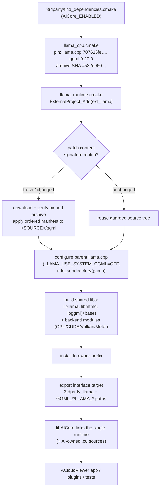
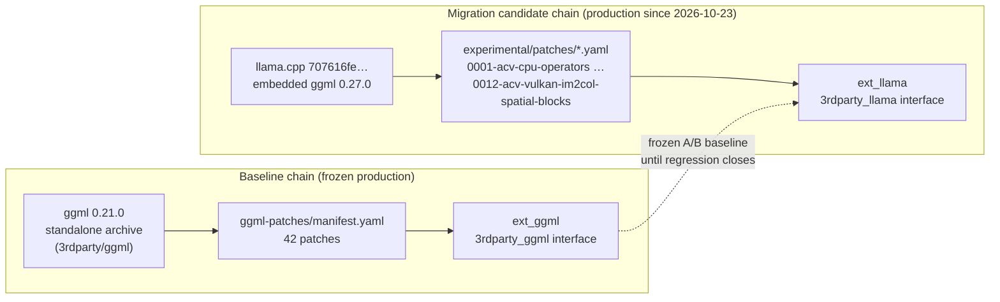

# llama.cpp — single source owner for AICore's embedded ggml runtime

Status on 2026-10-23: **production source ownership points to the pinned
llama.cpp archive**. `3rdparty/find_dependencies.cmake` selects
[`llama_cpp.cmake`](llama_cpp.cmake); the standalone ggml entry
(`3rdparty/ggml/ggml.cmake`) remains available only as a frozen comparison
baseline. Complete task/model regression, local VLM inference and Metal
validation remain open — see [Current gate status](#current-gate-status).

## 1. What this directory is

ACloudViewer's AI inference runtime (`libAICore`) needs one ggml with
task-specific custom operators. Historically ggml was vendored standalone
(`3rdparty/ggml`, embedded ggml **0.21.0**). This directory introduces a
llama.cpp-based source owner: **one pinned llama.cpp archive**, whose embedded
ggml (**0.27.0**) carries the same AICore operator patches, rebuilt as shared
llama + mtmd + ggml libraries. AICore links that single runtime; llama/mtmd
enable future local LLM/VLM tasks behind the same public C ABI rules.

The design contract is short:

- **One source owner per build.** The llama entry creates only
  `ext_llama` and exports `3rdparty_llama` (mtmd + llama + embedded ggml).
  The baseline entry creates only `ext_ggml`. Including both in one configure
  fails; cross-configure switching is guarded by persistent source-identity
  receipts (build/install prefixes bind to source owner + archive SHA).
- **Patches, never in-place edits.** Every change to the fetched ggml tree is
  an ordered unified-diff patch applied at ExternalProject fetch time.
- **ABI stays closed.** Plugins consume public `core/AICore/include/aicore/*`
  headers. Qt, STL, OpenCV, exceptions and ggml types never cross the ABI.
- **Promotion is evidence-gated.** Deleting the baseline entry requires the
  complete backend/model regression; build support alone certifies nothing.

## 2. Directory layout

| Entry | Responsibility |
|---|---|
| [`llama_cpp.cmake`](llama_cpp.cmake) | Source revision/SHA pin, embedded ggml version, manifest selection (CPU/CUDA/Vulkan/combined), llama/mtmd exports, owner target `_GGML_OWNER_TARGET=ext_llama` |
| [`llama_runtime.cmake`](llama_runtime.cmake) | Shared `ExternalProject_Add` implementation: unique-source guard, prefix lock, patch replay, byproducts, install and ggml exports |
| [`cmake/backends.cmake`](cmake/backends.cmake) | Backend discovery, compile options, SAM3D dependency closure (CUTLASS/PyTorch headers, spconv) |
| [`cmake/patches.cmake`](cmake/patches.cmake) | Content-signature computation, owner-scoped invalidation, patch command (idempotent replay) |
| [`ggml-patches/`](ggml-patches) | **Baseline chain**: 42 ordered patches against ggml 0.21.0 (frozen production baseline) + [`manifest.yaml`](ggml-patches/manifest.yaml) + `apply_ggml_patches.py` |
| [`sam3d/`](sam3d) | SAM3D operator support sources (spconv 2.3.8, CUTLASS closure) consumed by the embedded build |
| [`experimental/`](experimental) | **Migration candidate tooling**: rebased patch chains + manifests (`experimental/patches/`), isolated validation driver ([`CMakeLists.txt`](experimental/CMakeLists.txt)), contract/numeric probes, runner repair patch. See [The two patch chains](#the-two-patch-chains) |
| [`scripts/`](scripts) | `audit_llama_migration.py` — read-only source merge audit against the pristine archive |
| [`validation/`](validation/README.md) | Historical verification receipts (JSON). Never build inputs; bytes and historical input hashes are preserved |
| [`KERNEL_AUDIT.md`](KERNEL_AUDIT.md) | Operator-by-operator comparison against the pinned revision and the remaining numerical gates |
| [`README.md`](README.md) | This document |

## 3. Architecture

### 3.1 Source ownership and build flow



Key properties of the flow:

- **Persistent source identity.** Before any download, patch or install, a
  receipt check binds the build/install prefix to (source owner, archive SHA).
  A different owner or archive in the same prefix fails at configure time; a
  short prefix lock serializes concurrent configures. Reconfiguring the same
  identity is a no-op and never deletes an existing installation.
- **Patch content signature.** The patch runner hashes patch bytes *including
  their paths*. Unchanged signature → idempotent replay detection; changed
  signature → that owner's generated source/build/stamp directories are
  invalidated and everything replays from the pristine archive (twice-replay
  must produce identical trees). Relocating patch inputs therefore changes the
  signature by design.
- **Shared runtime implementation.** Both dependency entries (baseline ggml and
  candidate llama) use the same `llama_runtime.cmake` so backend selection,
  pins, module installation and invalidation stay identical during comparison.
- **No hidden inference layer.** The export surface is CMake targets and paths
  only. AICore builds its own task graphs; llama/mtmd are runtime libraries
  for future local LLM/VLM tasks, which additionally require a model/projector
  catalog, template/image contract and their own acceptance gates.

### 3.2 The two patch chains

There are exactly two ordered patch chains, one per ggml source tree. They are
**not duplicates** and cannot be merged, because the target trees differ in
API surface and file layout:



| Question | `ggml-patches/` | `experimental/patches/` |
|---|---|---|
| Target source tree | Pristine ggml **0.21.0** standalone archive | llama.cpp embedded ggml **0.27.0** |
| Consumed by | `3rdparty/ggml/ggml.cmake` (frozen baseline builds only) | [`llama_cpp.cmake`](llama_cpp.cmake) — the **production** entry (`_GGML_OWNER_PATCH_DIR`) |
| Chain shape | One merged task-oriented chain, tuned in place since v0.18 | Ordered rebase of the same semantics: CPU operators → CUDA operators → dispatch API → attention linkage → Vulkan → Metal, then per-fix additions (native output stride, im2col spatial blocks, …) |
| Backend manifests | Single `manifest.yaml` | `manifest.yaml` (CPU), `cuda-manifest.yaml`, `vulkan-manifest.yaml`, `cuda-vulkan-manifest.yaml`, `metal-manifest.yaml` (opt-in, unqualified) |
| Applies unchanged across trees | — | **No**: 0.21→0.27 changed backend APIs and source files; the old patches alone do not replay |

Why not merged: the baseline entry must keep applying **its** chain byte-for-byte
for controlled A/B against the frozen 0.21.0 production build; the candidate
must apply the **rebased** chain to 0.27.0. A single manifest would either break
the baseline identity or misapply 0.21-oriented hunks to 0.27 sources.

Why the name `experimental/` is partly misleading: the directory hosts the
**production-referenced** candidate chain and the isolated validation driver.
The name reflects its origin as migration scaffolding, not its verification
status. A rename (e.g. `llama-patches/`) is deferred until the complete
regression closes, because patch signatures are path-bearing and a rename
triggers a pristine replay in every configured owner — acceptable mechanically,
but it would invalidate path references inside active receipts
(`build_llama_production_20261023/...`, `validation/*.json`) mid-regression.
Treat the rename as a post-regression cleanup item with its mandatory
before/after configure comparison.

### 3.3 Backend selection

| Platform | Backend manifests | Notes |
|---|---|---|
| CPU only | `manifest.yaml` | Default validation profile; `GGML_CPU_ALL_VARIANTS=ON` required to match the frozen baseline |
| CUDA | `experimental/patches/cuda-manifest.yaml` | Ordered: CPU/common → CUDA operators → dispatch API adaptation → attention-helper linkage; full SAM3D closure (`GGML_USE_SAM3D_OPS=ON`) |
| Vulkan | `experimental/patches/vulkan-manifest.yaml` | 33-file port (0005) plus later fixes (0008–0010, 0011) |
| CUDA + Vulkan | `experimental/patches/cuda-vulkan-manifest.yaml` | Same source tree; both file sets verified equal to their separate replays |
| Metal | `experimental/patches/metal-manifest.yaml` | Explicit opt-in (`LLAMA_METAL_MIGRATION_VALIDATION=ON`, Apple hosts); production promotion blocked until macOS compile + inference validation |
| Other backends (SYCL, OpenCL, …) | — | Fail explicitly; never silently disabled |

AICore's CUDA/Vulkan/Metal inference backends are controlled by
`AICore_USE_*` options (independent of the application's `BUILD_CUDA_MODULE`);
the root `CMakeLists.txt` enables the CUDA language for AICore-owned `.cu`
sources when `AICore_USE_CUDA=ON` and `BUILD_CUDA_MODULE=OFF`.

## 4. Source pin and upgrade path

The pin lives in [`llama_cpp.cmake`](llama_cpp.cmake): llama.cpp revision
`707616feb5f379e99ff7442680a55b4a1704c7c9` (llama 0.7.0-dev, ggml 0.27.0),
archive SHA-256 `a532d0601f65cee41446cfbdc6872b98e689aa727eb366c6b6a61a70e9965759`.

To upgrade or change patches:

1. Update the pin or patch files (never the fetched tree).
2. Reconfigure so the content signature invalidates the owner; replay the
   ordered manifest from the pristine archive **twice** — the second pass must
   detect "already applied" and leave the tree identical.
3. Run the public contract tier, all affected task/model numerical checks, and
   a same-host controlled performance A/B against the frozen baseline.
4. Keep build and install prefixes separate from the frozen baseline.

AICore and Python consumers follow `GGML_DEPENDENCY_TARGET` /
`GGML_EXTERNAL_TARGET`; benchmark flag discovery follows `GGML_BUILD_DIR`.
RAM and YOLO inspect the exported dependency build directory for assets.

## 5. Validation ladder and current gate status

Run the narrowest checks first, then the real matrix:

```sh
# contract tier (36 public ABI/lifecycle CTests)
cmake --build build_app --target aicore-contract-tests -j4
ctest --test-dir build_app -L capi --output-on-failure -j1

# complete catalog-derived task/model matrix (release claims)
python3 core/AICore/scripts/validate_all.py \
  --build build_app --backend cuda --full \
  --output build_app/Testing/aicore_validation.json

# controlled performance A/B against the frozen baseline
python3 core/AICore/scripts/validate_all.py \
  --build build_app --backend cuda --full \
  --baseline-build <baseline-build-dir> --output .../ab.json

# read-only source merge audit
python3 3rdparty/llama/scripts/audit_llama_migration.py \
  --baseline /path/to/pristine-ggml-0.21.0 \
  --patched /path/to/0.21.0-after-manifest \
  --llama /path/to/pinned-llama.cpp \
  --repo . --revision 707616feb5f379e99ff7442680a55b4a1704c7c9 \
  --catalog /path/to/catalog.jsonl --output /path/to/audit.json
```

(`test_catalog_dump_urls --json` supplies the catalog JSONL. Audit exit 0 means
a source merge only — never inference validation.)

### Complete model regression scope

The original production gate covers **556 catalog rows / 526 unique files
across 22 tasks**, including F32, mixed precision and every pipeline consumer.
On 2026-10-22 the user waived expensive large-model full gates for this
migration (SAM3D/TRELLIS/MapAnything/LingBot full flows, SAM3 large variants,
RAM-family F32, large YOLO/ReID/relation variants) — those rows are recorded as
user-accepted compatibility assumptions in
[`validation/regression-waiver-policy.json`](validation/regression-waiver-policy.json)
(344 rows / 326 files remain measured; 212 / 200 waived). OCR is excluded from
the waiver. Unpublished OCR candidates additionally require their own
exact-SHA gates; see
[`OCR_RELEASE_GATES.md`](../../plugins/core/Standard/qAnyLabeling/OCR_RELEASE_GATES.md).

### Current gate status

**Complete regression: NOT closed.** Latest receipts live under
`build_llama_production_20261023/Testing/` (persistent):

| Receipt | Verdict | Detail |
|---|---|---|
| `llama-regression-cuda-release.{json,md,log}` (19-scenario CUDA release report) | FAIL (open rows) | SLANet table Q8 missing candidate metrics (audit/forward samples); tagging RAM and relation baselines fail — relation Q8 is a pre-existing checkpoint-accuracy miss (predicate-top1 agreement 0.96679 vs 0.97 floor; candidate outputs bitwise equal to the pinned upstream ggml) |
| `llama-regression-vulkan-release.{json,md,log}` | FAIL | depth-anything-base Q8 e2e +10.69% and fingerprint changed; ALIKED p50 +7.28%; RAM +7.21%; lightglue/rmbg/reid fingerprint changed; relation baseline fail (pre-existing). Fingerprint changes require per-task attribution to the Vulkan scheduling patches |
| `llama-cuda-im2col-repaired-probes.{json,md}` (6-scenario post-fix A/B) | 5 PASS / 1 FAIL | PASS: RF-DETR nano, OCR Chinese recognizer, SLANet (p50 20.06 ms vs ~20.95 baseline — former latency/peak-memory regression absent), AnyCalib, RAM++. FAIL: relation Q8 (pre-existing, see above) |
| `ocr-im2col-85e55y1b/im2col-model-regression.json` | PASS | 30 CUDA rows bitwise identical before/after the CUDA im2col patch |
| `ocr-im2col-85e55y1b/release-cuda-det-{f16,q8_0}.json` | PASS | CUDA detector source-speed gate passes after exact-gather scheduling + copy elision |
| `ocr-im2col-85e55y1b/vulkan-im2col-model-regression.json` | PASS | 15 Vulkan rows bitwise identical after the Vulkan sibling patch |
| `ocr-im2col-85e55y1b/release-vulkan-det-{f16,q8_0}.json` | FAIL | Vulkan detector source-speed gate: p50 12.1 ms vs Paddle ~6 ms; residual localized to Vulkan dense-conv graph execution |

Still open before deleting the baseline entry / full promotion:

1. Vulkan matrix: attribute and resolve the fingerprint changes and the depth/
   ALIKED/RAM timing regressions (Vulkan per-op timing to localize, then
   uninstrumented gate verification).
2. CUDA 19-scenario report: complete the missing SLANet Q8 metrics; resolve
   GKD/LoMa timing failures and Depth/LoMa/RMBG fingerprints.
3. Complete catalog-derived `--full` matrix on every required backend without
   `--allow-incomplete`, with upstream accuracy, stability and controlled A/B.
4. Metal port: macOS compilation, MSL execution and inference validation.
5. Local LLM/VLM: model/projector catalog, template/image/output acceptance —
   before exposing native inference in qAnyLabeling (the current ChatService
   path is OpenAI-compatible HTTP; no Florence-2 equivalence exists).

## 6. Evidence index

Historical receipts (bytes preserved, never rewritten):
[`validation/`](validation/README.md).

| Receipt | Records |
|---|---|
| `migration-evidence.json` | First CPU source-owner experiment: 40-patch chain replay, three-way merge inventory (119 files), contract tier 36/36, loader traces |
| `cuda-rebase-evidence.json` | CUDA chain rebase to 0.27, build/linkage and dynamic relocation checks |
| `vulkan-rebase-evidence.json` | Vulkan 33-file port, installed runtime, 158 retained-output OCR checks |
| `dual-gpu-evidence.json` | Combined CUDA+Vulkan build, 316 input comparisons, shared ggml base |
| `cuda-native-stride-evidence.json` | SAM3 F16 GEMM output-stride defect and the `0006` fix (single/batch/broadcast F16/F32 oracle) |
| `resource-migration-evidence.json` | Resource relocation into `3rdparty/llama`; 158-check CUDA OCR regression |
| `source-owner-guard-evidence.json` | Persistent source-identity guard: prefix binding, switch failures, safe reconfigure |
| `relocated-patch-replay-evidence.json` | Baseline manifest replay from the relocated patch directory produces the identical preserved 0.21 tree |
| `cmake-entry-evidence.json` | CMake entry state before the persistent guard |
| `all-model-regression-scope.json` | Full-catalog scope accounting (556/526/22) |
| `regression-waiver-policy.json` | Per-task waiver rows and identities |
| `full-model-regression-evidence.json` | 2026-10-21/22 complete-regression progress (**in progress**, not PASS) |
| `validation/README.md` | Receipt conventions |

Related living documents: [`KERNEL_AUDIT.md`](KERNEL_AUDIT.md) (operator
decisions and remaining numerical gates),
[`OCR_RELEASE_GATES.md`](../../plugins/core/Standard/qAnyLabeling/OCR_RELEASE_GATES.md)
(OCR per-file release gates), `.agents/skills/ggml-upgrade/SKILL.md`
(upgrade A/B protocol), `.agents/skills/acloudviewer-aicore-plugin/SKILL.md`
(integration contract).

## 7. Reproduce the isolated validation driver

The standalone driver (used for all migration evidence) configures the same
ExternalProject outside the application build:

```sh
cmake -S 3rdparty/llama/experimental -B build_llama_experiment \
  -DCMAKE_BUILD_TYPE=Release
cmake --build build_llama_experiment --parallel 4
ctest --test-dir build_llama_experiment --output-on-failure
```

- `-DLLAMA_SOURCE_ARCHIVE=/path/to/downloaded.tar.gz` reuses a local archive
  (pinned SHA still mandatory).
- `-DGGML_USE_CUDA=ON -DGGML_USE_SAM3D_OPS=ON` selects the CUDA migration
  manifest with the complete SAM3D closure; `-DGGML_USE_VULKAN=ON` selects the
  Vulkan manifest; both together select the combined manifest.
- Metal validation is opt-in on Apple hosts
  (`-DLLAMA_METAL_MIGRATION_VALIDATION=ON`).
- The driver enforces `GGML_CPU_ALL_VARIANTS=ON` and production hidden-visibility
  flags so measurements stay comparable to the frozen baseline.
- Fourteen configure contracts cover ownership, disabled inference, manifest
  selection, unported-backend rejection, stable signatures, patch-content
  invalidation scoped to the selected owner, source switches across configures,
  shared-prefix collisions, unidentified installations, archive changes and
  missing Vulkan dependencies.

This driver is validation scaffolding; the application's production owner is
`3rdparty/find_dependencies.cmake → llama_cpp.cmake`.

## 8. Historical context (compressed)

- **2026-10-20 integration audit**: both entries share one
  `ExternalProject_Add` implementation; the production archive was ggml
  (`ext_ggml`) and the candidate llama (`ext_llama`); same-configure inclusion
  fails; pin-file edits participate in automatic CMake regeneration.
- **2026-10-21 resource relocation**: the shared runtime helper, all original
  patch files and SAM3D sources moved here with bytes preserved; fresh CPU and
  CUDA builds passed their contracts; 158-check CUDA OCR regression bitwise
  equal.
- **2026-10-21/22 full-model regression in progress**: RF-DETR 44-model numeric
  fingerprints baseline-identical on both GPUs; timing failures diagnosed
  against warmup/protocol and CPU-variant build mismatches (superseded reruns
  retained); CUDA graph capture re-enabled for pure standard-op graphs via
  ordered patch; SAM3 F16 stride defect fixed by `0006`.
- **2026-10-23**: production source ownership switched to the llama entry;
  CUDA/Vulkan im2col scheduling repairs landed as ordered patches
  (`0011-acv-cuda-im2col-spatial-blocks`,
  `0011-acv-vulkan-im2col-spatial-blocks`) with CUDA speed gates passing,
  Vulkan outputs bit-preserved and the Vulkan detector speed gate still open.
  The 12 historical evidence receipts in `validation/` keep their original
  input hashes; the earlier source-pin JSON was replaced by CMake constants.

The pinned upstream references:

- [Pinned source](https://github.com/ggml-org/llama.cpp/tree/707616feb5f379e99ff7442680a55b4a1704c7c9)
- [Multimodal contract](https://github.com/ggml-org/llama.cpp/blob/707616feb5f379e99ff7442680a55b4a1704c7c9/docs/multimodal.md)
- [mtmd library](https://github.com/ggml-org/llama.cpp/blob/707616feb5f379e99ff7442680a55b4a1704c7c9/tools/mtmd/README.md)
