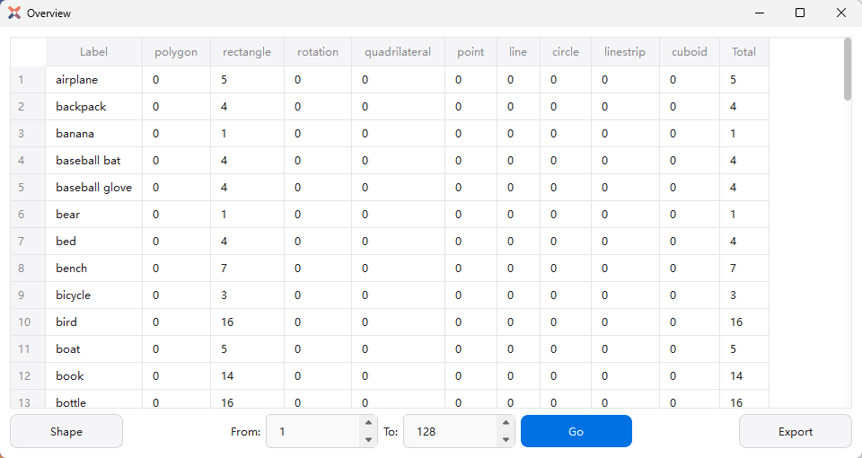
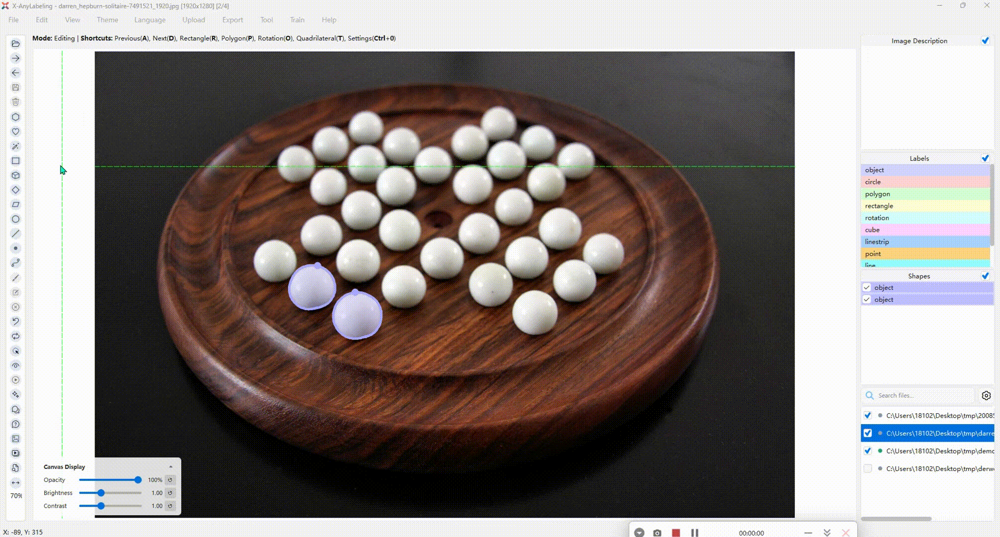
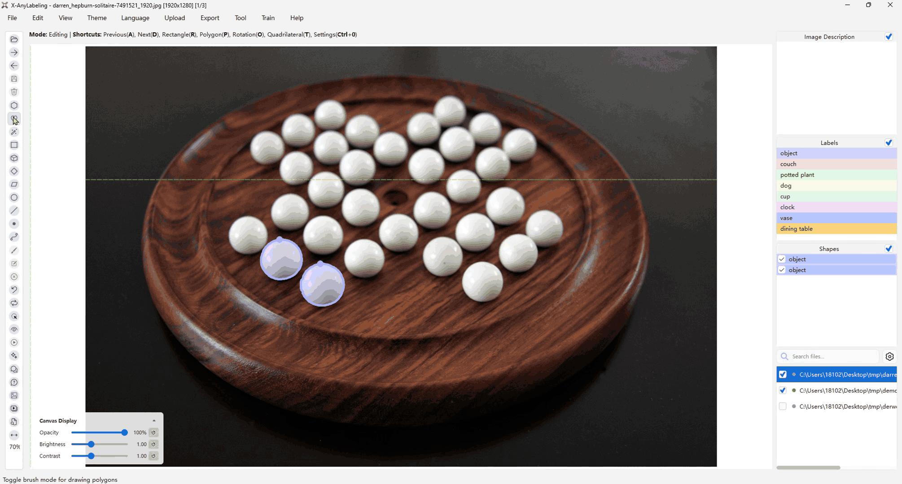

# qAnyLabeling — AI-Assisted Annotation Workbench

  

*The annotation workspace: image list, canvas with labels, scores and
descriptions, the embedded model panel and the object list.*

**qAnyLabeling** is a native Qt image annotation workspace inspired by
[X-AnyLabeling](https://github.com/CVHub520/X-AnyLabeling), embedded in
ACloudViewer as an AICore plugin. It combines versatile shape tools,
automated labeling workflows, flexible multi-format import/export and
video / point-cloud workspaces — and every AI assist runs **fully local**
through the AICore GGML runtime: no Python environment and no cloud service
are required for annotation.

## Demo

  
  

*Left: magic wand — a seed-connected color region becomes an editable
polygon in one click. Right: brush — paint / erase / invert with a
per-target class and stroke undo/redo.*

More interaction demos (canvas selection, annotation opacity, compare
view, navigator) live in the plugin's
[docs/images](https://github.com/Asher-1/ACloudViewer/tree/main/plugins/core/Standard/qAnyLabeling/docs/images);
they are the upstream X-AnyLabeling references and serve as the
layout-parity baselines for this port.

## Key features

* **Annotate everything** — polygon, rectangle, rotation, quadrilateral,
  circle, line, point, line strip and cuboid shapes with live
  measurements; brush paint/erase with per-class targets; magic wand;
  group/ungroup and shape union; label change manager (`Alt+L`); image
  tags; session-persistent settings and undo/redo.
* **AI-assisted labeling** — one embedded model panel (`Ctrl+A`) over the
  shared AICore catalogs with transient prompts, editable results, batch
  Auto Run (`Ctrl+B`), per-catalog quantization and device/backend rows.
* **Video toolchain** — SAM3 video tracking with timeline review,
  refinement and mask-archive export/import; video classifier with segment
  editing and MP4 / rawframe dataset export; annotation visualization MP4.
* **3D point cloud annotation** — native Qt/OpenGL workspace over KITTI
  `.bin` / PLY + `.label` files with semantic / instance / intensity / RGB
  coloring, brush and through-selection, and cuboid editors in the three
  orthographic views and the main view.
* **Interchange** — X-AnyLabeling JSON sidecars round-trip unchanged
  (unknown fields preserved); YOLO / VOC / COCO / DOTA / MOT / MASK /
  PPOCR / ODVG / VLM-R1 / Datumaro import and export.
* **Headless automation** — `-ANYLABEL_INFER` and `LLM_GENERATE` batch
  commands with `HELP` / `RESULT_JSON` schemas for scripts and CI.

## Model panel

The embedded model panel (`Ctrl+A`) consumes the public AICore catalogs;
the runtime catalog remains the single source of truth for selectable
files. The task→model mapping (object detection, instance/semantic
segmentation, pose, OBB, VLM captioning and more) is documented in
[MODEL_MATRIX.md](https://github.com/Asher-1/ACloudViewer/blob/main/plugins/core/Standard/qAnyLabeling/MODEL_MATRIX.md).

## Documentation

- [User guide](https://github.com/Asher-1/ACloudViewer/blob/main/plugins/core/Standard/qAnyLabeling/docs/en/user_guide.md) ·
  [中文指南](https://github.com/Asher-1/ACloudViewer/blob/main/plugins/core/Standard/qAnyLabeling/docs/zh_cn/user_guide.md)
- [Engineering notes](https://github.com/Asher-1/ACloudViewer/blob/main/plugins/core/Standard/qAnyLabeling/ENGINEERING.md) ·
  [Upstream parity audit](https://github.com/Asher-1/ACloudViewer/blob/main/plugins/core/Standard/qAnyLabeling/UPSTREAM_PARITY_AUDIT.md) ·
  [Model matrix](https://github.com/Asher-1/ACloudViewer/blob/main/plugins/core/Standard/qAnyLabeling/MODEL_MATRIX.md)

## License

GPL-3.0-only, inherited from the upstream X-AnyLabeling project; the
interaction demos above are upstream references with their attribution
preserved.
