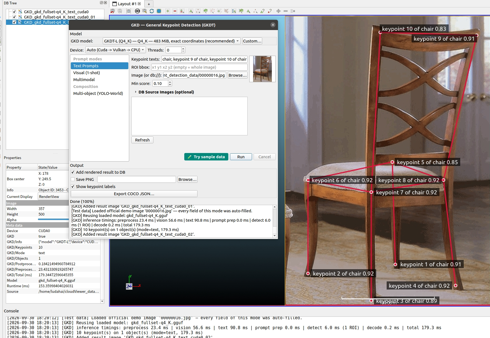
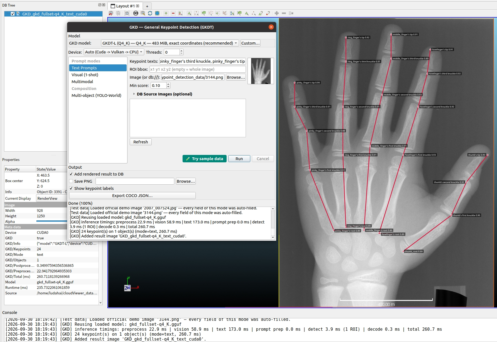
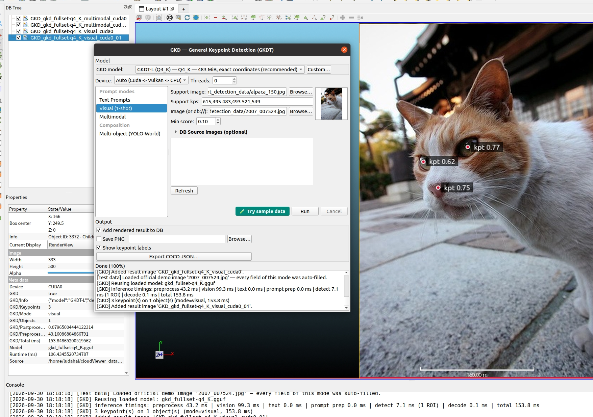
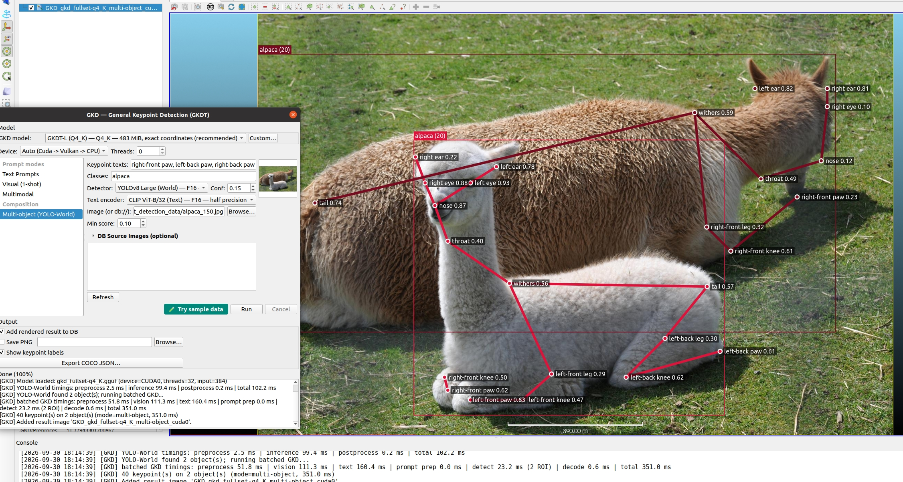

# qGKD — General Keypoint Detection (GGML)

  
  

General (open-world) keypoint detection on still and DB images with the
**GKDT-L** transformer (ECCV 2026), running through the in-tree ggml runtime
in `core/AICore/src/tasks/gkd/` — no Python at runtime. The official
`keypoint 1..10 of chair` phrases score 0.83–0.93 on all ten points; the
24-point `hand_xray` schema keeps 24/24 points at 0.9+ where a generic
"fingertip" prompt scores 0.04.

## Requirements

- Built with `-DAICore_ENABLED=ON -DPLUGIN_STANDARD_QGKD=ON`
- The default **GKDT-L (Q4_K)** GGUF (483 MiB) auto-downloads from
  [Hugging Face Asher-1/GKD_GGUF](https://huggingface.co/Asher-1/GKD_GGUF)
  into `~/cloudViewer_data/extract/gkd_models/` and is SHA-256 verified at
  ingestion; custom GGUF paths are accepted
- **Multi-object mode** additionally reuses the qYOLO World detector models
  and their CLIP/MobileCLIP text encoder from the shared catalogs

## Prompt modes

| Mode | Inputs | Result |
|---|---|---|
| **Text** | keypoint texts ("nose", "left eye", …) | one keypoint per text |
| **Visual (1-shot)** | support image + support keypoints (pixel coords) | one keypoint per support keypoint |
| **Multimodal** | keypoint texts **and** support image + keypoints (counts must match) | text row *i* fuses with visual row *i* |
| **Multi-object** | object classes + keypoint texts (+ optional support) | YOLO-World boxes (existing `aicore_yolo_*` WORLD models) → GKD per box |

## Workflow

1. **Plugins → GKD Keypoint Detection** — the dialog follows the qYOLO
   task-page layout: a grouped mode list on the left, one panel per mode on
   the right, global GKD model / Device / Threads controls above.
2. Fill the active mode's prompt fields (or click **Try sample data** —
   each panel bundles demo scenarios cycling on repeated clicks, starting
   with the upstream-recommended first-frame image).
3. Optional per-panel settings: ROI bbox (`x1 y1 x2 y2`, empty = whole
   image), min keypoint score, keypoint labels.
4. **Run** — the model stays resident across runs; switching model, device
   or thread count triggers exactly one reload.

  
  

*Left: visual 1-shot — a fixed support image with three annotated keypoints
drives detection on rotating query images (cross-instance, open-world
few-shot). Right: multi-object — YOLO-World detects boxes first, then GKD
runs per box (the official 20-point quadruped demo).*

## Outputs

- **DB tree**: rendered image with keypoints (prompt labels + scores) and
  boxes; metadata records mode, keypoint/object counts, per-stage timings,
  device and model under `GKD/*` keys (name prefix `GKD_`).
- **PNG export** to a user directory.
- **Export COCO JSON…** — official-style COCO prediction file (categories
  with keypoint names + 1-based skeleton, images, xywh boxes, x/y/score
  triplets for the displayed keypoints).

## Notes

- Scenarios with an upstream skeleton (coco / animal_pose / carfusion /
  onehand10k / keypoint5 / animalweb schemas) draw the official bone
  connections; bones only draw between keypoints that pass the display cut.
- The model combo lists the published AICore catalog; the deprecated
  upstream q4_0 build is not cataloged.
- **License**: GKDT weights and source are for **academic research and
  educational use only** (ECCV 2026; commercial use prohibited) — see
  the plugin's [MODEL_CARD.md](https://github.com/Asher-1/ACloudViewer/blob/main/plugins/core/Standard/qGKD/models/MODEL_CARD.md).

Full details, sample-data scenario lists and validation commands:
[qGKD plugin README](https://github.com/Asher-1/ACloudViewer/blob/main/plugins/core/Standard/qGKD/README.md).
