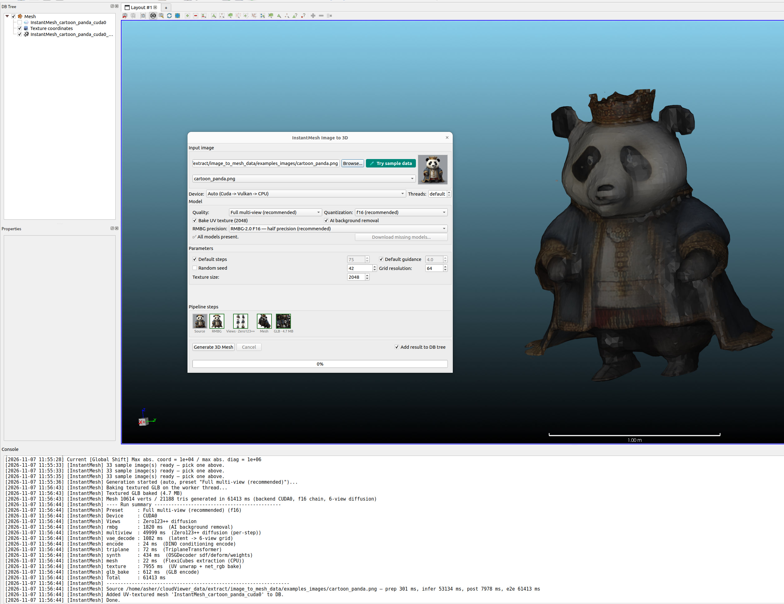

# qInstantMesh — InstantMesh Image-to-3D (GGML)

<p align="center">
  
</p>

Single-image to textured 3D mesh via native GGML inference — a C++/ggml port
of [TencentARC/InstantMesh](https://github.com/TencentARC/InstantMesh)
(Apache-2.0) integrated into the AICore shared runtime. The pipeline runs
RMBG-2.0 matting (optional, in-tree RMBG task), Zero123++ multi-view
diffusion (75 steps, 6×320² views), DINO ViT-B/16 encoding, a triplane
transformer, FlexiCubes isosurface extraction and an xatlas UV unwrap with a
2048-atlas texture bake — all in-process, no Python at runtime.

## Requirements

- Built with `-DAICore_ENABLED=ON -DPLUGIN_STANDARD_QINSTANTMESH=ON`
- 14 published GGUFs from
  [Hugging Face Asher-1/InstantMesh-GUFF](https://huggingface.co/Asher-1/InstantMesh-GUFF)
  (catalog in `core/AICore/src/tasks/instantmesh/model_catalog.cpp` is the
  single source of truth for URLs, sizes and SHA-256); missing files
  auto-download through the shared `ecvModelDownloader`
- Optional RMBG model — shared with the qRMBG/qTrellis cache
  (`extract/rmbg_models/`); never silently skipped when missing

## Workflow

1. **Plugins → InstantMesh Image-to-3D** and pick a source image (or
   **Try sample data** — the shared Image2Mesh dataset, the same bundle
   qTrellis/qSAM3D use).
2. Choose the **preset**: `full` (Zero123++ diffusion chain, recommended) or
   `geometry only` (upstream benchmark path — faster, lower quality).
3. Set quantization, steps / guidance / seed, grid resolution and texture
   options; toggle AI background removal.
4. **Run** — the pipeline-strip chips (Source, RMBG, Views, Mesh, GLB) show
   stage state and previews; the Mesh/GLB chips open the shared orbit viewer
   once a result mesh exists.

## Outputs

- **DB tree**: typed mesh entity with per-corner UV coordinates and RGBA
  material (GLB textures registered as DIFFUSE for the VTK renderer).
- **Exports**: UV-atlas-textured GLB (xatlas + meshoptimizer, all CPU) and
  OBJ/MTL/PNG (relative MTL, per-corner `vt`).

## Headless batch

```bash
ACloudViewer -SILENT -INSTANTMESH_GENERATE PRESET full QUANT f16 IMAGE image.png OUT_DIR out_dir
ACloudViewer -SILENT -INSTANTMESH_GENERATE HELP RESULT_JSON instantmesh-schema.json
```

Automation uses the generic toolchain:

```sh
cli-anything-acloudviewer --json --mode headless ai run instantmesh \
  --image image.png --out-dir out --option PRESET=full --option QUANT=f16
```

## Notes

- The default full/f16 chain needs several GB of VRAM; allocation failures
  release their graph resources and return an error instead of aborting.
- JSON results record common `timings`, separate `load_ms` / `export_ms`,
  the actual backend and the exported files.
- CUDA/Vulkan accuracy requires the real backend patch chains and operator
  gates — see the plugin README's validation history for the retained
  component gates and open items.

Full details (models table, tests, batch options):
[qInstantMesh plugin README](https://github.com/Asher-1/ACloudViewer/blob/main/plugins/core/Standard/qInstantMesh/README.md).
