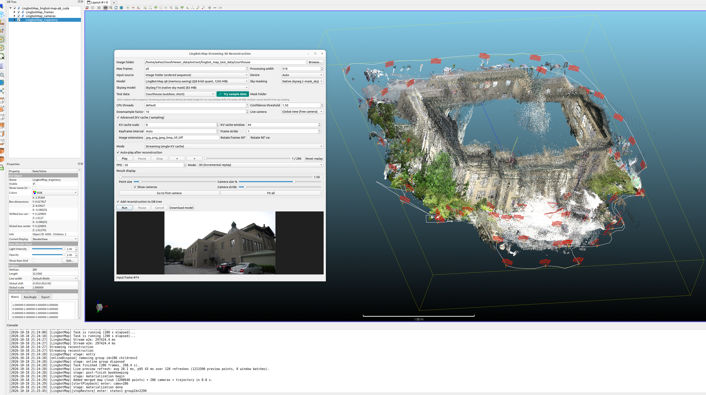
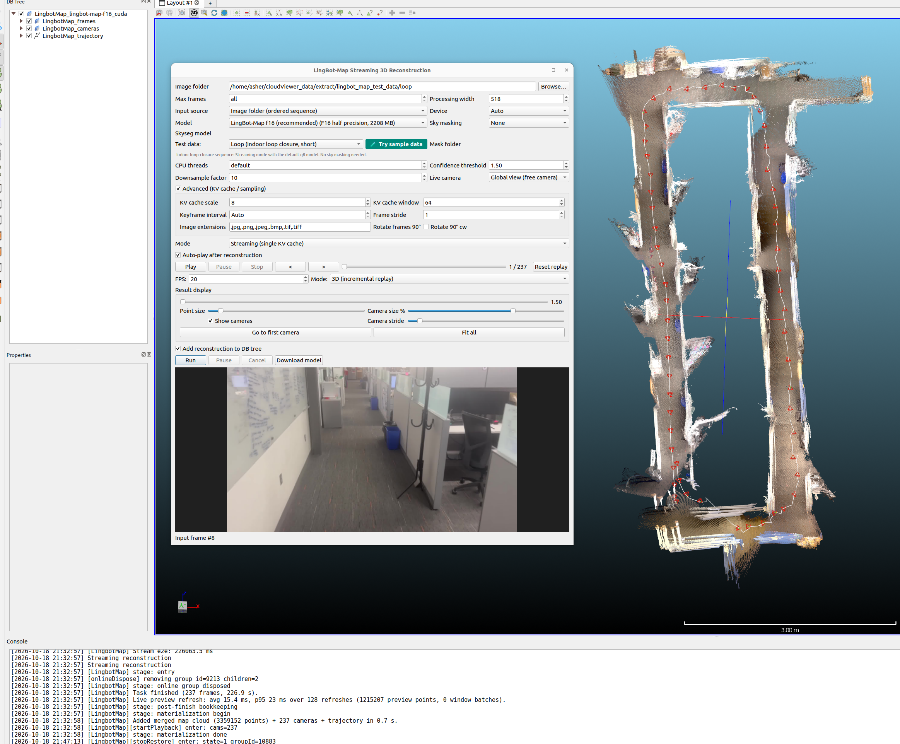

# qLingbotMap — LingBot-Map Streaming 3D Reconstruction

  
  

Streaming RGB-D 3D reconstruction from an ordered image sequence, powered by
the [LingBot-Map](https://technology.robbyant.com/lingbot-map) Geometric
Context Transformer (GCT) running natively on ggml (CPU / CUDA / Vulkan /
Metal — device auto-pick follows the AICore runtime order). During the run
the live preview builds the map at streaming pace: one immutable point cloud
per frame, camera frustums and the camera-center trajectory polyline.

## Requirements

- Built with `-DAICore_ENABLED=ON -DPLUGIN_STANDARD_QLINGBOTMAP=ON`
- A LingBot-Map GGUF from
  [Hugging Face Asher-1/lingbot-map-gguf](https://huggingface.co/Asher-1/lingbot-map-gguf)
  — the first-run default follows the upstream CLI (**q8** on a 24-GB-class
  GPU; f16 needs a ≥30-GiB card, f32 is the exact reference); missing files
  auto-download with pinned SHA-256 ingestion
- Optional native **sky segmentation** GGUF (`lingbot-map-skyseg-*`) for
  outdoor scenes, downloaded the same way
- Optional OpenCV (`BUILD_OPENCV=ON`) for video-file input via the shared
  `video_base` module; the image-folder input is unaffected without it

## Workflow

1. **Plugins → LingBot-Map Reconstruction** and pick the model.
2. Choose the input — an ordered image folder or a video file sampled at a
   chosen fps (`Input source` combo; `Max frames` limits the stream length).
3. Optional: enable native sky segmentation (outdoor scenes) and pick the
   SkySeg GGUF variant (f16 recommended / q8_0 / f32).
4. **Run** — progress, the resolved backend and per-frame streaming are
   logged; cancellation stops after the current frame.

The **Test data** combo lists the official demo sequences (cached download,
extract and image-folder auto-fill): `Courthouse (outdoor)`,
`Oxford Spires (outdoor)`, `University (outdoor)` — selecting one
automatically enables sky masking — and `Loop (indoor loop closure)` with no
sky.

## Outputs

The DB structure mirrors the official fused viewer
(`ggml_demo.py` + PointCloudViewer):

- `LingbotMap_<model>_<device>` group holding `LingbotMap_frames/` with
  **one point cloud per frame** (`LingbotMap_frame_%06d`), each filtered
  exactly like `parse_pc_data` (confidence > threshold, default 1.5, then
  the official sequential downsample, default factor 10);
- a dedicated `LingbotMap_cameras` subfolder with the COLMAP-style camera
  frustum per frame — never mixed with the point clouds;
- `LingbotMap_trajectory` camera-center polyline points;
- windowed runs build the cross-window aligned map the same way
  (`LingbotMap_aligned_frames/`).

## Notes

- The native skyseg path is upstream-parity verified on the 286-frame
  courthouse stream (keep-matches ≥ 99.99% per frame; identical
  conf-zeroing semantics).
- The live refresh stays O(new points): a frame's cloud never changes after
  creation, so the VTK per-entity draw gate skips every stable cloud.
- 4D playback mirrors the official replay: the current frame's point cloud
  and frustum only.

Full details (sky-masking parity notes, long sequences, test-data layout):
[qLingbotMap plugin README](https://github.com/Asher-1/ACloudViewer/blob/main/plugins/core/Standard/qLingbotMap/README.md).
