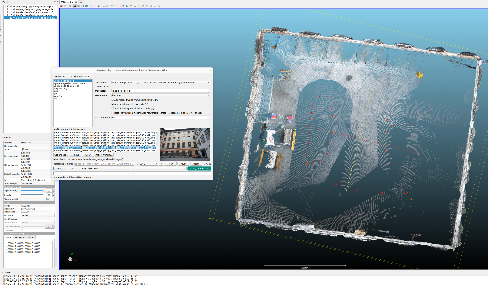
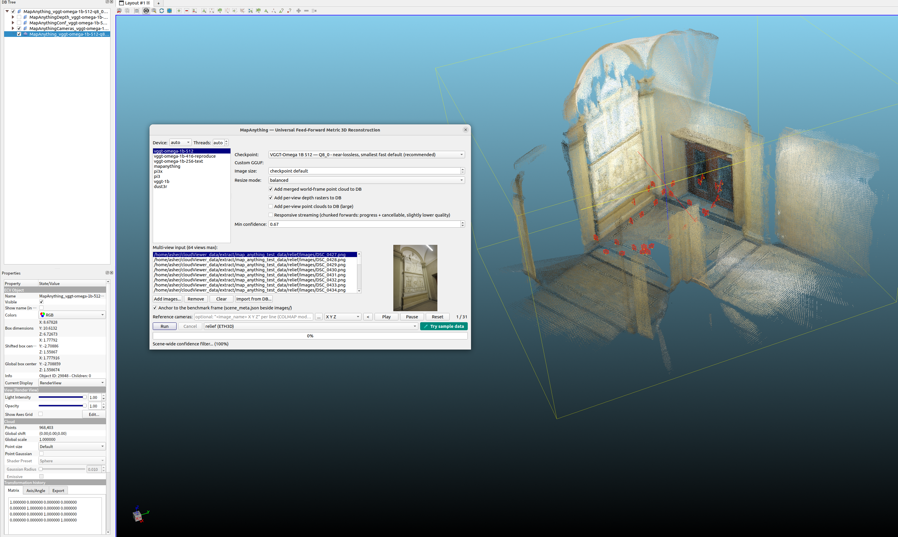

# qMapAnything — MapAnything Multi-View Reconstruction

  
  

Universal feed-forward metric 3D reconstruction from multi-view image sets,
powered by the in-tree ggml port (`core/AICore/src/tasks/map_anything/`,
upstream map-anything-ggml `cpp_ggml`). One monolithic libAICore task serves
**six model architectures**, routed by the GGUF `general.architecture` key;
each variant page offers its published quantizations (F16 / Q8_0 / F32 for
every variant, plus Q5_K and/or Q6_K depending on the family; Q8_0 marked
*recommended*).

| Variant (tab order) | Architecture key | Camera outputs | Notes |
|---|---|---|---|
| VGGT-Omega 1B 512 *(first tab, accuracy pick)* | `vggt_omega` | pose_enc 9 (absT + quat + FoV) | best pointmap/depth/pose accuracy |
| VGGT-Omega 1B 416 (reproduce) | `vggt_omega` | pose_enc 9 | paper-reproduction 416 px checkpoint |
| VGGT-Omega 1B 256 (text) | `vggt_omega` | pose_enc 9 + text embedding | language-aligned head |
| MapAnything | `mapanything` | c2w 4x4 + mask + metric scale | metric scale & poses pick |
| Pi3X | `pi3x` | c2w 4x4 | balanced paper-pinned alternative |
| Pi3 | `pi3` | c2w 4x4 | camera-frame depth convention |
| VGGT-1B | `vggt` | pose_enc 9 + view0-frame points | original VGGT point head |
| DUSt3R | `dust3r` | none (pairwise view1 frame) | throughput / small devices |

## Requirements

- Built with `-DAICore_ENABLED=ON -DPLUGIN_STANDARD_QMAPANYTHING=ON`
- Model GGUFs auto-download through the shared downloader with pinned
  SHA-256 verification into the shared model cache
- Test scenes: 13 official ETH3D benchmark zips
  (224 MB – 1.6 GB) fetched once via **Use test data** and cached under
  `~/cloudViewer_data/extract/map_anything_test_data/<scene>/`

## Workflow

1. **Plugins → MapAnything Multi-View Reconstruction** and pick a model
   variant page (each with its checkpoint combo, custom-GGUF path, image
   size / resize mode and output toggles).
2. Add 2–16 views (add files / import from DB / preview); all pages share
   the multi-view input block, the Run/Cancel row, the *Use test data*
   controls, the progress bar and the log.
3. **Use test data** fills the multi-view input list from a cached ETH3D
   scene (capped at 64 views).
4. With the WAI layout (`<scene>/images/` next to
   `<scene>/scene_meta.json`), **Anchor to the benchmark frame** (default)
   applies the robust Horn Sim3 that moves the prediction into the benchmark
   ground-truth frame and enables the 2 cm conf-priority voxel.
5. **Run** — images alone determine relative camera poses and scene shape;
   inputs without a `scene_meta.json` stay in the official model frame.

## Outputs

- **DB tree**: reconstructed point cloud (per variant official frame and
  unit — see the frame table in the plugin README) and the camera entities.
- Placing the result in an external world (geodetic, site survey, benchmark
  GT) needs external correspondences, the same as COLMAP's `model_aligner`
  (≥ 3 known camera centers, Sim3) — the dialog reads the benchmark
  `scene_meta.json` or your own camera positions in the `model_aligner`
  text format.

## Notes

- Measured on the courtyard scene (38 views, CUDA, vggt-omega-1b-512-f16):
  anchored result 4,794,314 points, extent 25.81 × 23.48 × 18.66 m,
  nearest-neighbour distance to the upstream cloud median 1.15 cm / p95
  2.29 cm (2 cm voxel).
- Chunked runs express every chunk in chunk 0's frame.

Full details (per-family output frames, scene driver, accuracy notes):
[qMapAnything plugin README](https://github.com/Asher-1/ACloudViewer/blob/main/plugins/core/Standard/qMapAnything/README.md).
