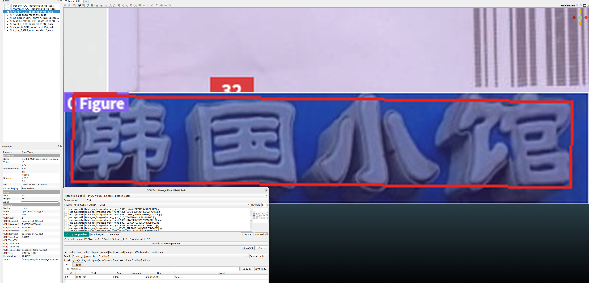
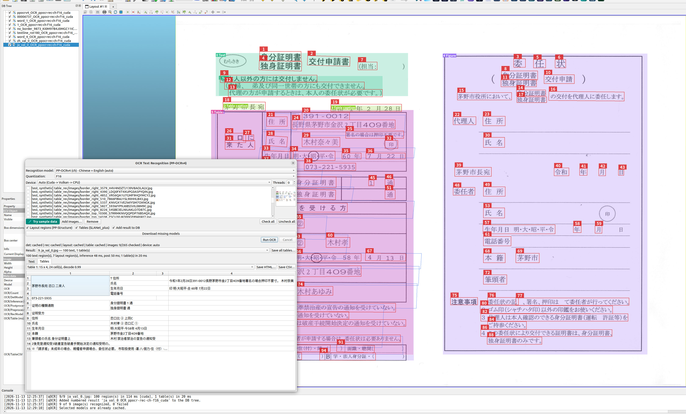
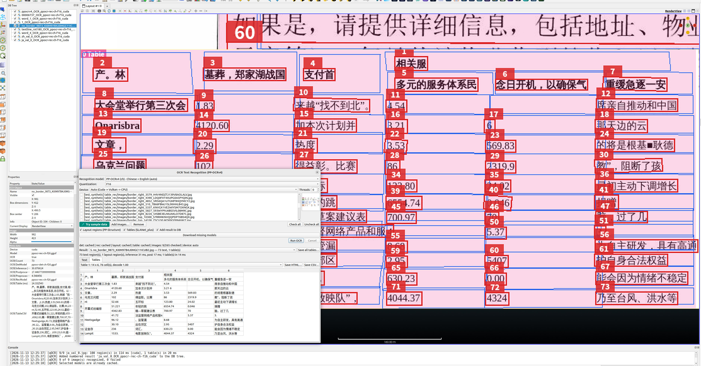
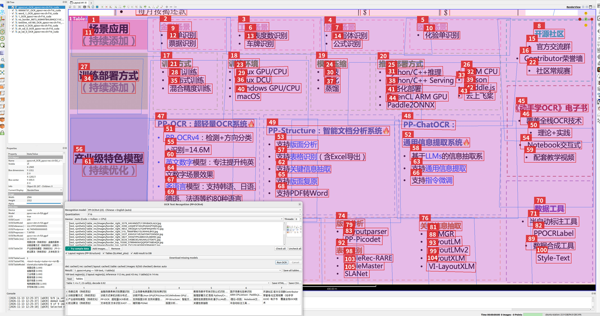
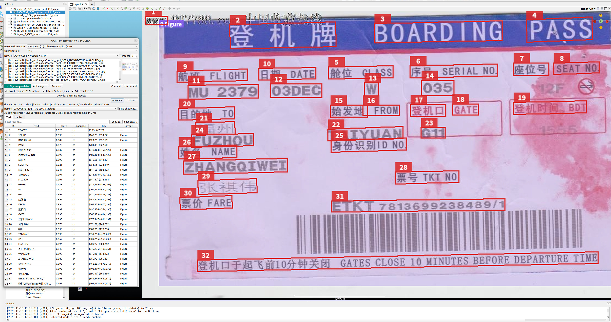

# qOCR — PP-OCR Text Recognition

  
  

*Left: text mode — 32 text regions drawn as red numbered boxes over the
render view, each mapped to its `# / Text / Score / Language / Box / Layout`
row in the workspace table. Right: tables mode — a real-document Japanese
validation page with a layout `Table` region decoded as a 15×4 grid (24
cells, decode confidence 0.99), PP-Structure style overlay layers.*

PP-OCRv4 text detection and recognition over the AICore `ocr` task, built on
the first-party Paddle inference → GGUF conversion
(`core/AICore/tools/convert_paddle_ocr_gguf.py`).

  
  
  

*More demo outputs: a Chinese document page (73 regions, 14×7 grid, decode
confidence 1.00), the PaddleOCR mindmap page (109 regions over two layout
regions), and a single decorative storefront region recognized as 韩国小馆
with score 1.000.*

## Requirements

- Built with `-DAICore_ENABLED=ON -DPLUGIN_STANDARD_QOCR=ON`
- One published catalog recipe per script family — **English**, **Japanese**
  or **Chinese + English (auto)** — with det shared and script-agnostic; a
  single quantization tier applies to every enabled stage (det / rec /
  layout / table); missing files auto-download with pinned SHA-256
  ingestion

## Workflow

1. **Plugins → OCR Workspace** (a pure view in the shared AICore plugin
   shape, same split as qRMBG).
2. Pick the **Recognition model / Quantization** combo entry; the entry
   label carries its script family.
3. Add images to the checkable image list (drag-and-drop anywhere on the
   workspace also appends them checked) or click **Try sample data** — it
   checks only the images recommended for the current **mode + family**
   (measured recommendations; repeated clicks re-apply and retire stale
   suggestions).
4. Optional stages: **Layout regions / Tables (SLANet_plus)** — opt-in;
   with both enabled the stages compose (tables consume the layout
   regions).
5. **Run OCR** — every checked image is processed in list order with one
   model load (one worker, one context), one result and one DB overlay per
   image; a failed image is logged and skipped, Cancel stops between images.

## Outputs

- **DB overlay** per image, layered PP-Structure style: translucent
  per-class layout regions with class tags underneath (green `Text`, pink
  `Table`, purple `Figure`), blue reconstructed cell polygons, red numbered
  text boxes on top.
- Workspace table rows: `# / Text / Score / Language / Box / Layout` per
  region; the numbered overlay and the result rows stay in sync.
- Clicking a row previews its image; clicking the preview opens the
  full-resolution wheel-zoom / drag-pan view.

## Notes

- Per-image script auto-switching is deliberately absent: the
  ch/v5/v6 dictionaries already cover Chinese + English, so the auto family
  IS the superset model.
- Tables mode uses the official table-recognition text detection
  (`limit_type=max`, 960); if layout finds no `table` region the table
  stage produces no tables.

Full details (recipes, sample-data recommendation tables, batch command):
[qOCR plugin README](https://github.com/Asher-1/ACloudViewer/blob/main/plugins/core/Standard/qOCR/README.md).
