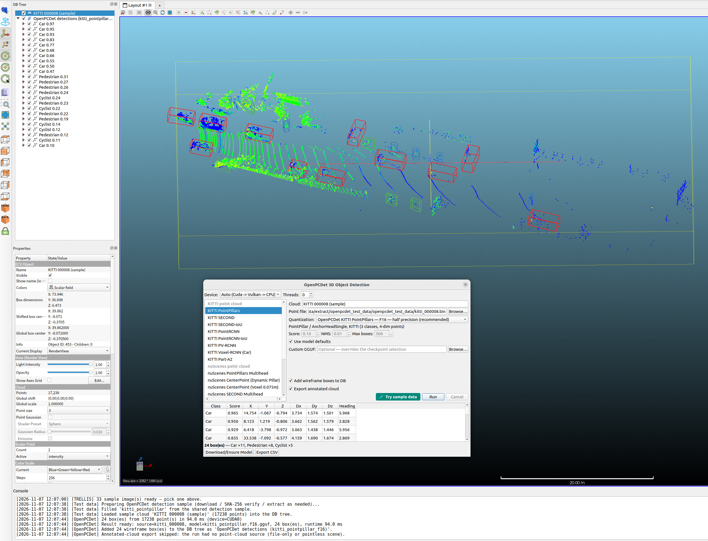

# qOpenPCDet — LiDAR 3D Object Detection

  

*PointPillars (`kitti_pointpillar`, f16) on the bundled KITTI sample frame:
per-class colored wireframe boxes overlaid on the source point cloud. Cars,
pedestrians and cyclists are detected and labeled with confidence scores.*

LiDAR point cloud **3D object detection** for ACloudViewer — PointPillars /
SECOND checkpoints from OpenPCDet, converted to GGUF and served through the
in-tree [OpenPCDet-GGML](https://github.com/Asher-1/OpenPCDet-GGML) engine
(native ggml ops only; CPU / CUDA / Vulkan backends).

## Requirements

- Built with `-DAICore_ENABLED=ON -DPLUGIN_STANDARD_QOPENPCDET=ON`
- **54 models** — 18 checkpoints × 3 quantizations (`f32` reference, `f16`
  recommended, `q8_0` 8-bit dense convs) published on
  [cloudViewer_downloads OpenPCDet-GGUF](https://github.com/Asher-1/cloudViewer_downloads/releases/download/OpenPCDet-GGUF/);
  the combo reads the catalog live from `aicore_openpcdet_model_count/at`
  and downloads through the shared SHA-256-verified `ecvModelDownloader`
- Checkpoints span **KITTI** (PointPillars, SECOND(+IoU), PointRCNN,
  PV-RCNN, VoxelRCNN, Part-A2, CaDDN) and **nuScenes** (PointPillars
  multihead, DynPillar CenterPoint, SECOND, CenterPoint voxel, VoxelNeXt
  (±TTA), TransFusion, BEVFusion) families

## Workflow

1. **Plugins → OpenPCDet 3D Detection** and pick the source cloud
   (`ccPointCloud` → `[N, point_dim]` float32 buffer; KITTI 4-dim,
   nuScenes 5-dim).
2. Choose a checkpoint + quantization; the combo label carries the dataset
   class count and point dimension.
3. **Run** — typed 3D boxes (center / size / heading / score / label) come
   back through the public `aicore/openpcdet_capi.h` ABI.

## Outputs

- Per-class **colored wireframe boxes** (`ccPolyline`) plus an annotated
  point-cloud export in the DB tree.
- **CSV export** of the detection list.

## Multi-modal scene checkpoints

`kitti_caddn` (monocular image + calibration),
`kitti_voxelrcnn_focal_multimodal` and `nuscenes_bevfusion` (6-camera
scene) consume camera images through `aicore_openpcdet_detect_scene` /
`aicore_openpcdet_load_scene_dir`; focal VoxelRCNN and BEVFusion also
require the LiDAR branch. The point-cloud workflow covers the 15
LiDAR-only checkpoints.

Full details (checkpoint table, tests, batch command):
[qOpenPCDet plugin README](https://github.com/Asher-1/ACloudViewer/blob/main/plugins/core/Standard/qOpenPCDet/README.md).
