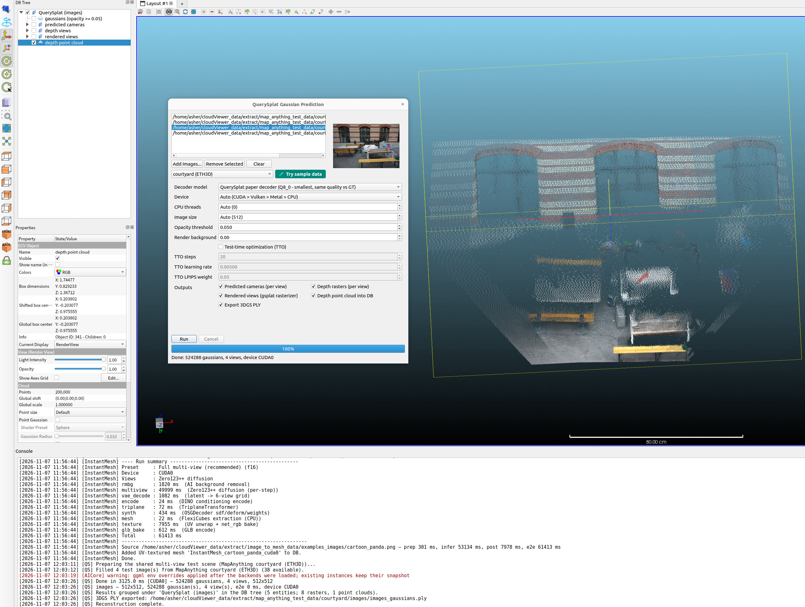

# qQuerySplat — Multi-View Image-to-3DGS Prediction

<p align="center">
  
</p>

*Feed-forward 3D Gaussian Splatting from a small set of unposed images: the
VGGT-Omega encoder exports cached-layer tokens, the QuerySplat decoder turns
them into 524 288 gaussians, and the built-in gsplat-semantics CPU
rasterizer renders the predicted views.*

Predicts a full 3D Gaussian Splatting scene from **2–16 unposed images**:
the in-tree VGGT-Omega encoder (shared with the MapAnything plugin — same
published GGUFs, one implementation) exports cached-layer tokens, the
QuerySplat decoder graph turns them into 524 288 gaussians, and the
built-in gsplat-semantics CPU rasterizer renders the predicted input views.
Everything runs locally through `libAICore` — no Python at runtime.

## Requirements

- Built with `-DAICore_ENABLED=ON -DPLUGIN_STANDARD_QQUERYSPLAT=ON`
- Decoder GGUFs from
  [Hugging Face Asher-1/querysplat_vggto](https://huggingface.co/Asher-1/querysplat_vggto)
  (`querysplat-paper-q8_0.gguf` recommended, 1.31 GB; f16 / f32 parity
  reference; `lpips-vgg-f32.gguf` 59 MB for TTO only)
- The VGGT-Omega encoder resolves from the **shared MapAnything model
  cache**; test images are shared with qMapAnything (the
  `map_anything_vggt_test_data` scene bundles are fetched once through
  `ecvTestDataRepository` and consumed by both plugins)

## Workflow

1. **Plugins → QuerySplat Gaussian Prediction** and add 2–16 images of one
   scene (**Use Test Data** auto-fills the first frames of any shared
   multi-view scene bundle — courtyard's first four frames are
   byte-identical to the upstream QuerySplat eval inputs).
2. Pick a decoder quantization tier (q8_0 is the recommended default).
3. Optionally enable **TTO** (test-time optimization, 20 steps is the
   official default) — it fine-tunes the decoder KV memory against the
   input pixels (L1 + SSIM + LPIPS, AdamW). The decoder KV-memory backward
   runs on CPU today and is sized by the checkpoint's 8192 gaussian tokens
   (resolution-independent); per-step L1/SSIM/LPIPS are logged and
   reported.
4. **Run**.

## Outputs

- Gaussian centers + colors imported as a **point cloud**, the predicted
  cameras as **camera sensors**, the depth rasters and the gsplat renders
  as **images** in the DB tree.
- The standard **3DGS PLY** export and a JSON run summary.

## Headless batch

```bash
ACloudViewer -SILENT -QUERY_SPLAT \
    IMAGE img1.png IMAGE img2.png IMAGE img3.png IMAGE img4.png \
    OUT_DIR ./out HELP
```

The batch default is one scene per IMAGE; `MULTIVIEW 1` switches to the
upstream `--images` semantics (all images form ONE multi-view scene).
`EXPORT_CAMERAS 1` (default) writes predicted cameras as JSON **and** NPZ;
`EXPORT_INPUT_DEPTHS 1` adds raw depth + confidence NPZ; `TTO 1` with
`TTO_SAVE_STEPS 0,5,10` + `TTO_SNAPSHOT_DIR <dir>` saves gaussian PLYs at
those steps.

Full details (models table, accuracy profile, batch schema):
[qQuerySplat plugin README](https://github.com/Asher-1/ACloudViewer/blob/main/plugins/core/Standard/qQuerySplat/README.md).
