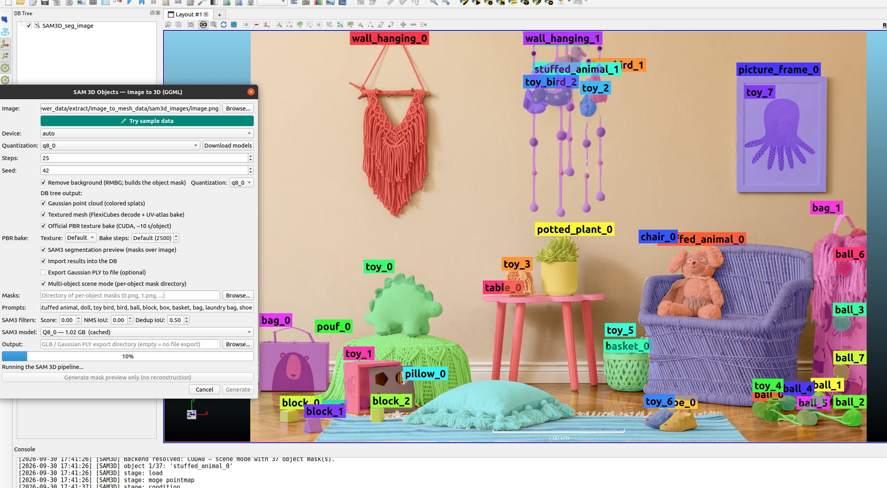

# qSAM3D — SAM 3D Objects Image to 3D

  

*Single-image 3D generation with SAM 3D Objects: the pipeline produces a
Gaussian splat PLY and an optional FlexiCubes mesh from one input image. The
example shows a prompted segmentation result with the 3D reconstruction
overlaid.*

Single-image 3D generation with **SAM 3D Objects** running on the in-tree
ggml runtime (`libAICore`, task `sam3d`, ported from the sam-3d-objects-ggml
C++ runtime). The textured-PBR GLB stage of the upstream runtime (CUDA-only
renderer plus non-commercial / GPL license opt-ins) is intentionally not
enabled by default.

## Requirements

- Built with `-DAICore_ENABLED=ON -DPLUGIN_STANDARD_QSAM3D=ON`
- Published GGUF weights of
  [Asher-1/SAM_3D_OBJECTS_GGUF](https://huggingface.co/Asher-1/SAM_3D_OBJECTS_GGUF)
  in the shared model cache (`~/cloudViewer_data/extract/sam3d_models`).
  The one-click AICore validation gate downloads and verifies them; the
  light-tier minimum set is `moge_vitl-f16.gguf` plus the five `q4_k`
  stage files (ss_generator / ss_decoder / slat_generator /
  slat_decoder_gs / slat_decoder_mesh)
- Optional: the shared **RMBG** model (`rmbg_q8.gguf` / `rmbg_f16.gguf`,
  downloadable via qRMBG) for automatic object-mask matting — without it
  the source image is used as-is, or provide an image whose alpha channel
  is the binary mask

## Workflow

1. **Plugins → SAM 3D Objects Image to 3D**.
2. Pick the source image and the output directory for the Gaussian PLY.
3. Choose device / quantization / steps / seed — defaults follow the
   official trajectory gate (`q4_k`, 25 steps, seed 42).
4. **Run** — stage progress and the AICore log appear in the dialog; the
   mesh is added to the DB tree and the PLY path is printed when the
   pipeline ends.

First runs load ~2–6 GB of weights from the model cache; an RTX 3060-class
GPU completes a full 25-step run in roughly 2.5–5 minutes depending on
quantization.

## Outputs

- A **Gaussian splat PLY** — the neural output of the full pipeline.
- An optional **FlexiCubes mesh** (101-channel sparse mesh decoder +
  FlexiCubes surface extraction), added to the DB tree as a mesh entity.

## Notes

- Mask semantics follow the official pipeline: binary alpha (`> 0`
  foreground). RMBG matting, image alpha channels and mask images all fold
  into the same contract.
- All model metadata (URLs, sizes, SHA-256) is owned by the AICore runtime
  catalog and verified by the validation gate — the plugin carries no
  second model table.
- Weights inherit the upstream SAM 3D Objects license.

Full details:
[qSAM3D plugin README](https://github.com/Asher-1/ACloudViewer/blob/main/plugins/core/Standard/qSAM3D/README.md).
