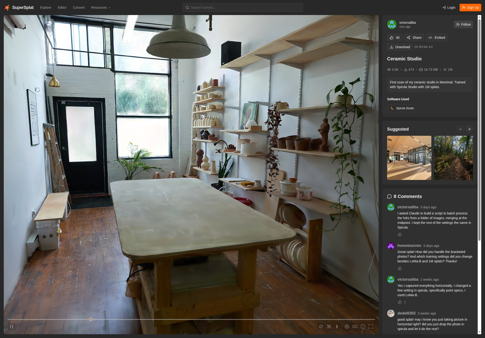
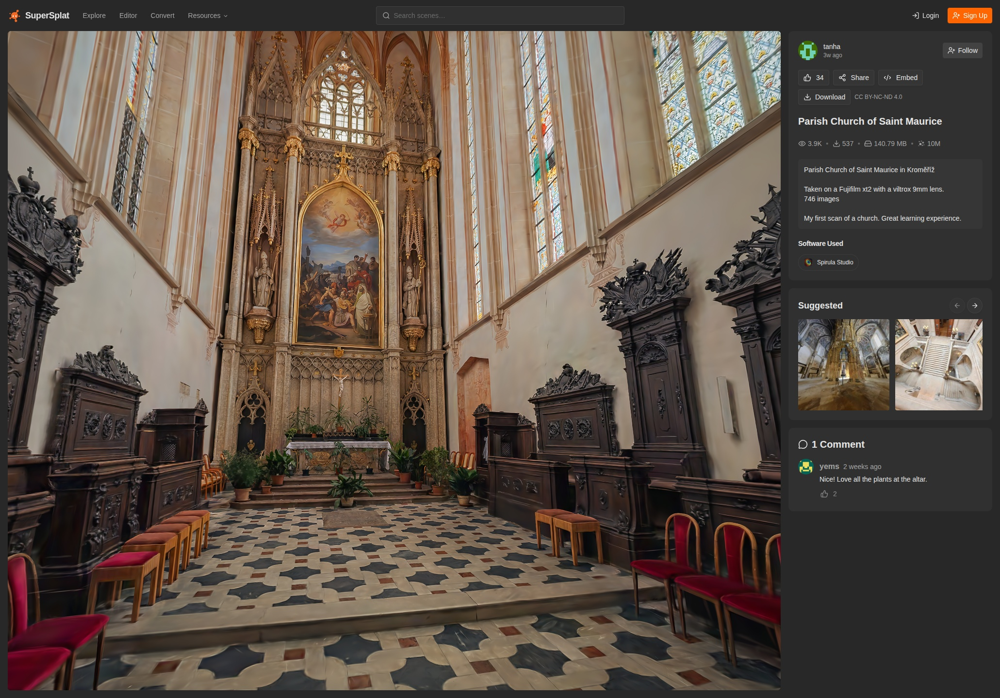
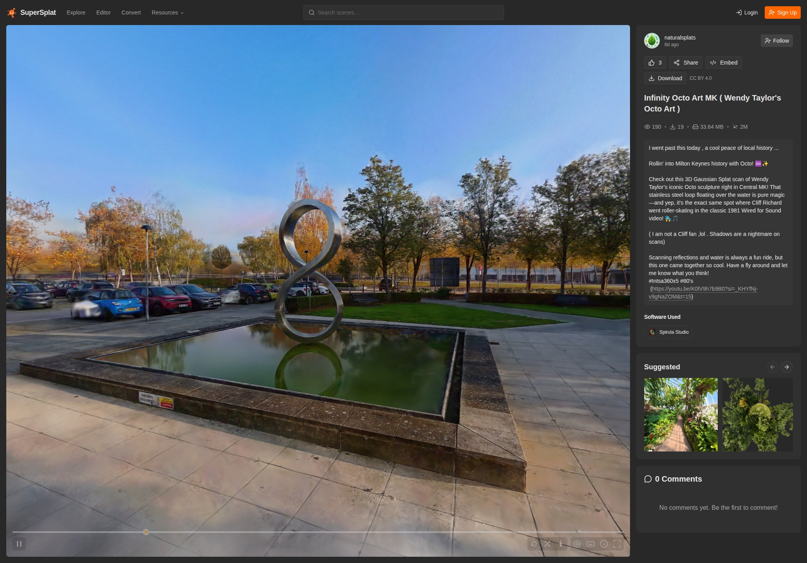
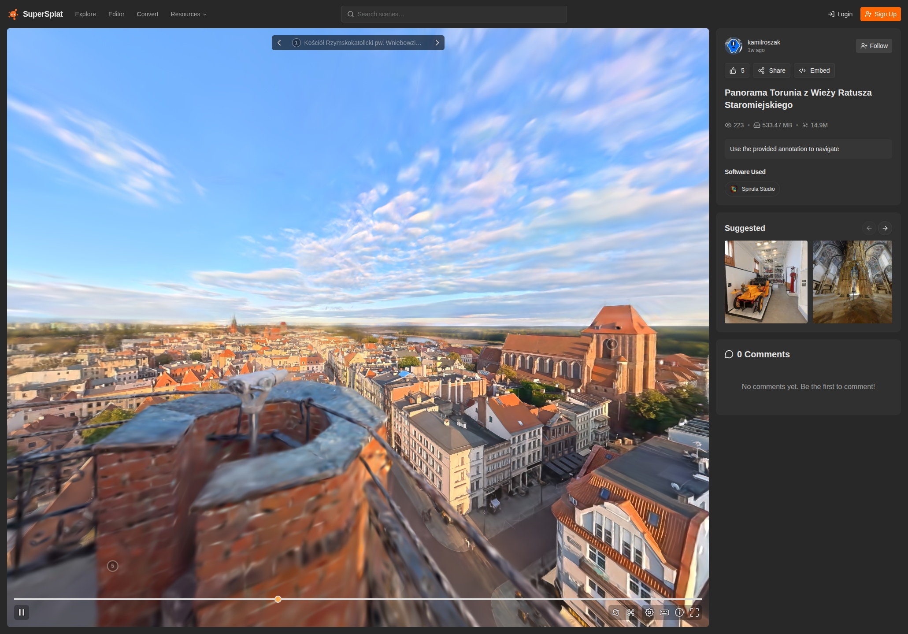

# qSpirula — Spirula Studio 3DGS Training & Reconstruction

<p align="center">
  
  
</p>
<p align="center">
  
  
</p>

*Reconstruction examples from the
[SuperSplat Spirula Studio Gallery](https://superspl.at/explore/software/spirula-studio):
**Ceramic Studio** (~50 photos, 1M splats), **Parish Church of Saint
Maurice** (746 photos, 9.97M splats), **Infinity Octo Art MK** (1.99M
splats), and **Panorama Torunia** (533 MB ultra-large scene, 14.9M splats —
Spirula Studio natively supports 360° cameras and equirectangular images).*

Process-boundary integration of
[Spirula Studio](https://github.com/harry7557558/spirula-studio), the
upstream 3D Gaussian Splatting trainer (photos / video → splat → textured
mesh, GPLv3). Unlike the AICore plugins, qSpirula launches the official
upstream binary — training, editing, rendering, meshing and device
selection all run in the official UI, so upstream UI evolution arrives with
the next tag.

## What the plugin does

- **Launch Spirula Studio** — starts the official upstream GUI binary
  (detached).
- **Import Result to DB Tree…** — reads a trained output and adds it to the
  ACloudViewer DB tree:
  - `splat.ply` (or a run directory / `step-*.ckpt`, resolved through
    their `splat.ply` like upstream `--resume`) → colored `ccPointCloud`
    with `Opacity`/`Scale` scalar fields (SH0 → RGB, low-opacity gaussians
    pruned);
  - `mesh.ply` → regular PLY load (`ccMesh`).
- **Run Headless Training…** — drives `spirula train <dataset>` headlessly:
  dataset folder, run name, device selector, optional verbatim extra args,
  live stdout log, graceful cancel (SIGTERM → upstream checkpoints on
  exit), and a one-click import hand-off of the finished run directory.

Over a **running GUI session** the same operations are exposed as JSON-RPC
methods (`spirula.version/devices/launch/cli/import`) — see
`agent-integration/docs/COMMAND-MAPPING.md`.

## Build

```bash
-DBUILD_SPIRULA=ON            # builds the standalone spirula executable
-DPLUGIN_STANDARD_QSPIRULA=ON # installs the plugin (requires ext_spirula)
```

`3rdparty/spirula/spirula.cmake` builds the executable via ExternalProject
with CMake args mirroring the upstream release CI verbatim
(`-DSS_BACKEND=vulkan -DSS_ENABLE_PATENTED=ON`). Release packages carry the
executable **next to the main application** — `bin/ACloudViewer/spirula` on
Linux/Windows, inside the `.app` bundle's `Contents/MacOS/` on macOS. A
local-only CUDA variant exists via `-DSPIRULA_BACKEND=cuda`.

## Notes

- Pretrained weights: core 3DGS training needs none (initialization comes
  from SfM). The optional masking/geometry models are downloaded on first
  use by the upstream GUI/CLI and cached locally; nothing is bundled.
- The first build is large (the full trainer + SfM + SAM/nn stack); slangc,
  GLFW, Dear ImGui and (on macOS) MoltenVK are fetched once by the upstream
  CMake modules.
- The upstream source tree is fetched and built unmodified — no patches.
  The `spirula` binary is a separate GPLv3 program aggregated with
  ACloudViewer; the executable carries its own license (see
  `LICENSE.spirula`).

Full details (upstream sync procedure, Ubuntu 20.04 slang note, roadmap):
[qSpirula plugin README](https://github.com/Asher-1/ACloudViewer/blob/main/plugins/core/Standard/qSpirula/README.md).
