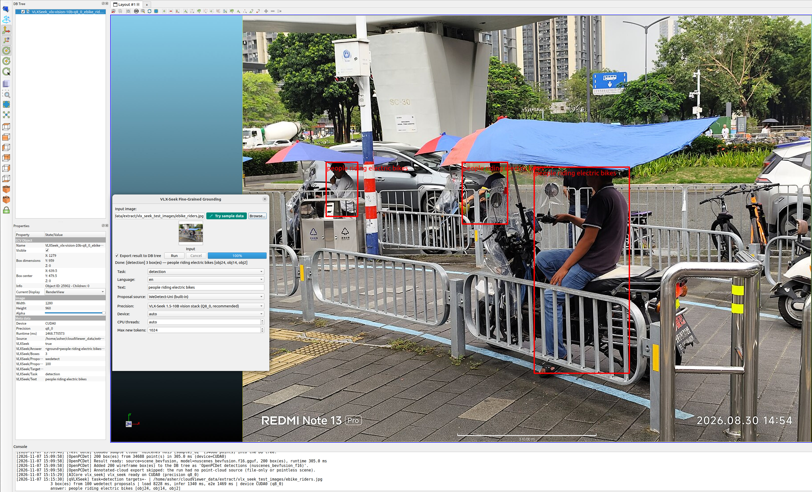
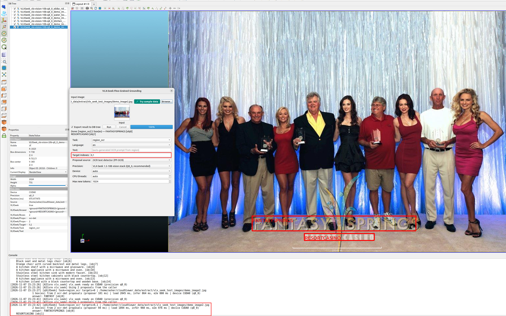

# qVLXSeek — VLX-Seek Fine-Grained Grounding

  
  

*Left: detection — "people riding electric bikes" enumerates every matching
instance (3 riders detected). Right: region OCR — the model reads text at a
target index using PP-OCR text-line proposals.*

Open-vocabulary, region-retrieval grounding on images, powered by
**VLX-Seek 1.5-10B** running through AICore's native GGML task
(`vlx_seek`): WeDetect-Uni proposals (f32) produce 100 candidate boxes, the
Qwen3.5-VL tower + C-RADIOv4/SimpleFPN + HFRE produce region tokens, and the
Qwen3.5-10B LLM answers with `<ground>label</ground><objects>…</objects>`
resolved from the proposal set. Because the model retrieves candidate
regions instead of generating coordinates, multi-object answers stay short,
stable and fast to decode, and absent targets are rejected with an explicit
answer instead of a hallucinated box.

## The seven upstream tasks

| Task | Prompt example | Behavior |
|---|---|---|
| `detection` | "people riding electric bikes" | Enumerates every matching instance |
| `grounding_single` | "the person in a white shirt" | Retrieves the single best region for the described target |
| `counting` | "water bottles" | Counts all visible instances of the prompted object |
| `reasoning_detection` | "the woman wearing red clothes" | Composes object detection with attribute reasoning |
| `brief_region_caption` | target index 1 | Short caption for a detector-proposal region |
| `region_ocr` | target index 0 (PP-OCR proposals) | Reads text at the target index; answer annotated on the text bbox |
| `vqa` | "What are the people doing in this image?" | Free-form question answering |

`en`/`zh` prompt templates are available for every task.

## Workflow

1. **Plugins → VLX-Seek grounding** and add the input image (or
   **Try sample data** — fills the multi-object street scene with the
   validated showcase prompt).
2. Pick a task and precision from the published catalog; choose the
   proposal source (built-in WeDetect-Uni, an external boxes JSON file in
   the upstream `--bbox-list` format, or the OCR text detector for
   `region_ocr`).
3. For `brief_region_caption` / `region_ocr`, set the zero-based
   **Target indexes** (e.g. `2, 3`) — the runtime rejects both tasks
   without targets.
4. **Run** — the annotated image exports to the DB tree (the entry is
   selected after every export).

## Outputs

- Annotated image in the DB tree (`Export result to DB tree` checkbox,
  default checked) with boxes resolved from the proposal set.
- Headless: `-VLXSEEK_RUN OUT_DIR <dir> IMAGE  TASK detection TEXT
  "person" LANG en PRECISION q8_0 DEVICE auto` writes
  `<stem>_vlxseek.json` plus `<stem>_vlxseek_vis.png` per image and the
  shared `RESULT_JSON` manifest (`HELP:1` prints the option schema).

## Notes

- Sampling matches the upstream CLI defaults (temperature 0 / top-p 1,
  greedy) — the runtime exposes greedy decoding only.
- On ornate/stylized text a single-region query may under-read; query
  several regions in one request when the full text matters (verified
  behavior documented in the plugin README).
- `region_ocr` with the OCR proposal source runs the PP-OCRv4 text detector
  (`ppocr-det-ch` + `ppocr-rec-ch`, q8_0 tier) through the public AICore
  OCR catalog; target indexes address actual text lines.

Full details (pipeline, region-OCR proposal semantics, batch options):
[qVLXSeek plugin README](https://github.com/Asher-1/ACloudViewer/blob/main/plugins/core/Standard/qVLXSeek/README.md).
