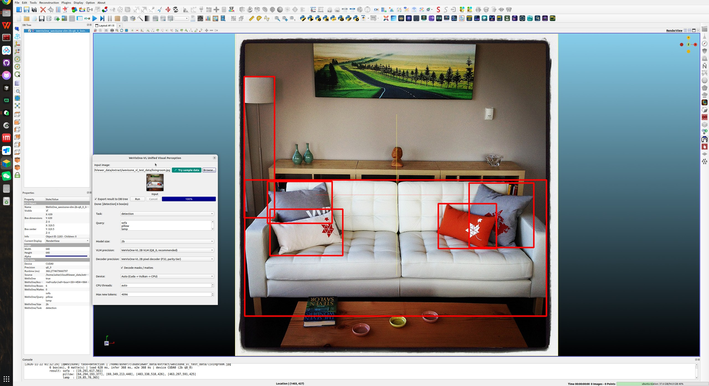
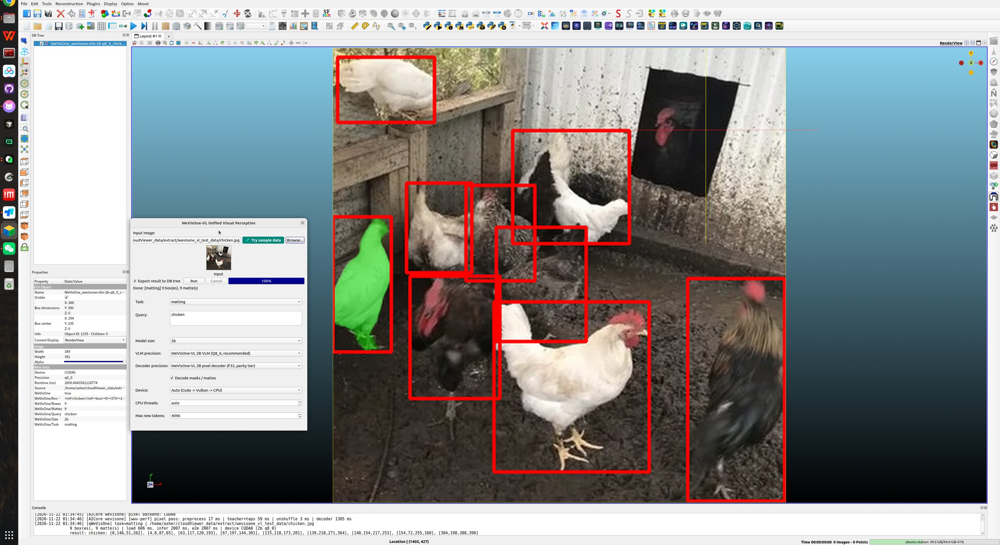

# qWeVisOne — WeVisOne-VL Unified Visual Perception

  
  

*Left: detection — the dialog filled by **Try sample data** runs the
newline-separated category list "sofa / pillow / lamp" and exports every
matching instance to the DB tree. Right: matting — "chicken" produces
per-object boxes plus pixel-decoder alpha mattes (the first matte is
composited in green). Both are full GUI captures: dialog, DB tree, 3D
view and console summary.*

Eleven perception tasks on images through one model, powered by
**WeVisOne-VL** (2B / 4B, Qwen3-VL based) running through AICore's native
GGML task (`wevisone`): the mmproj ViT encodes the image, the LLM answers
with `<box><x1><y1><x2><y2>label<OBJ></box>` structured tokens, boxes /
points / counts are parsed from normalized coordinate tokens, and every
`<OBJ>` marker can drive the 9.6M-parameter pixel decoder into an alpha
matte. Absent targets are rejected with an explicit `None` answer instead
of a hallucinated box.

## The eleven upstream tasks

| Task | Prompt example | Behavior |
|---|---|---|
| `detection` | "sofa\npillow\nlamp" | Enumerates every instance of each newline-separated category |
| `referring` | "the dog closest to the camera" | Grounds the single described target |
| `point` | "umbrella" | Points at the target instances |
| `count_box` | "people" | Counts instances with boxes |
| `count_point` | "white chess pieces" | Counts instances with points |
| `ocr` | (fixed prompt, query unused) | Reads all text in box format |
| `ocr_grounding` | "COFFEE" | Grounds the queried text |
| `segmentation` | "parasol with alternating rings…" | Boxes + per-object alpha mattes |
| `matting` | "person" | Boxes + per-object alpha mattes |
| `visual_prompt` | reference boxes (query unused) | Grounds objects similar to the referenced regions |
| `freeform` | "describe the image with bounding boxes in detail" | Query passed through verbatim |

## Workflow

1. **Plugins → WeVisOne-VL perception** and add the input image (or
   **Try sample data** — fills the task-optimal demo image plus the
   manifest-verbatim query, and the reference box for `visual_prompt`).
2. Pick the checkpoint family (2b/4b), precision (f16/q8_0/q4_K_M) and
   decoder tier (f32 default, f16 optional) from the published catalog;
   uncheck **Decode masks / mattes** for a pure object-level detector.
3. For `visual_prompt`, set the reference boxes in image pixels
   (`x1,y1,x2,y2[;x1,y1,x2,y2...]`, upstream `--ref-boxes` format).
4. **Run** — the annotated image exports to the DB tree (the entry is
   selected after every export).

## Outputs

- Annotated image in the DB tree (`Export result to DB tree` checkbox,
  default checked); segmentation/matting results carry the first alpha
  matte (upstream contract).
- Headless: `-WEVISONE_RUN OUT_DIR <dir> IMAGE  TASK detection QUERY
  "sofa\npillow\nlamp" SIZE 2b PRECISION q8_0 DEVICE auto` writes
  `<stem>_wevisone.json`, `<stem>_wevisone_vis.png` and — when the decoder
  ran — the raw row-major f32 `<stem>_wevisone_matte.bin`, plus the shared
  `RESULT_JSON` manifest (`HELP:1` prints the option schema).

## Notes

- Sampling matches the upstream CLI defaults (greedy decoding) — the
  runtime exposes greedy decoding only.
- All 12 published GGUFs (2B/4B × f16/q8_0/q4_K_M VLMs, f16 mmprojs,
  f32/f16 decoders) resolve through the AICore task catalog from the
  pinned revision of
  [Asher-1/WeVisOne-VL-GGML](https://huggingface.co/Asher-1/WeVisOne-VL-GGML);
  the shared model cache verifies every SHA-256 before use.
- CUDA and Vulkan parity against the pristine upstream `wevisone-cli`
  (same gguf bytes, greedy answer identity, box/matte numeric gates) is
  owned by the `wevisone` rows of the common validation manifest.

Full details (pipeline, batch options, model table):
[qWeVisOne plugin README](https://github.com/Asher-1/ACloudViewer/blob/main/plugins/core/Standard/qWeVisOne/README.md).