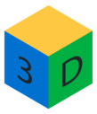

.. ACloudViewer documentation master file

-----------

ACloudViewer: A Modern Library for 3D Point Cloud Processing
=============================================================

**ACloudViewer** is a powerful open-source library for 3D point cloud and mesh processing, built on top of CloudCompare, Open3D, ParaView, and COLMAP.

.. note::
   **Latest Release:** |version| | `Download <https://github.com/Asher-1/ACloudViewer/releases>`_ | `GitHub <https://github.com/Asher-1/ACloudViewer>`_

.. raw:: html

   

       

           📚 <strong>Documentation Version:</strong>
       

       <select id="docs-version-select-main" 
               style="width: 100%; max-width: 300px; padding: 8px; border: 1px solid #ddd; border-radius: 4px; font-size: 14px; background: white; cursor: pointer;"
               onchange="if(window.ACloudViewerVersionSwitcher) { window.ACloudViewerVersionSwitcher.switchVersion(this.value); }">
           <option value="stable">Latest Stable</option>
           <option value="dev">Development (main)</option>
       </select>
       

           Switch between stable release and development documentation. Use the version selector in the sidebar for quick access.
       

   

   

AICore AI Plugins
-----------------

Twenty-two GUI plugins share one native inference library — **libAICore.so**, whose ggml runtime is vendored from `llama.cpp <https://github.com/ggml-org/llama.cpp>`_.
Run quantized **GGUF** models on **CUDA / Vulkan / Metal / CPU** with **no Python or PyTorch** at runtime.
Results land directly in the DB tree and plug into reconstruction, COLMAP, and SIBR workflows.

.. list-table:: Perception — depth, lines, matching, faces, text
   :header-rows: 1
   :widths: 14 28 26 22 10

   * - Plugin
     - Task
     - Model
     - Standout
     - CMake
   * - **qDA3**
     - Monocular & multi-view depth, camera pose
     - Depth Anything V3 GGUF
     - Single-image depth cloud in one click; automatic-reconstruction integration
     - ``PLUGIN_STANDARD_QDA3``
   * - **qDeepLSD**
     - Line-segment / wireframe extraction
     - DeepLSD wireframe GGUF
     - AFM + LSD lines on photos
     - ``PLUGIN_STANDARD_QDEEPLSD``
   * - **qLightGlue**
     - Sparse feature matching
     - SIFT/ALIKED LightGlue GGUF
     - 300+ matches in **< 1 s** on GPU
     - ``PLUGIN_STANDARD_QLIGHTGLUE``
   * - **qFaceDetect**
     - Face detect / analyze / verify
     - face-detect.cpp GGUF packs
     - SCRFD + ArcFace in one dialog; live multi-face video
     - ``PLUGIN_STANDARD_QFACEDETECT``
   * - **qOCR**
     - Text / layout / table recognition
     - PP-OCRv4 GGUF (EN / JA / CH+EN recipes)
     - SLANet layout + table grids overlaid PP-Structure style
     - ``PLUGIN_STANDARD_QOCR``

.. list-table:: Detection, segmentation & open-vocabulary understanding
   :header-rows: 1
   :widths: 14 28 26 22 10

   * - Plugin
     - Task
     - Model
     - Standout
     - CMake
   * - **qYOLO**
     - Detect / seg / depth / pose / OBB / classify + open-vocab
     - YOLOv8 / YOLO26 GGUF (63 models)
     - 9 task families incl. World / YOLOE prompts
     - ``PLUGIN_STANDARD_QYOLO``
   * - **qSAM3**
     - Promptable segmentation + video tracking
     - SAM2 / 2.1 / 3 GGUF (39 models)
     - Text / box / point prompts, video tracking
     - ``PLUGIN_STANDARD_QSAM3``
   * - **qRFDetr**
     - Detection & instance masks
     - RF-DETR GGUF (44 models)
     - 13 ms GPU latency + class allowlist
     - ``PLUGIN_STANDARD_QRFDETR``
   * - **qRMBG**
     - Background removal
     - RMBG-2.0 (BiRefNet-Swin-L) GGUF
     - Transparent RGBA + raw alpha matte
     - ``PLUGIN_STANDARD_QRMBG``
   * - **qRAM**
     - Image tagging & captioning
     - RAM / RAM++ / Tag2Text GGUF
     - All logits + thresholds, JSON/CSV/text export
     - ``PLUGIN_STANDARD_QRAM``
   * - **qRelateAnything**
     - Scene relation graphs
     - RelSGG ViT / ConvNeXt GGUF (24 models)
     - Subject–predicate–object edges over tracked objects (image & video)
     - ``PLUGIN_STANDARD_QRELATEANYTHING``
   * - **qGKD**
     - Open-world keypoint detection
     - GKDT-L GGUF (ECCV 2026)
     - Text / visual 1-shot / multimodal / multi-object prompts
     - ``PLUGIN_STANDARD_QGKD``
   * - **qVLXSeek**
     - Open-vocab grounding & region QA
     - VLX-Seek 1.5-10B GGUF
     - Detection, counting, VQA, region OCR via region retrieval
     - ``PLUGIN_STANDARD_QVLXSEEK``

.. list-table:: 3D generation & reconstruction
   :header-rows: 1
   :widths: 14 28 26 22 10

   * - Plugin
     - Task
     - Model
     - Standout
     - CMake
   * - **qFreeSplatter**
     - Uncalibrated photos → 3D Gaussian splats
     - FreeSplatter GGUF
     - **2 photos** → 3D scene + SIBR PLY; guided Face Capture
     - ``PLUGIN_STANDARD_QFREESPLATTER``
   * - **qTrellis**
     - Single image → 3D mesh with PBR
     - TRELLIS.2 GGUF (DINOv3 + flow DiTs)
     - PBR-textured GLB in one click
     - ``PLUGIN_STANDARD_QTRELLIS``
   * - **qInstantMesh**
     - Single image → textured 3D mesh
     - InstantMesh GGUF (14 files)
     - Zero123++ 6-view diffusion → FlexiCubes mesh + UV atlas
     - ``PLUGIN_STANDARD_QINSTANTMESH``
   * - **qSAM3D**
     - Single image → 3D object
     - SAM 3D Objects GGUF
     - Gaussian splat PLY + FlexiCubes mesh
     - ``PLUGIN_STANDARD_QSAM3D``
   * - **qQuerySplat**
     - 2–16 unposed photos → 3DGS scene
     - QuerySplat + VGGT-Omega GGUF
     - 524 288 gaussians feed-forward, optional TTO
     - ``PLUGIN_STANDARD_QQUERYSPLAT``
   * - **qMapAnything**
     - Multi-view metric reconstruction
     - VGGT-Omega / MapAnything / Pi3 / VGGT-1B / DUSt3R GGUF
     - 6 model variants, ETH3D benchmark anchoring
     - ``PLUGIN_STANDARD_QMAPANYTHING``
   * - **qLingbotMap**
     - Streaming RGB-D reconstruction
     - LingBot-Map GCT GGUF
     - Live per-frame map + camera frustums, native sky masking
     - ``PLUGIN_STANDARD_QLINGBOTMAP``
   * - **qOpenPCDet**
     - LiDAR 3D object detection
     - OpenPCDet GGUF (54 models)
     - PointPillars / SECOND / PV-RCNN on KITTI + nuScenes
     - ``PLUGIN_STANDARD_QOPENPCDET``

.. list-table:: Annotation workbench
   :header-rows: 1
   :widths: 14 28 26 22 10

   * - Plugin
     - Task
     - Model
     - Standout
     - CMake
   * - **qAnyLabeling**
     - AI-assisted image & 3D annotation
     - AICore catalogs (YOLO, SAM3, RF-DETR, …)
     - X-AnyLabeling-style workbench, video tracking + 3D cuboids, fully local
     - ``PLUGIN_STANDARD_QANYLABELING``

.. raw:: html

   

     <figure style="margin:0; text-align:center;">
       
       <figcaption style="margin-top:10px; font-size:.9em; color:#475569;"><strong>qDA3</strong> — depth maps &amp; 3D unprojection from a single photo (Depth Anything V3)</figcaption>
     </figure>
     <figure style="margin:0; text-align:center;">
       
       <figcaption style="margin-top:10px; font-size:.9em; color:#475569;"><strong>qDeepLSD</strong> — AFM + LSD line-segment extraction on photos</figcaption>
     </figure>
     <figure style="margin:0; text-align:center;">
       
       <figcaption style="margin-top:10px; font-size:.9em; color:#475569;"><strong>qLightGlue</strong> — SIFT / ALIKED matching with live visualization</figcaption>
     </figure>
     <figure style="margin:0; text-align:center;">
       

         
         
       

       <figcaption style="margin-top:10px; font-size:.9em; color:#475569;"><strong>qFaceDetect</strong> — identity registry, verification, and live multi-face recognition in one plugin</figcaption>
     </figure>
     <figure style="margin:0; text-align:center;">
       

         
         
       

       <figcaption style="margin-top:10px; font-size:.9em; color:#475569;"><strong>qFreeSplatter</strong> — sparse-view 3D Gaussian reconstruction and guided multi-view Face Capture, with optional qSIBR preview</figcaption>
     </figure>
     <figure style="margin:0; text-align:center;">
       

         
         
       

       <figcaption style="margin-top:10px; font-size:.9em; color:#475569;"><strong>qOCR</strong> — PP-OCRv4 text recognition with SLANet layout &amp; table reconstruction</figcaption>
     </figure>
     <figure style="margin:0; text-align:center;">
       

         
         
       

       <figcaption style="margin-top:10px; font-size:.9em; color:#475569;"><strong>qGKD</strong> — open-world keypoint detection: text, visual 1-shot, multimodal and multi-object prompts (GKDT-L)</figcaption>
     </figure>
     <figure style="margin:0; text-align:center;">
       
       <figcaption style="margin-top:10px; font-size:.9em; color:#475569;"><strong>qRAM</strong> — Recognize Anything / RAM++ / Tag2Text image tagging &amp; captioning</figcaption>
     </figure>
     <figure style="margin:0; text-align:center;">
       

         
         
       

       <figcaption style="margin-top:10px; font-size:.9em; color:#475569;"><strong>qVLXSeek</strong> — open-vocabulary grounding: detection, counting, VQA, region OCR (VLX-Seek 1.5-10B)</figcaption>
     </figure>
     <figure style="margin:0; text-align:center;">
       

         
         
       

       <figcaption style="margin-top:10px; font-size:.9em; color:#475569;"><strong>qYOLO</strong> — detection, segmentation, metric depth, pose, OBB, classification and open-vocab World / YOLOE prompts</figcaption>
     </figure>
     <figure style="margin:0; text-align:center;">
       

         
         
       

       <figcaption style="margin-top:10px; font-size:.9em; color:#475569;"><strong>qSAM3</strong> — point / box / text prompts and video object tracking (SAM 2 / 2.1 / 3)</figcaption>
     </figure>
     <figure style="margin:0; text-align:center;">
       

         
         
       

       <figcaption style="margin-top:10px; font-size:.9em; color:#475569;"><strong>qRFDetr</strong> — real-time RF-DETR detection &amp; instance masks with per-class allowlist</figcaption>
     </figure>
     <figure style="margin:0; text-align:center;">
       

         
         
       

       <figcaption style="margin-top:10px; font-size:.9em; color:#475569;"><strong>qRMBG</strong> — one-click transparent background removal (image &amp; live video)</figcaption>
     </figure>
     <figure style="margin:0; text-align:center;">
       

         
         
       

       <figcaption style="margin-top:10px; font-size:.9em; color:#475569;"><strong>qTrellis</strong> — single image → PBR-textured 3D mesh &amp; GLB (TRELLIS.2)</figcaption>
     </figure>
     <figure style="margin:0; text-align:center;">
       
       <figcaption style="margin-top:10px; font-size:.9em; color:#475569;"><strong>qInstantMesh</strong> — single image → textured 3D mesh (Zero123++ diffusion + FlexiCubes)</figcaption>
     </figure>
     <figure style="margin:0; text-align:center;">
       
       <figcaption style="margin-top:10px; font-size:.9em; color:#475569;"><strong>qSAM3D</strong> — SAM 3D Objects: one photo → Gaussian splat PLY + FlexiCubes mesh</figcaption>
     </figure>
     <figure style="margin:0; text-align:center;">
       
       <figcaption style="margin-top:10px; font-size:.9em; color:#475569;"><strong>qQuerySplat</strong> — 2–16 unposed photos → a 3D Gaussian Splatting scene (524 288 gaussians)</figcaption>
     </figure>
     <figure style="margin:0; text-align:center;">
       

         
         
       

       <figcaption style="margin-top:10px; font-size:.9em; color:#475569;"><strong>qMapAnything</strong> — multi-view feed-forward metric reconstruction (VGGT-Omega &amp; five more families)</figcaption>
     </figure>
     <figure style="margin:0; text-align:center;">
       

         
         
       

       <figcaption style="margin-top:10px; font-size:.9em; color:#475569;"><strong>qLingbotMap</strong> — streaming RGB-D 3D reconstruction from image folders / video</figcaption>
     </figure>
     <figure style="margin:0; text-align:center;">
       
       <figcaption style="margin-top:10px; font-size:.9em; color:#475569;"><strong>qOpenPCDet</strong> — LiDAR 3D detection: PointPillars / SECOND / PV-RCNN on KITTI + nuScenes</figcaption>
     </figure>
     <figure style="margin:0; text-align:center;">
       

         
         
       

       <figcaption style="margin-top:10px; font-size:.9em; color:#475569;"><strong>qRelateAnything</strong> — scene relation graphs: subject–predicate–object edges (image &amp; video)</figcaption>
     </figure>
     <figure style="margin:0; text-align:center;">
       
       <figcaption style="margin-top:10px; font-size:.9em; color:#475569;"><strong>qAnyLabeling</strong> — X-AnyLabeling-style annotation workbench with fully local AI assist</figcaption>
     </figure>
   

Why AICore?
~~~~~~~~~~~

* **Native C++ end-to-end** — GUI, automatic reconstruction, and COLMAP pipelines without a Python stack
* **Compact GGUF weights** — e.g. DA3 Base ~142 MB, LightGlue SIFT matcher ~22 MB; four matching families with one-click download in the dialog
* **Multi-backend GPU** — Auto picks CUDA → Vulkan → CPU (Linux/Windows) or Metal → CPU (macOS)
* **DB-tree integration** — depth clouds, match lines, Gaussian PLY, and camera frustums appear as first-class entities

.. code-block:: bash

   cmake -B build_app \
     -DBUILD_GUI=ON \
     -DAICore_ENABLED=ON \
     -DPLUGIN_STANDARD_QDA3=ON \
     -DPLUGIN_STANDARD_QDEEPLSD=ON \
     -DPLUGIN_STANDARD_QFACEDETECT=ON \
     -DPLUGIN_STANDARD_QLIGHTGLUE=ON \
     -DPLUGIN_STANDARD_QFREESPLATTER=ON \
     -DPLUGIN_STANDARD_QRFDETR=ON \
     -DPLUGIN_STANDARD_QRMBG=ON \
     -DPLUGIN_STANDARD_QYOLO=ON \
     -DPLUGIN_STANDARD_QSAM3=ON \
     -DPLUGIN_STANDARD_QSAM3D=ON \
     -DPLUGIN_STANDARD_QTRELLIS=ON \
     -DPLUGIN_STANDARD_QLINGBOTMAP=ON \
     -DPLUGIN_STANDARD_QGKD=ON \
     -DPLUGIN_STANDARD_QOCR=ON \
     -DPLUGIN_STANDARD_QRAM=ON \
     -DPLUGIN_STANDARD_QRELATEANYTHING=ON \
     -DPLUGIN_STANDARD_QANYLABELING=ON \
     -DPLUGIN_STANDARD_QMAPANYTHING=ON \
     -DPLUGIN_STANDARD_QOPENPCDET=ON \
     -DPLUGIN_STANDARD_QINSTANTMESH=ON \
     -DPLUGIN_STANDARD_QVLXSEEK=ON \
     -DPLUGIN_STANDARD_QQUERYSPLAT=ON \
     -DBUILD_RECONSTRUCTION=ON \
     -DPLUGIN_STANDARD_QSIBR=ON \
     .

   cmake --build build_app --target ACloudViewer -j$(nproc)

See :doc:`guides/plugins/README` for the complete overview and the
per-plugin user guides — one guide for each of the twenty-two AICore
plugins plus the qSpirula Spirula Studio integration — listed in the
toctree below.
Full build options: :doc:`getting_started/build_from_source`.

3D Gaussian Splatting — Rendering & Training
--------------------------------------------

**SIBR viewer** — real-time **3D Gaussian Splatting** rendering and novel
view synthesis as a built-in plugin: bidirectional entity hand-off with the
DB tree, remote-Gaussian training monitoring, and ULR / ULR v2 viewers
(``PLUGIN_STANDARD_QSIBR``; see the synced :doc:`plugins/qSIBR/README`).

.. raw:: html

   

     <figure style="margin:0; text-align:center;">
       
       <figcaption style="margin-top:10px; font-size:.9em; color:#475569;"><strong>SIBR viewer</strong> — real-time 3DGS rendering &amp; novel view synthesis</figcaption>
     </figure>
     <figure style="margin:0; text-align:center;">
       

         
         
       

       <figcaption style="margin-top:10px; font-size:.9em; color:#475569;"><strong>qSpirula</strong> — indoor (1M splats) and outdoor architectural (9.97M splats) reconstructions</figcaption>
     </figure>
     <figure style="margin:0; text-align:center;">
       

         
         
       

       <figcaption style="margin-top:10px; font-size:.9em; color:#475569;"><strong>qSpirula</strong> — object scan (1.99M splats) and 360° panorama (14.9M splats, native equirectangular support)</figcaption>
     </figure>
   

**qSpirula** bundles the upstream
`Spirula Studio <https://github.com/harry7557558/spirula-studio>`_ trainer
(photos / 360° video → splat → textured mesh, GPLv3) as a separate
``spirula`` executable: launch the official GUI, run headless training with
live logs and graceful cancel, and import results into the DB tree
(``splat.ply`` → colored ``ccPointCloud`` with ``Opacity``/``Scale``
scalar fields; ``mesh.ply`` → ``ccMesh``). Enable with
``-DBUILD_SPIRULA=ON -DPLUGIN_STANDARD_QSPIRULA=ON``.
See :doc:`guides/plugins/qSpirula` and the synced
:doc:`plugins/qSpirula/README` for details. Reconstruction examples are
from the `SuperSplat Spirula Studio Gallery
<https://superspl.at/explore/software/spirula-studio>`_.

.. toctree::
   :maxdepth: 1
   :caption: AI Plugins (AICore)

   guides/plugins/README
   guides/plugins/qDA3
   guides/plugins/qDeepLSD
   guides/plugins/qFaceDetect
   guides/plugins/qLightGlue
   guides/plugins/qFreeSplatter
   guides/plugins/qSAM3
   guides/plugins/qTrellis
   guides/plugins/qYOLO
   guides/plugins/qRFDetr
   guides/plugins/qRMBG
   guides/plugins/qGKD
   guides/plugins/qInstantMesh
   guides/plugins/qLingbotMap
   guides/plugins/qMapAnything
   guides/plugins/qOCR
   guides/plugins/qOpenPCDet
   guides/plugins/qQuerySplat
   guides/plugins/qRAM
   guides/plugins/qRelateAnything
   guides/plugins/qSAM3D
   guides/plugins/qVLXSeek
   guides/plugins/qAnyLabeling
   guides/plugins/qSpirula

.. toctree::
   :maxdepth: 1
   :caption: AI Plugin Deep Dives (synced plugin READMEs)

   plugins/qDA3/README
   plugins/qDeepLSD/README
   plugins/qFaceDetect/README
   plugins/qLightGlue/README
   plugins/qFreeSplatter/README
   plugins/qSAM3/README
   plugins/qTrellis/README
   plugins/qYOLO/README
   plugins/qRFDetr/README
   plugins/qRMBG/README
   plugins/qGKD/README
   plugins/qInstantMesh/README
   plugins/qLingbotMap/README
   plugins/qMapAnything/README
   plugins/qOCR/README
   plugins/qOpenPCDet/README
   plugins/qQuerySplat/README
   plugins/qRAM/README
   plugins/qRelateAnything/README
   plugins/qSAM3D/README
   plugins/qVLXSeek/README
   plugins/qAnyLabeling/README
   plugins/qSpirula/README
   plugins/qSIBR/README

.. toctree::
   :maxdepth: 1
   :caption: Getting Started

   getting_started/introduction
   getting_started/installation
   getting_started/quickstart
   getting_started/build_from_source
   getting_started/builddocs
   getting_started/cloudViewer_ml

.. toctree::
   :maxdepth: 2
   :caption: Tutorial

   tutorial/index
   tutorial/core/index
   tutorial/geometry/index
   tutorial/t_geometry/index
   tutorial/data/index
   tutorial/visualization/index
   tutorial/pipelines/index
   tutorial/t_pipelines/index
   tutorial/reconstruction_system/index
   tutorial/t_reconstruction_system/index
   tutorial/sensor/index
   tutorial/advanced/index
   tutorial/reference

.. toctree::
   :maxdepth: 1
   :caption: Python API

   python_api/cloudViewer.camera
   python_api/cloudViewer.core
   python_api/cloudViewer.data
   python_api/cloudViewer.geometry
   python_api/cloudViewer.io
   python_api/cloudViewer.t
   python_api/cloudViewer.ml
   python_api/cloudViewer.pipelines
   python_api/cloudViewer.reconstruction
   python_api/cloudViewer.utility
   python_api/cloudViewer.visualization

.. toctree::
   :maxdepth: 2
   :caption: Python Examples

   python_example/benchmark/index
   python_example/camera/index
   python_example/core/index
   python_example/geometry/index
   python_example/io/index
   python_example/pipelines/index
   python_example/reconstruction/index
   python_example/reconstruction_system/index
   python_example/t_reconstruction_system/index
   python_example/utility/index
   python_example/visualization/index

.. toctree::
   :maxdepth: 1
   :caption: C++ Examples

   examples/cpp_examples

.. toctree::
   :maxdepth: 1
   :caption: C++ API

   cpp_api
   cpp_api/overview
   cpp_api/quickstart
   cpp_api/plugins

.. toctree::
   :maxdepth: 1
   :caption: Developer Guide

   developer/contributing
   developer/docker
   developer/ci_cd

.. toctree::
   :maxdepth: 1
   :caption: Resources

   resources/changelog
   resources/faq
   resources/support

..
   Note: Python API and Examples sections will be auto-generated from docstrings
   when Python bindings include proper documentation.
