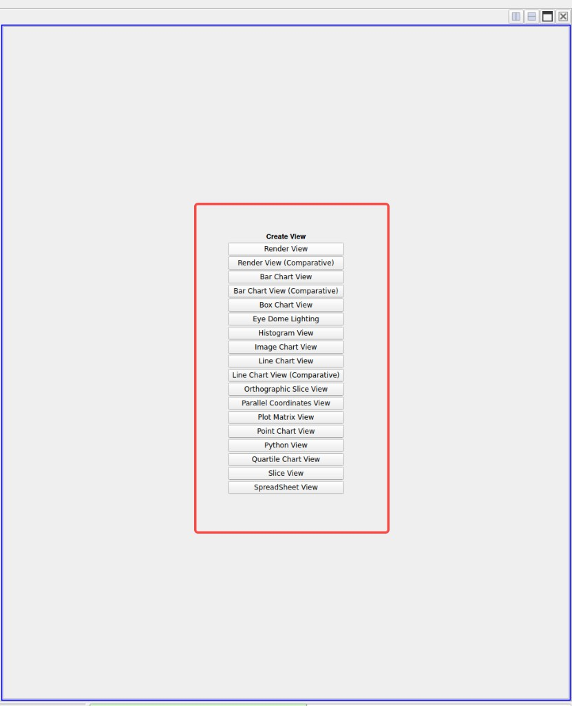
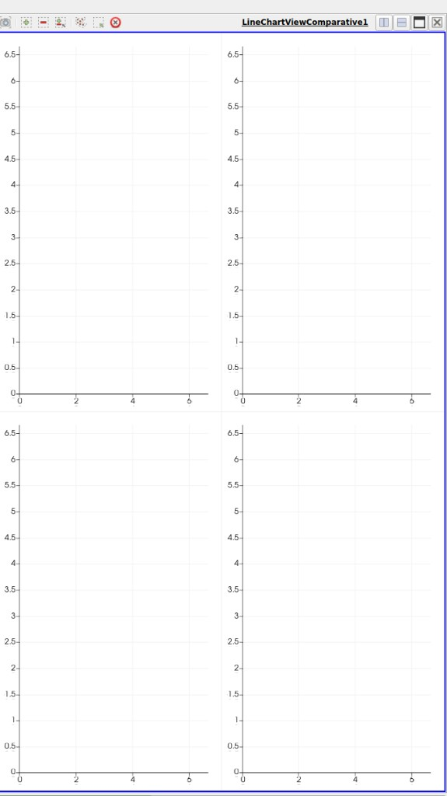
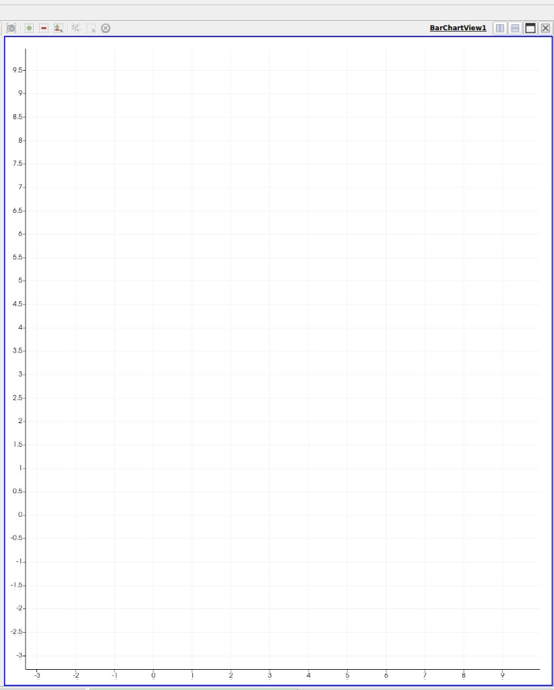
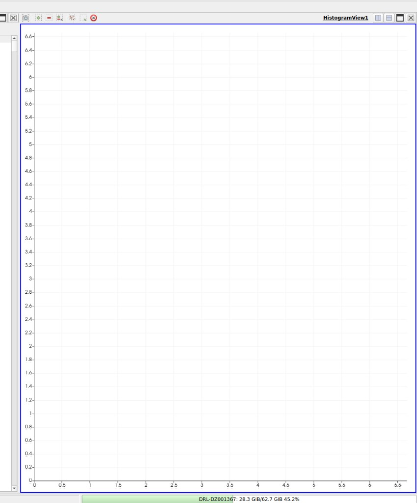
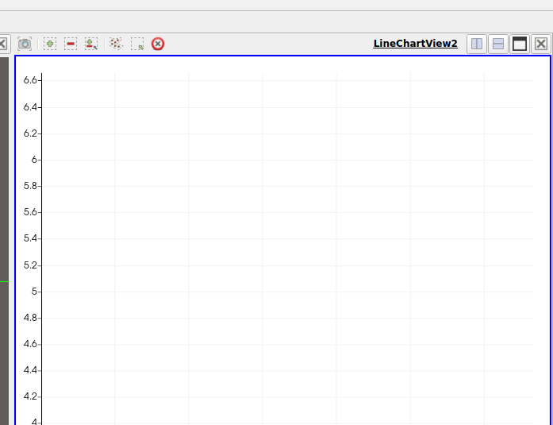
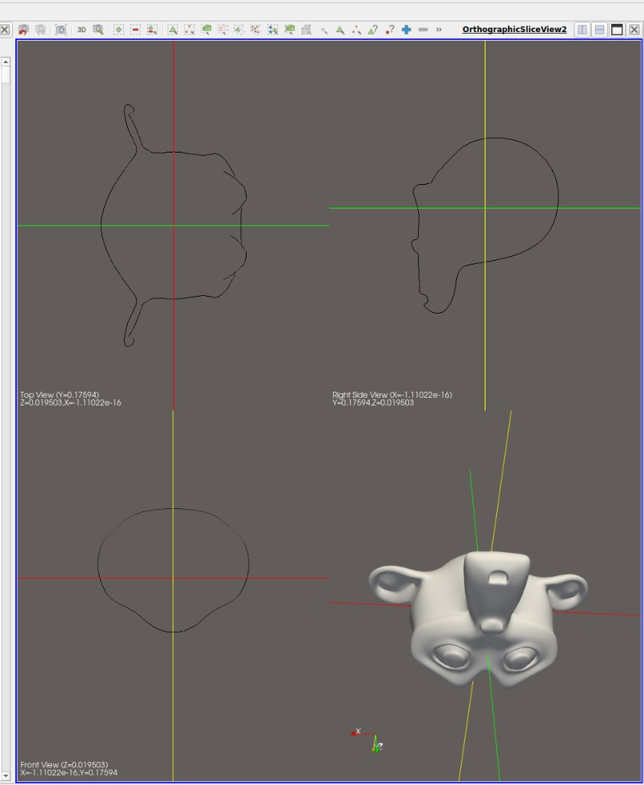
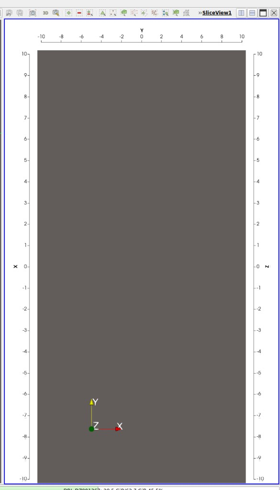
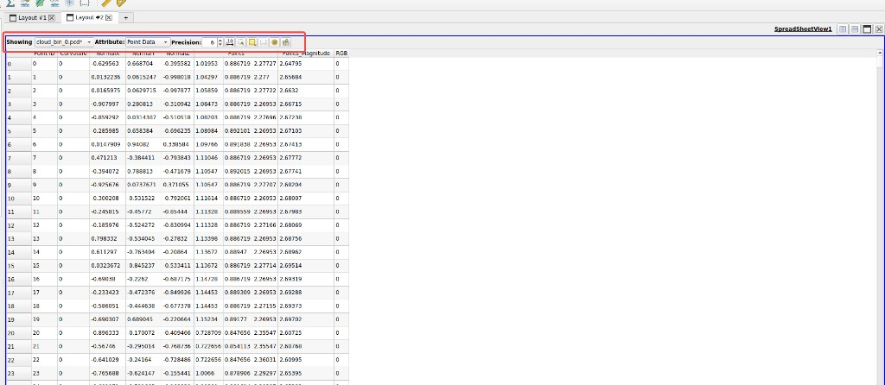

# ACloudViewer View Types — Illustrated Usage Guide

> This document provides detailed, illustrated usage instructions for all 18 view types
> available in ACloudViewer's **Create View** dialog, aligned with ParaView.
>
> **Capability update:** see [Adaptive view completion](#adaptive-view-completion-2026-11-25)
> for the current configurable comparative grid/Cues/overlays, nine Quartile
> roles, Python VTK callbacks and native Ortho inputs. Those additions supersede
> the original limits described in the corresponding baseline sections below.

---

## Table of Contents

1. [Render View](#1-render-view)
2. [Render View (Comparative)](#2-render-view-comparative)
3. [Bar Chart View](#3-bar-chart-view)
4. [Bar Chart View (Comparative)](#4-bar-chart-view-comparative)
5. [Box Chart View](#5-box-chart-view)
6. [Eye Dome Lighting](#6-eye-dome-lighting)
7. [Histogram View](#7-histogram-view)
8. [Image Chart View](#8-image-chart-view)
9. [Line Chart View](#9-line-chart-view)
10. [Line Chart View (Comparative)](#10-line-chart-view-comparative)
11. [Orthographic Slice View](#11-orthographic-slice-view)
12. [Parallel Coordinates View](#12-parallel-coordinates-view)
13. [Plot Matrix View](#13-plot-matrix-view)
14. [Point Chart View](#14-point-chart-view)
15. [Python View](#15-python-view)
16. [Quartile Chart View](#16-quartile-chart-view)
17. [Slice View](#17-slice-view)
18. [SpreadSheet View](#18-spreadsheet-view)

---

## How to Create a View

1. In the main window, locate the **layout area** (center panel)
2. Click the **split** button (horizontal ⬜|⬜ or vertical ⬜/⬜) on any existing view's title bar to create a new empty cell
3. An empty cell shows the **Create View** dialog with all 18 view type buttons:



4. Click any button to create that view type in the cell
5. The view will automatically populate if you have an entity selected in the DB tree

---

## 1. Render View

**ParaView equivalent:** `RenderView`
**ACloudViewer class:** `vtkGLView`

### What it does
The primary 3D visualization view. Renders point clouds, meshes, polylines, and all other 3D entities with interactive camera controls.

### How to use
1. Load any 3D data file (`.ply`, `.pcd`, `.obj`, `.stl`, `.bin`, etc.)
2. The data appears automatically in the active Render View
3. Use mouse to navigate:

| Mouse Action | Effect |
|-------------|--------|
| **Left drag** | Rotate (trackball) |
| **Middle drag** | Pan |
| **Right drag / Scroll** | Zoom in/out |
| **Shift + Left** | Pan |
| **Ctrl + Left** | Roll |

### Features
- Background gradient (configurable)
- Orientation marker (axes indicator)
- Scale bar
- Camera orientation widget
- Properties panel for per-entity display settings (color, opacity, point size)
- Selection tools (point picking, rectangle select, polygon select)

### Toolbar icons
| Icon | Function |
|------|----------|
| 🎯 | Reset camera to fit all |
| 🔍 | Zoom to selection |
| 📸 | Screenshot |
| 🎨 | Background color |
| 📐 | Toggle orientation axes |

---

## 2. Render View (Comparative)

**ParaView equivalent:** `ComparativeRenderView`
**ACloudViewer class:** `vtkComparativeViewWidget::RENDER`

> The current native controls/semantics supersede the historical summary below;
> see [Current native behavior](#current-native-behavior).

### What it does
Displays the same 3D scene in an N×M grid of sub-viewports within a single widget, allowing side-by-side comparison with different camera angles or parameters.

### How to use
1. Select an entity in the DB tree
2. Create a "Render View (Comparative)"
3. The default 2×2 grid shows 4 copies of the same scene

### Toolbar controls

| Control | Description |
|---------|-------------|
| **R** (spinner) | Number of rows (1–8) |
| **C** (spinner) | Number of columns (1–8) |
| **Cue** | Parameter to sweep: None / Camera Azimuth / Camera Elevation / Opacity |
| **Mode** | Distribution mode: X-Range / Y-Range / T-Range |
| **Min / Max** | Parameter value range for the sweep |
| **Apply** | Apply the parameter sweep across all sub-views |
| **Sp** (spinner) | Grid spacing in pixels (0–20) |
| **Overlay** | Toggle overlay mode (shows only first sub-view) |
| **Screenshot** | Export stitched composite image |

### Parameter sweep example
To compare 4 camera angles:
1. Set Grid to 2×2
2. Set Cue to "Camera Azimuth"
3. Set Min=0, Max=90
4. Set Mode to "T-Range"
5. Click Apply → Sub-views show 0°, 30°, 60°, 90° azimuth

### ParaView reference

*(Comparative layout pattern — single widget, N×M sub-viewports)*

---

## 3. Bar Chart View

**ParaView equivalent:** `XYBarChartView`
**ACloudViewer class:** `vtkChartView::BAR_CHART`

### What it does
Displays scalar field values as vertical bars, with point index on the X-axis and field value on the Y-axis.

### How to use
1. Load a point cloud with scalar fields
2. Select the entity in the DB tree
3. Create a "Bar Chart View"
4. In the **Fields** list (left side), check one or more scalar fields
5. Each field appears as a color-coded bar series

### Toolbar controls

| Control | Description |
|---------|-------------|
| **Title** | Text field to set chart title |
| **Legend** | Toggle legend display |
| **Grid** | Toggle grid lines |
| **Axis** | Selector (Left/Bottom/Right/Top) for per-axis settings |
| **Vis** | Toggle axis visibility |
| **Log** | Toggle logarithmic scale on selected axis |
| **Notation** | Mixed / Scientific / Fixed number format |
| **Prec** | Decimal precision (0–15) |
| **Custom** | Enable custom axis range |
| **Min / Max** | Custom range bounds |
| **Link 3D** | Toggle selection linkage with 3D view |
| **Reset** | Reset zoom to auto-fit |
| **PNG** | Export chart as PNG image |
| **CSV** | Export data as CSV |
| **Bins** | (Histogram only) Number of bins |

### ParaView reference


---

## 4. Bar Chart View (Comparative)

**ParaView equivalent:** `ComparativeXYBarChartView`
**ACloudViewer class:** `vtkComparativeViewWidget::BAR_CHART`

> The current native controls/semantics supersede the historical summary below;
> see [Current native behavior](#current-native-behavior).

### What it does
Displays the same bar chart in an N×M grid for parameter comparison.

### How to use
Same as Render View (Comparative), but each sub-view is a Bar Chart instead of a 3D render. Useful for comparing the same data under different filtering conditions.

---

## 5. Box Chart View

**ParaView equivalent:** `BoxChartView`
**ACloudViewer class:** `vtkChartView::BOX_CHART`

### What it does
Displays statistical distributions as box-and-whisker plots. Shows min, Q1, median, Q3, max for each selected scalar field.

### How to use
1. Load a point cloud with multiple scalar fields
2. Select the entity
3. Create a "Box Chart View"
4. Select 2+ fields from the Fields list
5. Each field renders as a color-coded box-and-whisker column

### Reading the chart
```
    ┬   ← max
    │
    ┤   ← Q3 (75th percentile)
    │
    ┼   ← median
    │
    ┤   ← Q1 (25th percentile)
    │
    ┴   ← min
```

### Implementation
Uses VTK's `vtkChartBox` + `vtkPlotBox`. Automatically computes the five-number summary from sampled data (up to 10k points).

---

## 6. Eye Dome Lighting

**ParaView equivalent:** `RenderViewWithEDL`
**ACloudViewer class:** `vtkGLView::enableEDL()`

### What it does
A Render View with Eye Dome Lighting post-processing enabled. EDL enhances depth perception by applying edge darkening based on the depth buffer, making point clouds appear more three-dimensional.

### How to use
1. Load any point cloud or mesh
2. Create an "Eye Dome Lighting" view
3. The EDL effect is automatically applied
4. Interact with the scene as in a normal Render View

### How EDL works
```
Normal Render Pipeline:
  Scene → Rasterize → Depth Buffer → Color Buffer → Display

EDL Pipeline:
  Scene → Rasterize → Depth Buffer → EDL Pass (edge detection) → FXAA → Display
                                      ↑
                            Darkens edges based on
                            depth discontinuities
```

### Supported geometry
- **Point clouds** — primary use case, dramatically improves depth readability
- **Meshes** — full support (uses `vtkRenderStepsPass` for complete geometry pipeline)
- **Translucent objects** — supported via full render steps

### Render pass chain
```
FXAA Pass → EDL Shading Pass → RenderStepsPass (lights, opaque, translucent, volumetric, overlays)
```

---

## 7. Histogram View

**ParaView equivalent:** `XYHistogramChartView`
**ACloudViewer class:** `vtkChartView::HISTOGRAM`

### What it does
Displays frequency distributions of scalar field values as a histogram.

### How to use
1. Load a point cloud with scalar fields
2. Select the entity
3. Create a "Histogram View"
4. Select field(s) from the Fields list
5. Adjust the **Bins** spinner (5–500) to control histogram resolution

### Toolbar controls
Same as Bar Chart View, plus:

| Control | Description |
|---------|-------------|
| **Bins** | Number of histogram bins (5–500, default 50) |

### How binning works
The scalar field range [min, max] is divided into N equal-width bins. Each bin counts the number of points whose scalar value falls within that bin's range.

### ParaView reference


---

## 8. Image Chart View

**ParaView equivalent:** `ImageChartView`
**ACloudViewer class:** `vtkChartView::IMAGE_CHART`

> The current native controls/semantics supersede the historical summary below;
> see [Current native behavior](#current-native-behavior).

### What it does
A line-based chart view designed for image data representation. Functionally similar to Line Chart View but optimized for image data display.

### How to use
Same workflow as Line Chart View. Select scalar fields to plot as line series.

---

## 9. Line Chart View

**ParaView equivalent:** `XYChartView`
**ACloudViewer class:** `vtkChartView::LINE_CHART`

### What it does
Plots scalar field values versus point index as connected line series.

### How to use
1. Load a point cloud with scalar fields (e.g., curvature, intensity, height)
2. Select the entity
3. Create a "Line Chart View"
4. Check one or more fields in the **Fields** list
5. Each field becomes a line series with automatic coloring

### Interaction
| Mouse Action | Effect |
|-------------|--------|
| **Left drag** | Pan chart |
| **Right drag** | Zoom |
| **Middle drag** | Zoom axis |
| **Scroll** | Zoom in/out |

### Performance note
Point clouds with >10,000 points are automatically subsampled to ~10k for chart performance. The full data is accessible via SpreadSheet View.

### ParaView reference


---

## 10. Line Chart View (Comparative)

**ParaView equivalent:** `ComparativeXYChartView`
**ACloudViewer class:** `vtkComparativeViewWidget::LINE_CHART`

### What it does
Displays the same line chart in an N×M grid for parameter comparison.

### How to use
Same as Render View (Comparative), but each sub-view is a Line Chart.

### ParaView reference


---

## 11. Orthographic Slice View

**ParaView equivalent:** `OrthographicSliceView`
**ACloudViewer class:** `vtkOrthoSliceViewWidget`

### What it does
A quad-viewport view showing Top, Right Side, Front orthographic projections plus a free 3D perspective view, all in a single widget.

### How to use
1. Load a mesh or point cloud
2. Create an "Orthographic Slice View"
3. The four viewports show:

```
┌──────────────────┬──────────────────┐
│  Top View        │  Right Side View │
│  (XZ plane)      │  (YZ plane)      │
│  camera: -Y      │  camera: -X      │
├──────────────────┼──────────────────┤
│  Front View      │  3D Perspective  │
│  (XY plane)      │  (free camera)   │
│  camera: -Z      │                  │
└──────────────────┴──────────────────┘
```

### Interactive slice positioning

| Action | Effect |
|--------|--------|
| **Scroll wheel** on any ortho view | Scrolls slice position along that view's normal axis |
| **Double-click** on any ortho view | Picks 3D position and updates slice to that location |
| **Drag** in 3D perspective view | Normal camera rotation |

### Features
- Crosshair axes in all 4 viewports showing current slice position
- Color-coded crosshairs: X=red, Y=yellow, Z=blue
- Text annotations: view name + slice position coordinates (e.g., "Top View (Y=0.17594)")
- Grid axes per orthographic pane with colored axis labels
- Shared render window for efficient rendering
- `slicePositionChanged` signal for external integration

### ParaView reference


---

## 12. Parallel Coordinates View

**ParaView equivalent:** `ParallelCoordinatesChartView`
**ACloudViewer class:** `vtkChartView::PARALLEL_COORDINATES`

### What it does
Multi-axis polyline visualization for high-dimensional data analysis. Each scalar field becomes a vertical axis; each data point draws a line connecting its values across all axes.

### How to use
1. Load a point cloud with 2+ scalar fields
2. Select the entity
3. Create a "Parallel Coordinates View"
4. Select 2 or more fields from the Fields list
5. Polylines connect each point's values across the selected axes

### Reading the chart
```
  Field A    Field B    Field C    Field D
     │          │          │          │
  10 ┤          ┤          ┤          ┤
     │╲         │    ╱─────│──╲       │
   8 ┤ ╲────────│───╱     │   ╲──────│─── point 1
     │          │          │          │
   6 ┤    ╱─────│──╲       │    ╱─────│─── point 2
     │   ╱      │   ╲──────│───╱      │
   4 ┤──╱       │          │          │
     │          │          │          │
   2 ┤          ┤          ┤          ┤
     │          │          │          │
   0 ┴──────────┴──────────┴──────────┴
```

### Use cases
- Detecting correlations between scalar fields
- Identifying clusters in multi-dimensional data
- Filtering outliers visually

---

## 13. Plot Matrix View

**ParaView equivalent:** `PlotMatrixView`
**ACloudViewer class:** `vtkChartView::PLOT_MATRIX`

### What it does
NxN scatter plot matrix showing pairwise relationships between all selected scalar fields. Diagonal cells show histograms of individual fields.

### How to use
1. Load a point cloud with 2+ scalar fields
2. Select the entity
3. Create a "Plot Matrix View"
4. Select 2+ fields from the Fields list
5. An NxN grid appears:

```
        Field A      Field B      Field C
       ┌────────────┬────────────┬────────────┐
Field A│ [Histogram]│  ·  ·  ·   │  ·    ·    │
       │            │   ·  ·     │    ·  ·    │
       ├────────────┼────────────┼────────────┤
Field B│ ·    ·     │ [Histogram]│  ·  ·      │
       │  ·  ·  ·   │            │ ·   ·  ·   │
       ├────────────┼────────────┼────────────┤
Field C│ ·   ·      │  ·  ·  ·   │ [Histogram]│
       │   ·  ·     │ ·   ·      │            │
       └────────────┴────────────┴────────────┘
```

### Use cases
- Finding correlations between multiple fields at once
- Quick overview of data distribution
- Identifying field pairs with strong/weak correlations

---

## 14. Point Chart View

**ParaView equivalent:** `XYPointChartView`
**ACloudViewer class:** `vtkChartView::POINT_CHART`

### What it does
Scatter plot of scalar field values vs point index. Same as Line Chart but renders as individual dots instead of connected lines.

### How to use
Same workflow as Line Chart View.

### Key differences from Line Chart
- Renders as scattered dots (not connected lines)
- Wider marker width (3.0px) for visibility
- Better for spotting discrete distributions and outliers
- More suitable when data points are sparse or unordered

---

## 15. Python View

**ParaView equivalent:** `PythonView`
**ACloudViewer class:** `ecvPythonView`

### What it does
A built-in Python script editor and executor. Write Python code in the editor, run it, and see output — all within the application.

### How to use
1. Create a "Python View"
2. The view shows two panels:
   - **Top panel**: Script editor (dark theme, monospace font)
   - **Bottom panel**: Output console (read-only)

3. Type your Python script in the editor
4. Press **Run** (or `Ctrl+Enter`) to execute
5. Output appears in the bottom panel

### Toolbar

| Button | Action | Shortcut |
|--------|--------|----------|
| **Run** | Execute the script | `Ctrl+Enter` |
| **Export+Run** | Export selected entity to CSV, set `DATA_FILE` env var, then run | — |
| **Clear** | Clear output panel | — |
| **Load** | Load a `.py` file into the editor | — |
| **Save** | Save editor contents to a `.py` file | — |

### Code editor features
- **Line numbers** on the left gutter (auto-sizing width based on line count)
- **Current line highlighting** (subtle dark background on the active line)
- **Syntax highlighting** (pure C++, no Pygments dependency):
  - Python keywords (blue, bold): `def`, `class`, `if`, `for`, `return`, etc.
  - Built-in functions (yellow): `print`, `len`, `range`, `dict`, etc.
  - Strings (orange): single/double/triple quotes with escape support
  - f-string prefixes: `f"..."`, `r"..."`, `b"..."`
  - Comments (green, italic): `# ...`
  - Numbers (green): integers, floats, hex, octal, binary
  - Decorators (yellow, italic): `@property`, `@staticmethod`
  - self/cls (blue, italic)
- **Auto-indent**: pressing Enter preserves current indentation; adds 4 spaces after `:` lines
- **Block indent/dedent**: Tab indents selected lines, Shift+Tab dedents
- **Tab = 4 spaces** (soft tabs)
- **Auto-completion** (Ctrl+Space or auto after 2+ chars): 150+ Python keywords, builtins, modules
- Dark theme (Consolas/Monaco monospace font)

### Entity data access (Export+Run)
The **Export+Run** button provides pipeline-like data access:
1. Exports the currently selected entity (point cloud/mesh) to a temporary CSV file
2. Sets the `DATA_FILE` environment variable to the CSV path
3. Runs your script with this env var available

The CSV contains columns: `X,Y,Z,<ScalarField1>,<ScalarField2>,...,Nx,Ny,Nz,R,G,B`

### Example: Analyze entity data with Export+Run
```python
import os, numpy as np
data = np.loadtxt(os.environ['DATA_FILE'], delimiter=',', skiprows=1)
print(f'Points: {len(data)}')
print(f'X: [{data[:,0].min():.4f}, {data[:,0].max():.4f}]')
print(f'Y: [{data[:,1].min():.4f}, {data[:,1].max():.4f}]')
print(f'Z: [{data[:,2].min():.4f}, {data[:,2].max():.4f}]')
for i in range(3, data.shape[1]):
    print(f'Col {i}: [{data[:,i].min():.4f}, {data[:,i].max():.4f}]')
```

### Example: Generate a matplotlib plot
```python
import matplotlib
matplotlib.use('Agg')
import matplotlib.pyplot as plt
import numpy as np

x = np.linspace(0, 2*np.pi, 100)
plt.figure(figsize=(8, 5))
plt.plot(x, np.sin(x), 'b-', label='sin(x)')
plt.plot(x, np.cos(x), 'r--', label='cos(x)')
plt.title('Trigonometric Functions')
plt.xlabel('x')
plt.ylabel('y')
plt.legend()
plt.grid(True)
plt.savefig('/tmp/trig_plot.png', dpi=150)
print('Plot saved to /tmp/trig_plot.png')
```

### Example: Process a point cloud file
```python
import numpy as np

data = np.loadtxt('/path/to/exported_cloud.csv', delimiter=',', skiprows=1)
print(f'Points: {len(data)}')
print(f'X range: [{data[:,0].min():.3f}, {data[:,0].max():.3f}]')
print(f'Y range: [{data[:,1].min():.3f}, {data[:,1].max():.3f}]')
print(f'Z range: [{data[:,2].min():.3f}, {data[:,2].max():.3f}]')
```

### Limitations
- Scripts run as a subprocess (`python3 -c`) with a 30-second timeout
- Entity access is via CSV export (not direct in-memory access like ParaView's `vtkPythonInterpreter`)
- `DATA_FILE` env var persists between `Run` calls after first `Export+Run`
- No inline plot rendering (save to file and open externally)

---

## 16. Quartile Chart View

**ParaView equivalent:** `QuartileChartView`
**ACloudViewer class:** `vtkChartView::QUARTILE_CHART`

> The current native controls/semantics supersede the historical summary below;
> see [Current native behavior](#current-native-behavior).

### What it does
Area chart showing filled regions for scalar field values. Useful for visualizing distributions and confidence bands.

### How to use
Same workflow as Line Chart View. Each selected field renders as a filled area plot instead of a line.

### Implementation
Uses `vtkChart::AREA` plot type for filled rendering.

---

## 17. Slice View

**ParaView equivalent:** `MultiSlice`
**ACloudViewer class:** `vtkSliceViewWidget`

> The current native controls/semantics supersede the historical summary below;
> see [Current native behavior](#current-native-behavior).

### What it does
Interactive multi-slice visualization with three-axis slice plane control. Shows a 3D view with draggable axis rulers on three edges for adding and positioning slice planes.

### How to use
1. Load a mesh or point cloud
2. Create a "Slice View"
3. The view shows:
   - **Center**: 3D viewport with the scene
   - **Top edge**: Y-axis ruler (green)
   - **Left edge**: X-axis ruler (red)
   - **Right edge**: Z-axis ruler (blue)

### Layout
```
    ┌───────── Y axis (green) ──────────┐
    │                                    │
  X │                                    │ Z
  a │         3D Viewport               │ a
  x │                                    │ x
  i │    (slice planes visible)         │ i
  s │                                    │ s
    │                                    │
(r) │                                    │(b)
    └────────────────────────────────────┘
```

### Slice interaction

| Action | Where | Effect |
|--------|-------|--------|
| **Double-click** | On any axis ruler | Add a new slice at that position |
| **Drag** | A slice marker (triangle) | Move the slice interactively |
| **Right-click** | A slice marker | Context menu → "Remove Slice" |

### Slice colors
- **X-axis slices**: Red
- **Y-axis slices**: Green
- **Z-axis slices**: Blue

### How slicing works
Each slice is implemented as a `vtkCutter` with a `vtkPlane`:
- The plane's normal is aligned to the axis (e.g., X-slice has normal [1,0,0])
- The plane's origin is set to the slice position
- The cut geometry is rendered as colored line actors in the 3D viewport

### ParaView reference


---

## 18. SpreadSheet View

**ParaView equivalent:** `SpreadSheetView`
**ACloudViewer class:** `ecvSpreadSheetView`

### What it does
Tabular display of entity attributes with full ParaView-style decorator toolbar. Shows point coordinates, scalar fields, normals, colors, and metadata in a spreadsheet format.

### How to use
1. Load any point cloud or mesh
2. Select the entity in the DB tree
3. Create a "SpreadSheet View"
4. The table automatically populates with the selected entity's data

### Decorator toolbar

| Control | Description |
|---------|-------------|
| **Showing** | Displays entity name of the current data source |
| **Attribute** | Dropdown: Point Data / Cell Data / Field Data |
| **Precision** | Spinner (1–32): decimal digit control |
| **Fixed** | Toggle: scientific (`g`) vs fixed-point (`f`) representation |
| **Columns** | Menu: show/hide individual columns |
| **Selected** | Toggle: show only selected points |
| **Conn** | Toggle: generate cell connectivity (V1/V2/V3 coordinates) |
| **Cell Font** | Spinner (6–24pt): table cell font size |
| **Header Font** | Spinner (6–24pt): header font size |
| **🔍** | Filter text box for row search |
| **Export** | Export data to CSV file |

### Data modes

#### Point Data
| Column | Description |
|--------|-------------|
| Point ID | Sequential point index |
| Points_X / Y / Z | 3D coordinates |
| Normals_X / Y / Z | Normal vectors (if available) |
| *ScalarFieldName* | Value from each scalar field |
| RGB | Color value (if available) |

#### Cell Data (meshes only)
| Column | Description |
|--------|-------------|
| Cell ID | Triangle index |
| V1 / V2 / V3 | Vertex indices |
| Material | Material index (if available) |
| V1_X/Y/Z, V2_X/Y/Z, V3_X/Y/Z | Vertex coordinates (when Conn is enabled) |

#### Field Data (metadata)
| Property | Value |
|----------|-------|
| Name | Entity name |
| Type | "Mesh", "Point Cloud", etc. |
| Number of Points | Total point count |
| Bounds X/Y/Z | [min, max] range per axis |
| Has Colors | Yes/No |
| Has Normals | Yes/No |
| Scalar Fields | Count + per-field [min, max] |
| Number of Triangles | (meshes) |
| Has Materials | (meshes) |

### Bidirectional selection
- **3D → SpreadSheet**: Select points in the 3D view → rows automatically highlight and scroll
- **SpreadSheet → 3D**: Select rows in the table → points highlight in the 3D view
- Toggle "Selected" to filter the table to show only selected points

### Keyboard shortcuts
| Key | Action |
|-----|--------|
| **Ctrl+C** | Copy selected rows (or all rows if none selected) to clipboard |

### ParaView reference


---

## Quick Reference: View Type Selection Guide

| Your Goal | Recommended View |
|-----------|-----------------|
| Visualize 3D geometry | **Render View** |
| Enhanced depth for point clouds | **Eye Dome Lighting** |
| Compare camera angles | **Render View (Comparative)** |
| View orthographic projections | **Orthographic Slice View** |
| Cut through geometry | **Slice View** |
| Inspect data values | **SpreadSheet View** |
| Plot scalar distributions | **Histogram View** |
| Plot scalar values vs index | **Line Chart View** |
| Bar chart of scalar values | **Bar Chart View** |
| Scatter plot | **Point Chart View** |
| Statistical summary (box plots) | **Box Chart View** |
| Multi-field correlation | **Parallel Coordinates View** |
| Pairwise scatter matrix | **Plot Matrix View** |
| Area/band visualization | **Quartile Chart View** |
| Compare charts side-by-side | **Line/Bar Chart View (Comparative)** |
| Run Python scripts | **Python View** |
| Image data plotting | **Image Chart View** |


## Current native behavior

The following contracts describe the current native implementation; older
comparative toolbar and image/quartile descriptions above are historical.

### Comparative charts and renders

> The fixed-grid and restricted-Cue description below records the initial
> implementation. The [adaptive completion](#adaptive-view-completion-2026-11-25)
> section supersedes those limits and adds the current Quartile, Python and
> Ortho capabilities without replacing the original usage notes.
- The grid is currently fixed at 2×2. **Showing** overlays checked sources in
  every pane; **Reset**, **Refresh** and **Cues...** are the toolbar controls.
- Render Cues sweep **Slice X/Y/Z** in world coordinates. Chart Cues sweep an
  inclusive **Threshold minimum/maximum** for an exact named point/cell field,
  such as `Points_X` or `Centroid_X`. Missing/non-finite values are excluded.
- **Across columns**, **Across rows**, **Row major** and **Column major** evaluate
  ranges independently per pane. Overrides use 1-based pane numbers, for example
  `1=0.5;4=2`. Removing a Slice Cue clears only its own axis.
- Chart filtering precedes display sampling. Series retain source identity and
  original point/cell IDs; CSV exports all accepted rows, with SourceId for
  overlays. These Cues are not arbitrary ServerManager or time-pipeline scans.

### Quartile and Image charts
- Quartiles group all finite (X,Y) pairs by exact X, sort the groups, and draw
  min/max and Q1/Q3 bands plus a median curve. Disable index X to select a
  grouping field. The display limit does not truncate observations in a group.
  ParaView's inverse-CDF averaged-step definition gives (min,Q1,median,Q3,max)
  = (1,1.5,2.5,3.5,4) for Y=[1,2,3,4]; these are not confidence intervals.
- Image Chart uses an actual DB image, not line-series or point density. Its
  dimensions, pixels, components and available aspect ratio are retained.
  Select an RGBA component or grayscale Intensity. Native 8-bit grayscale and
  Qt 5.13+ 16-bit grayscale keep scalar precision; other formats use RGBA.
  Pixel coordinates have origin (0,0), with the top image row at largest Y.
  Source-row CSV and point/cell linkage do not apply to image pixels.

### Slice and linked selections
- Composite Slice traverses visible dataset leaves in nested multiblock and
  partitioned inputs, applies the actor transform in world coordinates, and
  retains block color/opacity/scalar settings. Non-geometric leaves are ignored.
  Cuts use full-resolution geometry even when the source actor is using LOD.
  Cut actors are not pickable and do not claim original point/cell IDs.
- Matrix and Parallel selections preserve source ID, POINTS/CELLS association,
  sampled original IDs and typed empty selections without feedback publication.
  Available cell fields include index, centroids, area, triangle-normal
  components/magnitude and MaterialId, including both native material stores.

### VTK version compatibility
- Changes to these native views must be reviewed against VTK 9.1 through the
  latest stable release. A successful build on the pinned VTK 9.3.1 alone is
  not evidence that the full version range builds or runs.
- Image Chart feeds the selected component as a single-component image on all
  versions, retaining its scalar type and geometry. This avoids the fixed
  scalar stride in VTK 9.1/9.2's histogram plot; the DB image and other selectable
  channels are not modified. Pixel-mapping regressions check the resulting RGBA
  colors, not just the LUT's component property.
- Native GL includes use GLEW before VTK 9.4 and GLAD from 9.4, before Qt OpenGL
  headers. Composite groups retain Mapper2 before 9.5 and use its supported
  replacement from 9.5, when Mapper2 was removed. The modern mapper's display
  attributes are queried only from 9.3, when that API became available.
- AMR's specialized iterator retains its required recursive/leaf-only defaults
  from VTK 9.6. This prevents an invalid traversal; it is not acceptance of all
  AMR rendering, level-specific block styling, or selection semantics.
- Matrix input is cleared with the native null-input API. An empty table is
  intentionally ignored by VTK and must not be used to release old charts.
- Source/API review, translation-unit compilation, isolated VTK runtime probes,
  and complete application regressions are distinct evidence levels. In
  particular, an isolated endpoint probe does not certify every application
  pipeline, deployment SDK, operating system, or intermediate release.
- Gaussian splat bounds use `TriangleScale` before VTK 9.4 and `BoundScale`
  from 9.4. The latter is the same property to which the deprecated setter
  forwards in [VTK 9.4's public API](https://github.com/Kitware/VTK/blob/v9.4.0/Rendering/Core/vtkPointGaussianMapper.h);
  the old setter is absent from 9.5 onward. Dataset-only mapper convenience
  getters are not used where the supported input can be composite.
- Multiblock selection reads `GetInputDataObject(0, 0)` both when traversing
  a frustum's sources and when resolving block-local selection IDs. The typed
  `GetInput()` cannot return a multiblock on either mapper generation. Existing
  DB-backed selection regressions cover POINTS/CELLS, original IDs, transforms,
  and block visibility/pickability without adding another selection owner.

#### Validation record (2026-11-25)

> This is the initial alignment baseline, before the adaptive capability work
> below. Its source hashes and case counts belong to that baseline; the final
> adaptive-completion evidence is recorded separately at the end of this guide.

The latest stable release reviewed here is
[VTK 9.7.2](https://github.com/Kitware/VTK/blob/v9.7.2/CMake/vtkVersion.cmake).
Source/API review covered release tags 9.1.0, 9.2.6, 9.3.1, 9.4.2, 9.5.0,
9.6.2 and 9.7.2, plus the relevant 9.2.0/9.3.0/9.4.0/9.6.0 API boundaries.

| VTK version | Executed evidence | Evidence boundary |
|---|---|---|
| 9.1.0 | 15/15 actual application/dependency/test translation units passed syntax-only compilation against configured upstream headers; four isolated native contract groups passed | No complete endpoint application link or GUI acceptance |
| 9.2.6, 9.4.2, 9.5.0, 9.6.2 | Source/API comparison, including the switch boundaries above | No per-version application compilation or runtime claim |
| 9.3.1 | Qt 5, C++17, Release application and affected test targets rebuilt; four existing CTest gates passed normally and again with `MALLOC_PERTURB_=165` | Local Linux/Qt 5 configuration, not every deployment configuration |
| 9.7.2 | 15/15 actual application/dependency/test translation units passed syntax-only compilation against configured upstream headers; four isolated native contract groups passed | No complete endpoint application link or GUI acceptance |

- The 30 endpoint checks use the final source hashes and exclude installed
  9.3/7.1 VTK include paths. Configured header trees are not fully built SDKs.
- Each endpoint probe uses its matching headers and official wheel native
  libraries, compiled with their verified old libstdc++ string ABI. It does not
  import Python extensions or link the application's 9.3 libraries. The four
  groups cover RGBA component extraction and actual histogram output pixels,
  Matrix null-input clearing, AMR iterator defaults, and composite hardware
  selection block IDs/visibility/pickability. The old image error was reproduced
  on 9.1; extracting the selected scalar plane passed for all four components
  on both endpoints.
- The four native CTest gates are `composite_block_registry`, `lod_actor_bounds`,
  `test_layout_close` and `test_spreadsheet_header`: 48 GTest cases. The two
  CTest runs passed 4/4 each, and the final recorded GTest log has no skips.
- This record does not certify Qt 6, Windows/macOS, full AMR rendering, custom
  glyph/shader representations, automatic production aggregation, missing-array
  NaN colors, or arbitrary ServerManager/time scans.

## Adaptive view completion (2026-11-25)

The four capability families below extend the existing view owners. They are
working local-data features, not declarations that the corresponding ParaView
features are unavailable. No ServerManager, duplicate representation registry,
or second chart-style cache is introduced.

### Comparative grid, parameter scans and comparison overlays

- **Grid** exposes independent row and column counts, each from 1 to 8. Resizing
  retains existing panes and removes only excess panes, including their camera
  links, interaction timers, selection hooks and view registrations.
- **Cues...** evaluates values across columns, across rows, in row-major order
  or in column-major order. Explicit cell overrides use 1-based row-major cell
  numbers in the editor, for example `1=0.5;4=2`.
- Render comparisons support world-coordinate **Slice X/Y/Z**, **Opacity**,
  **Point / marker size**, **Line width** and **Time**. Time selects checked
  frame entities using the numeric metadata key entered in **Field**. It is
  not a fabricated global temporal pipeline.
- Line/bar comparisons support inclusive field thresholds, the same display
  properties, **Time**, and independent **X values scale / Y values scale**.
  The scale cues multiply actual plotted values; they do not change the axis
  between linear and logarithmic modes. Chart Time selects the representable
  timestamp value of the named local scalar field.
- **Overlay all comparisons** puts every evaluated comparison in the first
  pane. Chart comparisons retain separate qualified tables and plot selections.
  Render comparisons use independently owned, unpickable snapshots of other
  panes, including their derived slices; disabling the option restores the grid.
- Source coordinates/scalars remain unchanged. Chart CSV export uses original
  rows, exporting the union of accepted rows once rather than duplicating a row
  for each comparison. Removing a render display cue restores source
  representation properties, not an unrelated cache of arbitrary pane edits.

### Quartile statistics roles

The **Statistics** menu independently toggles **Minimum**, **Lower quartile**,
**Median**, **Upper quartile**, **Maximum**, **Average**, **Sum**, **Min/max band**
and **Quartile band**. The initial selection remains Median plus the two bands.

Statistics group all finite observations having exactly the same X value before
sampling. Quartiles use the averaged-step inverse-CDF rule shared with Box
charts: `[1,2,3,4]` yields `(min,Q1,median,Q3,max) = (1,1.5,2.5,3.5,4)`.
Average and Sum use those same complete groups. Every enabled line/band is bound
to its actual statistic; hiding one role does not suppress another role.

### Python typed VTK inputs and setup/render callbacks

Choose a source in **Showing**, or **Visible representations** for the captured
source view's visible native inputs. A selected native leaf remains that leaf;
a visible composite and its registered leaves are not sent twice. Input
`vtkDataObject` types, composite structure and local coordinates are preserved,
rather than converting everything into a flat point-cloud CSV or applying an
actor transform a second time. **None** supplies zero objects.

The **VTK setup/render callbacks** snippet demonstrates the supported contract:

```python
def setup_data(view):
    view.EnableAllAttributeArrays()

def render(view, width, height):
    figure = python_view.matplotlib_figure(width, height)
    axes = figure.add_subplot(111)
    axes.set_title(str(view.GetNumberOfVisibleDataObjects()))
    return python_view.figure_to_image(figure)
```

`GetVisibleDataObjectForSetup(i)` reads the process-owned setup copy.
`GetNumberOfAttributeArrays`, `GetAttributeArrayName`,
`GetAttributeArrayStatus` and `SetAttributeArrayStatus` use object index,
VTK association and array name. Array status initially defaults to disabled,
as in ParaView; enable only needed arrays or call `EnableAllAttributeArrays()`.
`GetVisibleDataObjectForRendering(i)` supplies a separate copy containing enabled
arrays, including composite leaf/table arrays. Editing it cannot modify the
setup copy or the application's source data.

Modern `render(view,width,height)` returns `vtkImageData`, a NumPy image, or
`None` after `view.SetImageData(...)`. PNG output accepts uint8/uint16 data with
1–4 components. `python_view.numpy_to_image` uses VTK's bottom-left image
origin; `figure_to_image` / `matplotlib_figure` handle Matplotlib conversion.
The legacy `render(view,figure)` callback is also supported. The user script,
setup and render each run once per execution; callback exceptions remain errors.
The variable inspector reads that same process, excluding the reserved helper.

Python VTK is imported only for the callback contract and must be installed in
the selected Python environment. Existing CSV `DATA_FILE`, PNG `PLOT_FILE` and
ordinary scripts remain supported without requiring Python VTK. The helper is
`python_view`; this does not install or imitate the `paraview` Python package.

### Ortho native representations and generic datasets

**Visible representations** captures registered dataset representations from the
source view. Native composite leaves inherit mapper scalar/LUT/clip and display
properties; source actor transforms are applied once into independently owned
world-coordinate data. Polygon meshes retain cap clipping, while other datasets
(including image/structured volumes) use dataset cutters and a surface shell.
Surface extraction retains original point/cell IDs.

**Source appearance** is enabled initially. **Refresh** reloads the current
scope without silently switching to a uniform style. Explicit appearance edits
transfer control to the Ortho view; point/cell array choices use their actual
association. **None** clears the view. Replacing or clearing an input detaches
its old owned actors, and an unavailable source scope becomes empty rather than
being reinterpreted as an entity pointer.

The scope is the repository's existing registered dataset/actor representations,
not arbitrary custom glyph/shader rendering or a new remote-volume proxy.
Legacy outgoing picking still primarily targets the first legacy surface; this
work does not certify generalized outgoing multi-volume picking.

### Final adaptive validation (2026-11-25)

- The final Qt 5 / C++17 / Release application and affected test target built
  successfully against VTK 9.3.1. All four native CTest gates passed under Xvfb,
  then passed again with `MALLOC_PERTURB_=165`: **60/60 GTest cases per run,
  zero failures and zero skips** (24 composite-registry, 3 LOD/bounds, 29
  layout/view and 4 spreadsheet-header cases). Fresh final XML directories
  isolate these results from earlier failed iterations.
- Coverage includes all seven reproduced defects and five capability tests,
  plus expanded Quartile and render-comparison cases. Render tests exercise
  actual overlay add/remove, parameter changes while other panes are hidden,
  metadata-time visibility and grid-shrink registration cleanup. Python tests
  exercise composite image/table types, enabled-array filtering, independent
  setup/render copies and bottom-left NumPy image row orientation.
- VTK **9.1.0 and 9.7.2** each passed syntax-only compilation of **17 selected
  actual translation units**, including both Ortho owners: **34/34 checks**.
  Every recorded source hash matches the final code. The latest-version check
  caught the removed `AddActor2D` calls; Ortho now uses the common `AddViewProp`
  API rather than introducing another version-specific path.
- Both endpoint versions also passed **six isolated native contract groups**
  using their matching upstream headers and wheel libraries, not the installed
  VTK 9.3 libraries. In addition to the four baseline groups, these execute
  transformed generic-volume cuts with original IDs/deep ownership, and binary
  multiblock image/table transfer with retained scalar types and null blocks.
  These are not full endpoint application builds or application GUI runs.
- Intermediate-version evidence remains source/API review for 9.2.6, 9.4.2,
  9.5.0 and 9.6.2, not a per-version application-runtime certification. Qt 6,
  Windows/macOS and arbitrary custom/volume proxies remain unverified layers.
- Supported CLI discovery with `ACV_BINARY` set to the final build returned
  exit 0 and reported 74 formats; dependency inspection found no missing linked
  libraries. This does not prove a full application GUI launch. The bounded
  read-only GUI scene-list attempt returned exit 1, without timing out, because
  RPC refused the connection. Native Qt/VTK GUI regression under Xvfb passed;
  the user's current desktop scene was **not** interactively accepted, and no
  existing application/installation or user scene was restarted or replaced.

The four-gate command is unchanged; the outer Xvfb also provides a valid GLX
context for the composite-selection gate:

```bash
cmake --build build_app --target test_layout_close ACloudViewer -j8
LIBGL_ALWAYS_SOFTWARE=1 QT_X11_NO_MITSHM=1 xvfb-run -a \
  ctest --test-dir build_app --output-on-failure \
  -R '^(composite_block_registry|lod_actor_bounds|test_layout_close|test_spreadsheet_header)$'
```

### GUI startup root cause and Qt range follow-up (2026-11-25)

The refused GUI connection above was investigated rather than accepted as an
expected limitation. Two main-thread startup blockers were identified with an
owned debugger and repaired at their existing owners:

1. Optional CUDA backend diagnostics reached `ecvConsole::logMessage()` during
   reconstruction-widget construction. Its synchronous error message box entered
   `QDialog::exec()` before the RPC plugin could listen. Logging no longer opens
   that dialog: error severity, red display and file output remain, and the
   existing refresh reveals the console for errors and warnings. Refresh drains
   the message queue under its mutex, then renders and reveals the dock after
   unlocking, so event delivery cannot reenter logging while that lock is held.
2. Once the dialog was removed, plugin-toolbar construction repeatedly entered
   shortcut reconciliation through enabled/ownership events. Each action sorted
   all listeners again, and the Qt const-map subscript copied whole commands in
   the sorting comparator. Reconciliation now uses one ordered snapshot per
   synchronous pass, const-iterator references and no exclusion work for empty
   bindings. Priority, overlap, focus/lifecycle rules and immediate rebinding
   remain unchanged; no startup bypass, cache or debounce was added.

Cross-version fixes reuse `QtCompat`: Qt 5.15 split flags, wheel position and
owned label-pixmap APIs have the correct version boundary, with Qt 5.12 fallbacks;
vertical wheel delta uses the common API. Qt 5 retains its existing `QRegExp`
semantics. The layout test also uses the existing owned-pixmap helper.

| Genuine Qt SDK | Selected actual TU object builds | Strict helper compile | Matching-library helper runtime |
| --- | --- | --- | --- |
| 5.12.8 | 33/33 | Pass | Pass |
| 5.15.2 | 33/33 | Pass | Pass |
| 6.2.4 | 33/33 | Pass | Pass, with isolated official ICU 56 libraries |
| 6.12.1 | 33/33 | Pass | Not linked: this host lacks the SDK's newer GLIBC/CXXABI and ICU requirements |

The **132/132** object checks use genuine SDK headers and production TU flags,
including the changed console and shortcut owners, view/test owners and all RPC
implementation files. The strict helper probe treats deprecated declarations as
errors. These are not whole-application Qt 5.12/Qt 6 builds or plugin-ABI/runtime
certification; the complete rebuilt application remains Qt 5.15.2 / VTK 9.3.1.

The corrected owned GUI completed the supported CLI acceptance: empty scene,
view/method/action discovery, a **288-point colored PLY**, zoom, camera query,
refresh, viewport screenshot, subsequent responsiveness and scene cleanup. The
first successful controlled launch was RPC-ready after **6.821 seconds**. Binary
hash/build ID, plugin identity and process-local loaded-library evidence are
recorded. This was a fresh Xvfb/llvmpipe instance, not an acceptance of the user's
desktop session or an interactive sweep of all 18 view types. Only the owned
process was terminated; no existing installation or user scene was replaced.

Final native regression ran seven CTest registrations twice, normally and with
`MALLOC_PERTURB_=165`: **89/89 GTest cases per run**, with zero failures, errors,
disabled cases or skips. This comprises the original 60 view cases, two existing
Qt helper cases, 25 existing shortcut cases and two existing VTK graphics shortcut
cases. Fresh per-run XML prevents earlier results from being counted again.
VTK **9.1.0 and 9.7.2** each passed syntax compilation of **19 actual TUs**
(**38/38 total**), and both matching-library native probes passed their six
contract groups. These endpoint probes remain distinct from full endpoint
application builds; intermediate VTK versions retain the API-review scope above.

Reproducible scripts, isolated diffs, source hashes, raw logs and final receipts
are under `build_app/Testing/rpc-qt-followup/`; in particular:

```text
final-source-only.diff
final-source-manifest.json
qt-object-results-5.12.8-5.15.2-6.2.4-6.12.1.json
qt-strict-results.json
native-startup-final-results.json
vtk-syntax-results.json
vtk-native-results.json
corrected-gui-process.json
corrected-gui-cli-results.json
```

### Early Qt6 and annotation regression follow-up (2026-11-25)

The annotation window and video dialog now object-compile with genuine Qt
**5.12.8, 5.15.2, 6.0.4, 6.1.3, 6.2.4 and 6.12.1** SDKs. The fixes reuse the
existing `qtCompatSizeInt` for Qt6 container bounds, remove an unused conflicting
QStringList forward declaration and use bitwise modifier composition supported
by both Qt generations. The three standalone canvas/cuboid/video test owners
also pass that six-SDK object matrix; their INI user and system scopes are now
temporary before the shortcut registry is created.

The final current **Qt 5.15.2 / VTK 9.3.1 complete build passes**. All **11**
selected root CTest registrations pass, including the real annotation plugin,
review, video, canvas, cuboid and point-cloud cases, central shortcuts and the
independent xcb/Xvfb VTK graphics gate. Source fingerprints remain unchanged
through the build and tests. The video digit assertion addresses the registered
QAction owners rather than deleted QShortcut objects; this checks command wiring,
not an additional real-key acceptance. The polygon fixture displays its canvas
before sending its registered finish key.

Both VTK source recipes forward the parent-selected Qt major, exact package
directory and SDK root. The standalone archive project reuses the same central
Qt selection owner. Four recipe argument probes (including paths with spaces)
and genuine archive-owner configurations on Qt 5.15.2, 6.0.4 and 6.1.3 pass.
The archive CI profile is still Qt5.15-oriented: published binary Qt ABI must be
checked before using an archive in a Qt6 application.

These results do **not** replace full Qt6 application/dependency builds, full
VTK endpoint application runtime tests, or Windows/macOS acceptance. Qt 6.12.1
is object/header evidence on this host, not a runtime result. Remaining plugin
command migrations and shared video-host/lifecycle behavior also remain open.
The earlier endpoint VTK evidence above is unchanged, not a new full build.

Current evidence (paths relative to the repository root):

```text
build_app/Testing/compat-continuation-20261125-1806/REVIEW.md
build_app/Testing/compat-continuation-20261125-1806/native-final-receipt.json
build_app/Testing/compat-continuation-20261125-1806/qt613-final-source-object-manifest.json
build_app/Testing/compat-continuation-20261125-1806/vtk-final-owner-results.json
```

### Runtime-library resolution and full-project Qt6 boundary (2026-11-25)

A genuine Qt6 configuration also exposes compatibility-named `Qt5::*` interface
targets. The existing runtime-library resolver now prefers the selected real
`${QT_PREFIX}::Core` target rather than taking `Qt5::Core`'s nonexistent library
location. The before-fix Qt 6.1.3 failure and after-fix results are retained in
[the runtime-owner audit](<build_app/Testing/qt-root-round3-20261125/REVIEW.md>).

The actual existing QtCompat test target now configures, builds, links and runs
on **Qt 5.12.8, 5.15.2, 6.0.4, 6.1.3 and 6.2.4**: two GoogleTests pass on each.
The isolated consumer reuses the core test owner and root test-registration and
runtime modules; this is not a full Qt6 application build. The supplied 6.12.1
SDK lacks LinguistTools at this configure gate; no new runtime pass is claimed.
The native **Qt 5.15.2 / VTK 9.3.1 full configured build and 11 selected root
CTests** were rerun successfully after the resolver change, with 19 tracked
inputs unchanged.

All **217 tracked Designer forms** also generate successfully using the genuine
`uic` tools from those five runnable SDKs (**1,085 generation pairs**). This
checks generation, not compilation or execution of every generated header.

Both fresh whole-project **Qt 6.0.4 and 6.1.3** configurations reach PCL and then
fail in the installed **Qt5-built VTK** package graph. A compatibility target
name cannot bridge Qt binary ABI. Matching Qt6 dependencies are still required
before full-application Qt6 link/runtime acceptance; Qt6.0/6.1 remain in scope.
Named legacy codecs, regex semantics and default-version QVariant streams also
remain distinct, unclosed compatibility checks. The audit above records exact
commands, input hashes, failures and coverage boundaries.
