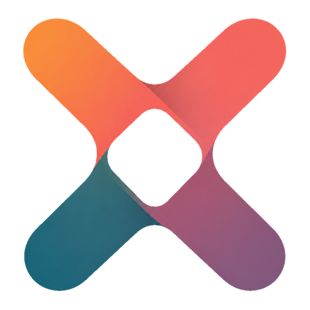
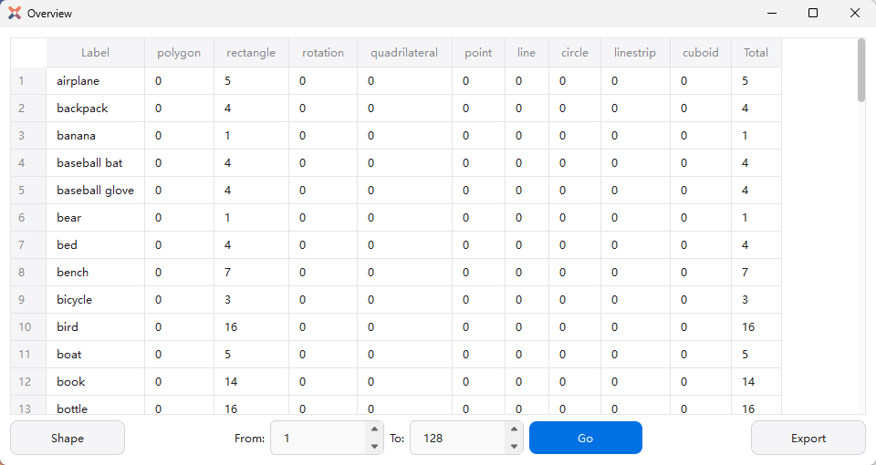
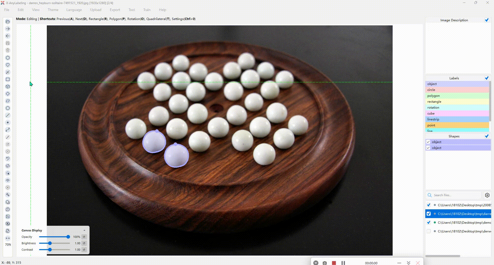
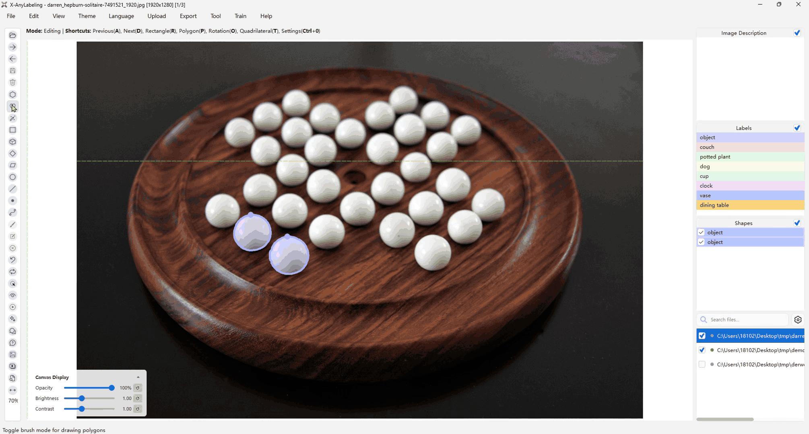
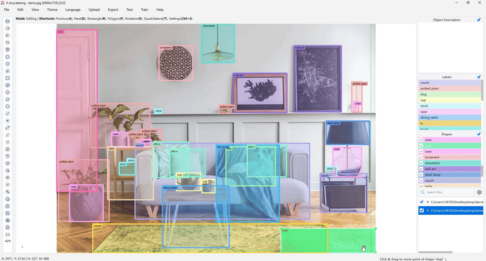
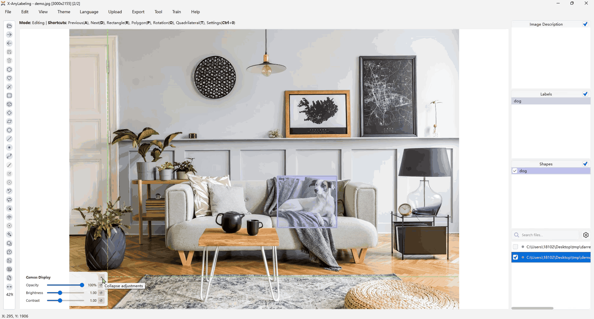
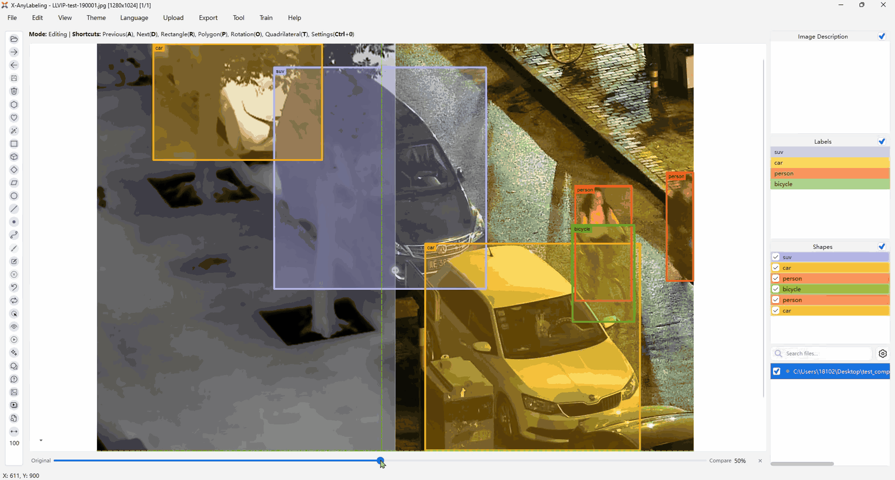
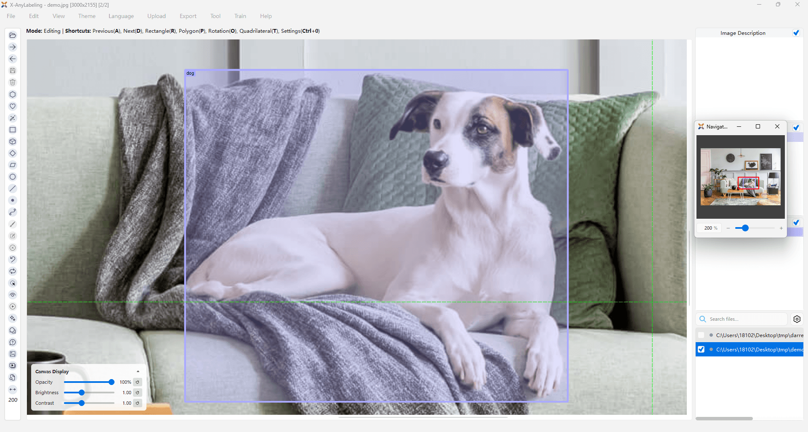

<p align="center">
  
</p>

# qAnyLabeling

<h4>
    <a href="docs/en/user_guide.md">User guide</a> |
    <a href="docs/zh_cn/user_guide.md">中文指南</a> |
    <a href="ENGINEERING.md">Engineering notes</a> |
    <a href="UPSTREAM_PARITY_AUDIT.md">Parity audit</a> |
    <a href="MODEL_MATRIX.md">Model matrix</a> |
    <a href="https://github.com/CVHub520/X-AnyLabeling">Upstream project</a>
</h4>

[](UPSTREAM-LICENSE)
[](https://github.com/CVHub520/X-AnyLabeling)
[](../../../../README.md)



*The annotation workspace: image list, canvas with labels, scores and
descriptions, the embedded model panel and the object list.*

## Introduction

**qAnyLabeling** is a native Qt image annotation workspace inspired by
[X-AnyLabeling](https://github.com/CVHub520/X-AnyLabeling), embedded in
ACloudViewer as an AICore plugin. It combines versatile shape tools,
automated labeling workflows, flexible multi-format import/export and video /
point-cloud workspaces — and every AI assist runs **fully local** through the
AICore GGML runtime: no Python environment and no cloud service are required
for annotation, and every model is verified and downloaded through the shared
AICore catalog/cache pipeline.

## Key Features

* **Annotate everything** — polygon, rectangle, rotation, quadrilateral,
  circle, line, point, line strip and cuboid shapes with live measurements;
  brush paint/erase with per-class targets; magic wand; group/ungroup and
  shape union; rename / lock / visibility; label change manager (`Alt+L`);
  image tags; session-persistent settings and undo/redo.
* **AI-assisted labeling** — one embedded model panel (`Ctrl+A`) over the
  shared AICore catalogs with transient prompts, editable results, batch
  Auto Run (`Ctrl+B`), per-catalog quantization and device/backend rows.
* **Video toolchain** — SAM3 video tracking with timeline review, refinement
  and mask-archive export/import; video classifier with segment editing and
  MP4 / rawframe dataset export; annotation visualization MP4.
* **3D point cloud annotation** — native Qt/OpenGL workspace over KITTI
  `.bin` / PLY + `.label` files with semantic / instance / intensity / RGB
  coloring, brush and through-selection, and cuboid editors in the three
  orthographic views and the main view.
* **Interchange** — X-AnyLabeling JSON sidecars round-trip unchanged (unknown
  fields preserved); YOLO / VOC / COCO / DOTA / MOT / MASK / PPOCR / ODVG /
  VLM-R1 / Datumaro import and export.
* **Optional remote services** — Chatbot (`Ctrl+1`) and VQA (`Ctrl+2`) over
  OpenAI-compatible endpoints (Ollama by default); local vision-language
  captioning via **AI Describe**.
* **Headless automation** — `-ANYLABEL_INFER` and `LLM_GENERATE` batch
  commands with `HELP` / `RESULT_JSON` schemas for scripts and CI.

## Demo

The interaction demos below are the upstream X-AnyLabeling references; they
also serve as the layout-parity baselines for this port
([docs/images](docs/images)).



*Magic wand — a seed-connected color region becomes an editable polygon in
one click.*



*Brush — paint / erase / invert with a per-target class, one-pixel wheel
radius steps and stroke undo/redo.*



*Canvas selection — multi-select, grouped shapes and exclusive display modes
(color by label / instance / group, binary-mask render).*



*Semantic masks with adjustable opacity — exact alpha pixels, holes and
disconnected areas are preserved.*



*Compare view — a same-size reference image (visible / infrared pair) with
shared canvas transforms.*



*Navigator dock — minimap, current-viewport rectangle and drag navigation.*

More interaction loops (brightness / contrast controls, label looping) live
in [docs/images](docs/images).

## Model panel

The embedded model panel (`Ctrl+A`) consumes the public AICore catalogs; the
runtime catalog remains the single source of truth for selectable files
([MODEL_MATRIX.md](MODEL_MATRIX.md)).

| Task | Models in the panel |
| :--- | :--- |
| Object detection | YOLO family (detect), RF-DETR |
| Instance segmentation | YOLO-Seg, RF-DETR-Seg |
| Semantic segmentation | YOLO26 class maps as editable exact masks |
| Oriented detection | YOLO-OBB |
| Pose estimation | YOLO-Pose |
| Classification / attributes | YOLO-Cls; PULC person / vehicle attributes |
| Interactive segmentation | SAM 2.1 point/box prompts; SAM 3 text prompts; SAM 3 Visual and YOLOE SAVPE visual prompts |
| Video tracking | SAM3 video tracker (per-instance masks, archive export/import) |
| Depth estimation | DA3 (Nested AnyView metric variants) |
| Line detection | DeepLSD |
| Keypoints & matching | ALIKED proposals; LoMa; LightGlue bridge; GKD top-down keypoints |
| Face estimation | FaceDetect boxes + 5 landmarks; dense mode with 106 2D / 68 3D points |
| Image matting | RMBG-2.0 alpha mattes as editable foreground polygons |
| Tagging | RAM, RAM++, Tag2Text; YOLO-World / YOLOE per-box object descriptions |
| OCR | PP-OCRv4 (ch / en), PP-OCRv3 (ja), PP-OCRv5, PP-OCRv6 Tiny/Small/Medium |
| Relation recognition | RelateAnything (relsgg families) |
| Vision-language | AI Describe (local `llm` catalog, SmolVLM by default); Chatbot / VQA over OpenAI-compatible endpoints |

## Data interchange

| Direction | Formats |
| :--- | :--- |
| Sidecar | X-AnyLabeling JSON, round-trip with unknown fields preserved |
| Import | YOLO hbb / seg / obb / pose, VOC detection / segmentation, DOTA, COCO detection / segmentation / keypoints (lossless RLE), RGB / grayscale masks, MOT / MOTS, ODVG, VLM-R1 OVD, PaddleOCR rec / KIE, SAM3 tracking archives, Datumaro / KITTI Raw / Sly point-cloud ZIPs |
| Export | the same label sets plus native JSON, RLE masks, visualization MP4, video datasets (MP4 / rawframes with `label_map.txt`), PaddleOCR `crop_img` bundles, point-cloud dataset ZIPs |

## Quick start

```bash
# 1. Configure with the AICore runtime and the plugin enabled
cmake -DBUILD_GUI=ON -DAICore_ENABLED=ON -DPLUGIN_STANDARD_QANYLABELING=ON ..

# 2. Build
cmake --build build_app -j 4

# 3. Open Plugins -> X-AnyLabeling Annotation, then File -> Use Test Data
```

**Use Test Data** (File menu, four entries) fills each annotation mode from
the official X-AnyLabeling demo collection: the shared test-data repository
downloads and verifies `anylabeling_test_data.zip` (about 8.7 MB, provenance
pinned per file), copies it to `cloudViewer_data/anylabeling_demo` so edits
never touch the cache, and every entry is offline afterwards. Delete that
folder to restore the pristine demo.

## Documentation

Bundled upstream reference docs (the port follows these workflows; tracked
gaps are listed in the [parity audit](UPSTREAM_PARITY_AUDIT.md)):

0. [Installation & quickstart](docs/en/get_started.md) — [中文](docs/zh_cn/get_started.md)
1. [User guide](docs/en/user_guide.md) — [中文](docs/zh_cn/user_guide.md)
2. [3D point cloud annotation](docs/en/point_cloud.md) — [中文](docs/zh_cn/point_cloud.md)
3. [Video classifier](docs/en/video_classifier.md) — [中文](docs/zh_cn/video_classifier.md)
4. [Chatbot](docs/en/chatbot.md) — [中文](docs/zh_cn/chatbot.md)
5. [VQA](docs/en/vqa.md) — [中文](docs/zh_cn/vqa.md)
6. [Image classifier](docs/en/image_classifier.md) — [中文](docs/zh_cn/image_classifier.md)
7. [Command line interface](docs/en/cli.md) — [中文](docs/zh_cn/cli.md)
8. [Model zoo (upstream reference)](docs/en/model_zoo.md)

Companion documents: [Engineering notes](ENGINEERING.md) (implementation,
validation, licenses) and [Model matrix](MODEL_MATRIX.md).

## Acknowledgement

This workspace reuses the UI assets, interaction baselines and bundled
documentation from [X-AnyLabeling](https://github.com/CVHub520/X-AnyLabeling)
(commit `926017d09b22564a78c55eb2f368c7b20faa0466`), which itself builds on
[AnyLabeling](https://github.com/vietanhdev/anylabeling),
[LabelMe](https://github.com/wkentaro/labelme),
[LabelImg](https://github.com/tzutalin/labelImg),
[roLabelImg](https://github.com/cgvict/roLabelImg),
[PPOCRLabel](https://github.com/PFCCLab/PPOCRLabel) and
[CVAT](https://github.com/opencv/cvat). The C++ implementation and the AICore
integration are independently written.

## License

All reused upstream files in `images/` and the adapted sources remain under
the upstream GPL-3.0-only license (see [UPSTREAM-LICENSE](UPSTREAM-LICENSE));
the complete attribution list is in [ENGINEERING.md](ENGINEERING.md). Other
C++ code is independently written against Qt and AICore.
