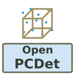
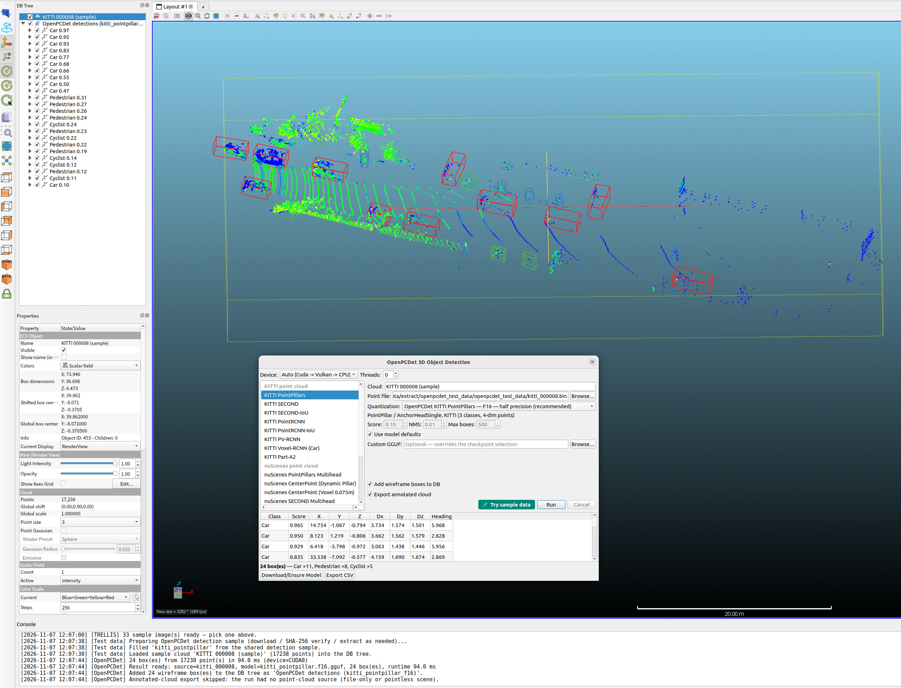

# qOpenPCDet



LiDAR point cloud **3D object detection** for ACloudViewer — PointPillars /
SECOND checkpoints from OpenPCDet, converted to GGUF and served through the
in-tree [OpenPCDet-GGML](https://github.com/Asher-1/OpenPCDet-GGML) engine
(native ggml ops only; CPU / CUDA / Vulkan backends).

```
ccPointCloud → [N, point_dim] float32 buffer → AICore OpenPCDet GGUF →
typed 3D boxes (center/size/heading/score/label) → per-class colored
wireframe ccPolyline boxes + annotated point-cloud export in the DB tree
+ CSV export
```

## Demo



*PointPillars (`kitti_pointpillar`, f16) on the bundled KITTI sample frame: per-class colored wireframe boxes overlaid on the source point cloud. Cars, pedestrians and cyclists are detected and labeled with confidence scores.*

## Build

```bash
cmake -DBUILD_GUI=ON \
  -DAICore_ENABLED=ON \
  -DPLUGIN_STANDARD_QOPENPCDET=ON \
  ..
cmake --build build_app --target QOPENPCDET_PLUGIN -j4
```

OpenPCDet GGML sources live in `core/AICore/src/tasks/openpcdet/`; plugins
consume only the public `aicore/openpcdet_capi.h` ABI.

### Unit tests (pure helpers)

Point-file parsing (.bin/.txt), CSV serialization, class-name mapping,
box-corner math, wireframe edge coverage and catalog mirror (no GGUF model
required):

```bash
cmake -DBUILD_GUI=ON -DAICore_ENABLED=ON -DPLUGIN_STANDARD_QOPENPCDET=ON \
  -DBUILD_UNIT_TESTS=ON ..
cmake --build build_app --target test_qopenpcdet_helpers -j4
ctest -R test_qopenpcdet_helpers --output-on-failure
```

## Models

Published on
[cloudViewer_downloads OpenPCDet-GGUF](https://github.com/Asher-1/cloudViewer_downloads/releases/download/OpenPCDet-GGUF/);
the combo reads the catalog live from `aicore_openpcdet_model_count/at` and
downloads through the shared SHA-256-verified `ecvModelDownloader` (digests
pinned in `core/AICore/include/aicore/asset_digests.h`). 18 checkpoints x 3
quantizations = 54 models:

| Checkpoint | Backbone / Head | Dataset (classes, point dim) |
|------------|-----------------|------------------------------|
| `kitti_pointpillar` | PointPillar / AnchorHeadSingle | KITTI (3, 4-dim) |
| `kitti_second_iou` | SECOND + RoI refinement | KITTI (3, 4-dim) |
| `second_7862` | SECOND / VoxelBackBone8x | KITTI (3, 4-dim) |
| `kitti_pointrcnn` | SECOND + PointRCNN head | KITTI (3, 4-dim) |
| `kitti_pointrcnn_iou` | SECOND + PointRCNN + IoU head | KITTI (3, 4-dim) |
| `kitti_pvrcnn` | SECOND + PV-RCNN head | KITTI (3, 4-dim) |
| `kitti_voxelrcnn_car` | VoxelResBackBone / VoxelRCNN | KITTI (1, 4-dim) |
| `kitti_voxelrcnn_focal_multimodal` * | VoxelResBackBone + focal sparse conv | KITTI (3, 4-dim) |
| `kitti_parta2_anchor` | SECOND + Part-A2 head | KITTI (3, 4-dim) |
| `kitti_caddn` * | CaDDN monocular (image + calibration) | KITTI (3, 4-dim) |
| `nuscenes_pointpillar_multihead` | PointPillar / AnchorHeadMulti | nuScenes (10, 5-dim) |
| `nuscenes_dynpillar_centerpoint` | PointPillar / CenterHead | nuScenes (10, 5-dim) |
| `nuscenes_second_multihead` | SECOND residual / AnchorHeadMulti | nuScenes (10, 5-dim) |
| `nuscenes_centerpoint_voxel0075` | VoxelBackBone / CenterHead | nuScenes (10, 5-dim) |
| `nuscenes_voxelnext` | VoxelNeXt sparse backbone | nuScenes (10, 5-dim) |
| `nuscenes_voxelnext_doubleflip` | VoxelNeXt + TTA double flip | nuScenes (10, 5-dim) |
| `nuscenes_transfusion_lidar` | Transformer fusion (lidar pass) | nuScenes (10, 5-dim) |
| `nuscenes_bevfusion` * | BEVFusion multi-modal (6-camera scene) | nuScenes (10, 5-dim) |

\* Multi-modal checkpoints (`kitti_caddn`, `kitti_voxelrcnn_focal_multimodal`,
`nuscenes_bevfusion`) consume camera images through
`aicore_openpcdet_detect_scene` / `aicore_openpcdet_load_scene_dir`: their
panels take a scene directory (CaDDN and focal VoxelRCNN: one image +
calibration; BEVFusion: a 6-camera scene). Focal VoxelRCNN and BEVFusion also
require the LiDAR branch. The point-cloud workflow covers 15 LiDAR-only
checkpoints. The scene checkpoints are additionally exercised by the
validation runner (`openpcdet-caddn-scene`, `openpcdet-bevfusion-scene`).

Each checkpoint ships as `f32` (full-precision reference), `f16` (recommended)
and `q8_0` (8-bit dense convs, sparse backbone stays F32). License:
Apache-2.0 (OpenPCDet).

## Usage

The dialog follows the qYOLO task-panel layout: a global Device/Threads row,
a left-hand grouped checkpoint list (**KITTI point cloud** — 8 checkpoints,
**nuScenes point cloud** — 7 checkpoints, **Multi-modal scene** — 3
checkpoints) driving one panel per checkpoint, a shared detection result
table (class / score / center / size / heading), application console and CSV export.

1. Pick a checkpoint in the left list and a quantization (`f32` / `f16` /
   `q8_0`, default = the recommended F16 row) inside the panel. Score / NMS /
   Max boxes seed themselves with the effective task defaults
   (`aicore_openpcdet_model_defaults`) as soon as a model file is cached.
   Score / NMS seed the per-checkpoint task defaults (KITTI mirrors the
   official GGUF / upstream config values; nuScenes uses a 0.2 score and a
   tighter NMS); Max boxes seeds the GGUF-declared default. Setting a
   spinbox back to its
   minimum (`model`) restores the follow-the-defaults behavior, and explicit
   non-zero values persist as overrides
2. Point-cloud panels: select a point cloud in the DB tree **or** point at
   a KITTI `.bin` / ASCII `.txt` file (the file wins). Scene panels
   (`kitti_caddn`, `nuscenes_bevfusion`): select a scene directory
   (images.bin + calibration + scene.json) — every camera frame is previewed
   in the panel's multi-camera grid; BEVFusion additionally needs the LiDAR
   branch (active cloud or `LiDAR file`), CaDDN ignores it
3. **Run** → each detection becomes a per-class colored wireframe box
   polyline (`OpenPCDet detections (<model>)` group, children named like
   `Car 0.97`; nuScenes-devkit palette at 10 classes, common KITTI demo
   colors at 3), the shared result table lists every box, and the dialog
   shows a per-class summary. Uncheck *Add wireframe boxes to DB* to skip
   the DB write
4. **Annotated cloud** → *Export annotated cloud* (default on) writes a
   clone of the source point cloud (`OpenPCDet annotated (<model>)`, RGB
   display enabled) whose in-box points are tinted with the detection
   class color — matching the OpenPCDet Python demo styling in the VTK
   view. Needs a point-cloud source (skipped for file-only or pointless
   scene runs)
5. **Export CSV** writes `x,y,z,dx,dy,dz,heading,score,label` (KITTI LiDAR
   frame)

Inference/download logs use the application's existing console, without a
plugin-local log panel. Routine inference chatter (model/scene details,
stage progress, heartbeats, export stages) is routed to `CVLog::PrintDebug`,
so the console only carries errors and the final run summary unless debug
logging is enabled. Inputs and run/cancel/sample/progress stay visible while
configuration scrolls without horizontal field clipping. Long catalog labels
remain readable in the combo popup rather than widening the configuration.
Navigation shows each dataset/scene group once; active checkpoint identity and
quantization remain stable across regrouping and refresh. Restored sessions
re-render each scene panel's preview from its own saved scene dir when the
panel becomes current.

### Use test data

Every checkpoint panel carries the shared teal **Try sample data** button
(`ecvAICoreUi::makeSampleDataBtn`), wired to the shared
`ecvTestDataRepository` one-click chain (download + SHA-256 verify + extract
of the `openpcdet_test_data_v2` bundle into `~/cloudViewer_data`; no private
downloader). One click fills the requesting panel on its selected test frame
(default `kitti_000008` / `nuscenes_n015`); every frame lives under
`frames/<id>/` with its raw LiDAR bin, optional PointRCNN variant and `scene/`:

| Panel(s) | Filled input (default frame) |
|----------|--------------|
| KITTI point cloud (non-PointRCNN) | `Point file` → `frames/kitti_000008/kitti_000008.bin` (17238 × 4) |
| `kitti_pointrcnn` / `kitti_pointrcnn_iou` | `Point file` → `frames/kitti_000008/kitti_000008_sampled16384.bin` (pre-sampled 16384 × 4) |
| nuScenes point cloud | `Point file` → `frames/nuscenes_n015/nuscenes_n015_lidar.bin` (5-dim) |
| `kitti_caddn`, `kitti_voxelrcnn_focal_multimodal` | `Scene dir` → `frames/kitti_000008/scene`; `LiDAR file` → `frames/kitti_000008/kitti_000008.bin` |
| `nuscenes_bevfusion` | `Scene dir` → `frames/nuscenes_n015/scene` (6 cameras); `LiDAR file` → `frames/nuscenes_n015/nuscenes_n015_lidar.bin` |

The panel's own sample frame is additionally loaded into the DB tree and
selected (x, y, z + the `intensity` scalar field — the inverse of the
worker's cloud input path), so the active-cloud Run path works without
touching the point file again and the rendered wireframe boxes share the
displayed cloud's coordinate frame: nuScenes checkpoints load the
`nuScenes n015 (sample)` sweep (5-feature), KITTI checkpoints the
`KITTI 000008 (sample)` frame (4-feature). Missing
bundle members log an error line instead of filling partial paths. A cold cache
miss starts shared preparation without emitting an Error; real download,
integrity and extraction failures retain their error behavior. Closed/rejected
windows discard late sample results and recover their controls when reopened.

The model-free dialog test covers console routing, all 18 panel geometries at
800x480, 800x600 and 1024x768, fixed input/actions/progress and closure.
Explicit real cold-cache validation (the data root must not exist yet) also
verifies the retained ZIP and automatic input fill for all 18 checkpoints:

```sh
QT_QPA_PLATFORM=xcb <build>/bin/plugin_test/test_qopenpcdet_dialog --sample-cache <new-absolute-data-root>
```

This is sample/UI workflow evidence, not model accuracy or release performance.

### Multi-camera preview and frame selection

Each panel renders a full-width camera grid inside the configuration scroll
(no extra fixed-height row): a class-color legend plus one labeled,
click-to-enlarge thumbnail per scene camera (`ecvClickableImageLabel`). KITTI
frames show the single `CAM2` view; nuScenes frames show the six-camera ring
(`CAM_FRONT`, `CAM_FRONT_RIGHT`, `CAM_FRONT_LEFT`, `CAM_BACK`, `CAM_BACK_LEFT`,
`CAM_BACK_RIGHT`) in a 3×2 layout. Camera names come from the optional
`scene.json` `camera_names` array (legacy scenes fall back to the dataset
convention). ImageNet-normalized payloads (BEVFusion) are denormalized for
display only; the on-disk inference payload is never touched.

A **Frame** combo merged into the point-file row (point panels) or scene-dir
row (scene panels) lists the extracted bundle's frames of the panel's own
dataset plus a `Custom…` escape hatch. Selecting a frame fills the input
edits, refreshes the camera grid and loads that frame into the DB tree;
`Custom…` keeps the browsed files. The selection persists per checkpoint
(`qOpenPCDet/frame/<checkpoint>`), as does the grid's scene source
(`qOpenPCDet/previewSceneDir/<checkpoint>`).

After a run, the detections are projected onto every camera with the engine
calibration chain (`lidar_aug` → `lidar_to_image` → perspective divide →
`image_aug`, near-plane + image-rectangle clipping) and painted as 2px
class-colored wireframes with a class/score label. Detections stay verbatim in
the original LiDAR frame — the worker lifts a shifted DB cloud back before
inference, so no shift/scale back-projection is applied here. Overlays clear
on a new run and on close; a stale or cancelled result never paints. Panels
without an associated calibrated scene show a hint instead of the grid.

### Point features

`ccPointCloud` provides `[x, y, z]` plus the first scalar field named
`intensity` / `reflectance` (case-insensitive) as the 4th feature; a missing
intensity field zero-fills it. nuScenes checkpoints expect 5 features
(`x, y, z, intensity, ring/velocity`) — the 5th channel is zero-filled with a
console hint, since ccPointCloud does not carry ring/velocity data.

### Class names

The AICore OpenPCDet C API exposes the label index only (1-indexed, OpenPCDet
convention). For 3-class checkpoints the KITTI mapping (1=Car, 2=Pedestrian,
3=Cyclist) is applied; other layouts display `class N`.

## Headless batch

```bash
ACloudViewer -SILENT -OPENPCDET_DETECT \
    INPUT_DIR ./lidar_bins PATTERN "*.bin;*.txt" \
    OUT_DIR ./out MODEL kitti_pointpillar.f16.gguf DOWNLOAD 1 \
    THRESHOLD 0.3 DEVICE cuda RESULT_JSON ./out/result.json
```

Inputs: KITTI `.bin` (raw float32 rows, width from the model geometry or
`POINT_DIM`) and ASCII `.txt` (`x y z [i]` per line). Outputs per item:
`<stem>_detections.json` plus the shared
`acloudviewer.aicore.batch/1` manifest. `LIST_MODELS 1` prints the 54-model
catalog with cache state (the plugin's detect commands apply to the 15
LiDAR-only checkpoints).

## References

- [OpenPCDet-GGML](https://github.com/Asher-1/OpenPCDet-GGML) (upstream ggml port)
- [OpenPCDet](https://github.com/open-mmlab/OpenPCDet) (original PyTorch toolkit)
