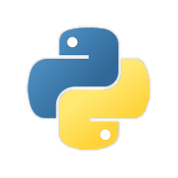

# qPythonRuntime — Embedded Python scripting

## Introduction

**qPythonRuntime** runs **Python scripts** inside ACloudViewer via **pybind11**, with bindings to the application API for automation, batch jobs, and experimental tools. Scripts can load clouds, invoke algorithms, and interact with the scene graph depending on the exposed bindings in your build.



Further build and embedding details live in **`docs/building.rst`** inside this plugin directory.

## Usage

From the GUI, use the Python plugin entry points your build provides (console, script runner, or menu actions). For repeatable runs, prefer the **CLI** below or a small driver script checked into your project.

## ACloudViewer CLI

```bash
ACloudViewer -SILENT -PYTHON_SCRIPT my_script.py [script arguments...]
ACloudViewer -SILENT -O cloud.las -PYTHON_SCRIPT process.py --extra-args
```

Arguments after the script path are forwarded to your script (see `tests/test_cmdline.py` in this plugin for behavior).

## Build

Enable the Python module and the plugin together:

```bash
-DPLUGIN_PYTHON=ON -DBUILD_PYTHON_MODULE=ON
```

For **installer / PACKAGE=ON** builds, use a dedicated minimal venv (not a bloated pyenv global env):

```bash
python -m venv /tmp/acloudviewer-python-pack
/tmp/acloudviewer-python-pack/bin/pip install -r plugins/core/Standard/qPythonRuntime/requirements-release.txt
cmake ... -DPython3_EXECUTABLE=/tmp/acloudviewer-python-pack/bin/python \
          -DPLUGIN_PYTHON_COPY_MINIMAL_ENV=ON -DPLUGIN_PYTHON_COPY_ENV=OFF
```

CMake options (see `plugins/core/Standard/qPythonRuntime/CMakeLists.txt`):

| Option | Default | Meaning |
|--------|---------|---------|
| `PLUGIN_PYTHON_COPY_MINIMAL_ENV` | ON | stdlib + `requirements-release.txt` only |
| `PLUGIN_PYTHON_COPY_ENV` | OFF | full site-packages (minus torch/jupyter bloat filter) |

Use **Python** development headers/libs matching the interpreter you link. Configure **pybind11** per `cmake/PythonEnvHelper.cmake` and project docs.

## Dependencies

- **Python** (development package).
- **pybind11**.

## Binding regression tests

Enable `BUILD_UNIT_TESTS=ON` and test the actual built binary:

```bash
cmake --build build_app --target QPYTHONRUNTIME_PLUGIN test_qpythonruntime_binding_types test_qpythonruntime_plugin_loading -j4
ctest --test-dir build_app -R '^test_qpythonruntime_' --output-on-failure -j1
```

Python regressions use the official `cli-anything-acloudviewer` toolchain; the command must be on `PATH`.
Embedded modules, standalone extensions and two-translation-unit tests share converter declarations;
GNU builds retain LTO and strict ODR checking; Windows embedded linking no longer suppresses
duplicate-symbol failures with `/force:multiple`. Histograms and waveform decoding preserve independent
list results using pybind11's STL converter. `ToASCII` validates numeric sequences before writing.
Opaque containers retain C++ reference semantics. Their `PYBIND11_MAKE_OPAQUE` declarations
remain in shared headers before binding instantiation, and each exposed container has a
`py::class_`/`py::bind_vector` registration, including `GenericDistribution.ScalarContainer`
and `CCVector2List`. Read-only geometry/distribution consumers borrow opaque containers
and accept list/tuple inputs through an explicit call-owned sequence conversion. The
established geometry sequence inputs remain supported; the statistics adapter exposes
an explicit const-input compatibility boundary without redefining the global opaque caster.
See [Making opaque types](https://pybind11.readthedocs.io/en/stable/advanced/cast/stl.html#making-opaque-types).

The shared CI native gate runs the two C++ CTests only when the plugin, Python modules and
unit tests are enabled; missing registrations or test failures are errors. Installed-app
lanes use the official CLI for the Python contracts, including Unicode paths in a real
C-locale child with Python UTF-8 filesystem mode and NumPy transaction regressions.
The child reports its actual locale and filesystem encoding. Windows gate tests execute
the maintained workflow script against real CTest registrations with `IGNORE_TEST=ON`;
they require native Windows and are not counted as Linux execution evidence.
CI wiring is not evidence that a platform run passed. The complete local CTest additionally requires `pytest` in both the
test interpreter and embedded runtime for the existing nested wrapper suite.

`tools/compare_source_identity.py` attributes source byte changes after formatting. It compares
libclang tokens (string, raw-string and operator spellings preserved) and ordered preprocessing
directives, including macro function-likeness and continuation boundaries, against the exact
recovered bytes recorded by an earlier receipt. A different raw SHA is a byte-identity mismatch,
not a functional regression; equal body tokens are still not runtime evidence. Include reordering
and include- or line-sensitive sources are classified as requiring a fresh build and test run.
The tool never rewrites an existing receipt. `test_qpythonruntime_source_identity` is registered
only when CMake finds a real libclang and is outside the pytest-collected runtime suite.

`ScalarField.asArray()` returns a writable NumPy-compatible view using `NDArrayOperatorsMixin`.
Comparisons, ufuncs, broadcasting and indexing use NumPy; assignments and `out=view` write back
without per-element Python loops. Views retain their field owner, including sliced views.
NumPy work buffers are owned copies in the core `ScalarType`, not exported vector pointers.
`np.asarray(view)` returns an independent snapshot; `copy=False` is rejected. Views reject access
when the current field size differs from their creation size; obtain a new `asArray()` view after
resizing. Concurrent native mutation is unsupported.

Each write validates the actual work-array dtype, shape and contiguous layout before
commit. Reentrant changes outside the write target are preserved; changes inside it reject
commit without undoing the callback's own update. All ufunc outputs are checked before any
field is written. For elementwise calls, `where=False` locations are not write targets;
reduction `where` filters inputs without suppressing the reduced output. Mutable `where`
and `ufunc.at` index controls are privately copied before computation. `where` sequences
retain NumPy's boolean conversion; integer ndarray controls retain its safe-cast rejection.
If the original controls' dtype, shape or contents differ at preflight after a callback,
the transaction rejects field commit and preserves the callback's own updates. Basic tuple/slice
index callbacks are resolved once when creating a view. Slice bounds follow the native
`step`, `start`, `stop` callback order; a zero step rejects before the other bound callbacks.
Native basic slices retain only resolved offsets, so they do not need a frozen index copy.
Unknown array-protocol objects and ndarray subclasses receive `NotImplemented`; internal work
buffers are not handed to their callbacks.

For ordinary one-dimensional views, length and integer reads are O(1), basic slice creation
is O(1), and copying or assigning a K-element basic slice is O(K). A top-level single-slice
index tuple on a native one-dimensional view uses the same bounded slice path; nested index
tuples retain NumPy's rejection rules. NumPy handles slice normalization, broadcasting and
computation; C++ only maps/copies native storage. General
indexing may still use O(N) work buffers. Aliased basic ufunc operands share the smallest
continuous owner window of W values, including overlapping/reversed views. Read-only owners
allocate one compute snapshot; only writers allocate a before-image and write mask.
Full-field or distant/sparse aliases can still require W = N. Allocation regressions bound
small-window buffers, not numerical-kernel speedups. `ScalarField[index]` keeps the Python
float value boundary; `asArray()[index]` returns a NumPy scalar in the core dtype.
`toArray()` preserves its independent float64 copy contract; explicit `__array__` dtypes are honored.

## References

- CloudCompare Python runtime documentation (conceptual lineage): [tmontaigu.github.io/CloudCompare-PythonRuntime](https://tmontaigu.github.io/CloudCompare-PythonRuntime/index.html)
- Local build notes: `plugins/core/Standard/qPythonRuntime/docs/building.rst`
