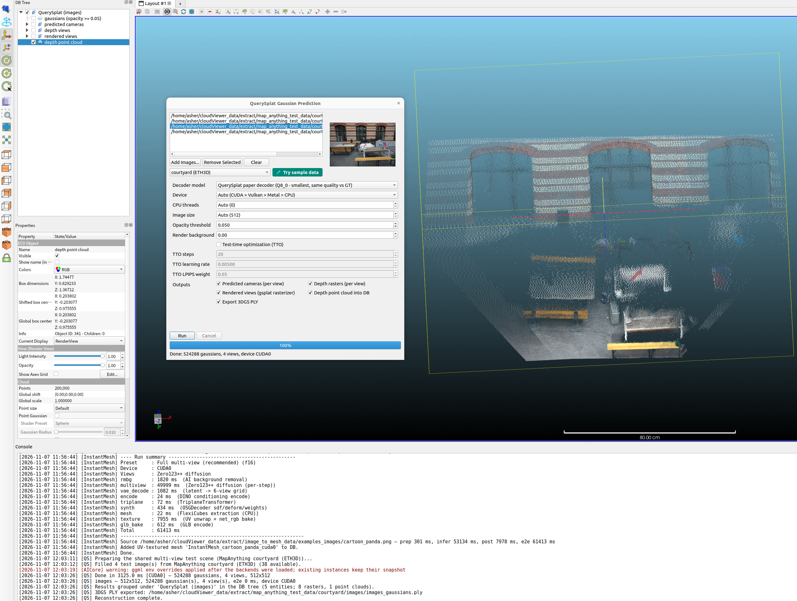

# qQuerySplat — Multi-View Image-to-3DGS Prediction

Predicts a full 3D Gaussian Splatting scene from a small set of unposed
images: the in-tree VGGT-Omega encoder (shared with the MapAnything
plugin — same published GGUFs, one implementation) exports cached-layer
tokens, the QuerySplat decoder graph turns them into 524288 gaussians, and
the built-in gsplat-semantics CPU rasterizer renders the predicted input
views. Optional test-time optimization (TTO) fine-tunes the decoder KV
memory against the input pixels (L1 + SSIM + LPIPS, AdamW).

Everything runs locally through `libAICore` — no Python at runtime.

## Usage

1. Open the plugin from the AI menu: **QuerySplat Gaussian Prediction**.
2. Add 2-16 images of one scene (use **Use Test Data** to auto-fill the
   first frames of any shared multi-view scene bundle — the same 13 official
   scene fixtures the MapAnything plugin consumes; courtyard's first four
   frames are byte-identical to the upstream QuerySplat eval inputs).
3. Pick a decoder quantization tier (q8_0 is the recommended default; the
   VGGT-Omega encoder resolves from the shared MapAnything model cache).
4. Optionally enable TTO (20 steps is the official default). The decoder
   KV-memory backward runs on CPU today: the backward graph is sized by the
   checkpoint's 8192 gaussian tokens (resolution-independent) and exceeds a
   24 GB GPU at 512x512 — CUDA needs a larger device, CPU is slower but
   fully functional (per-step L1/SSIM/LPIPS are logged and reported).
5. **Run**: the plugin imports the gaussian centers + colors as a point
   cloud, the predicted cameras as camera sensors, the depth rasters and
   the gsplat renders as images, exports the standard 3DGS PLY, and writes
   a JSON run summary.

## Demo



*Feed-forward 3D Gaussian Splatting from a small set of unposed images: the VGGT-Omega encoder exports cached-layer tokens, the QuerySplat decoder turns them into 524 288 gaussians, and the built-in gsplat-semantics CPU rasterizer renders the predicted views. Optional TTO fine-tunes the decoder KV memory against the input pixels.*

## Models

| File | Role | Size |
|---|---|---|
| `querysplat-paper-q8_0.gguf` | decoder, recommended | 1.31 GB |
| `querysplat-paper-f16.gguf` | decoder, staged as f32 | 2.30 GB |
| `querysplat-paper-f32.gguf` | decoder, parity reference | 4.47 GB |
| `lpips-vgg-f32.gguf` | LPIPS metric (TTO only) | 59 MB |
| `vggt-omega-1b-512-{q8_0,f16,f32}.gguf` | encoder (shared with qMapAnything) | 1.3-4.6 GB |

Published at <https://huggingface.co/Asher-1/querysplat_vggto> (decoder +
LPIPS) and <https://huggingface.co/Asher-1/map_anything_vggt> (encoder);
downloads go through the shared model downloader with pinned SHA-256
verification. Test images are shared with qMapAnything: the
`map_anything_vggt_test_data` scene bundles
(<https://github.com/Asher-1/cloudViewer_downloads/releases/tag/map_anything_vggt_test_data>)
are fetched once through `ecvTestDataRepository` and consumed by both
plugins.

## Headless batch

```bash
ACloudViewer -SILENT -QUERY_SPLAT \
    IMAGE img1.png IMAGE img2.png IMAGE img3.png IMAGE img4.png \
    OUT_DIR ./out HELP
```

The batch default is one scene per IMAGE (batch processing); `MULTIVIEW 1`
switches to the upstream `--images` semantics — all images form ONE
multi-view scene with a single run and one export set. `EXPORT_CAMERAS 1`
(default) writes the predicted cameras as JSON **and** NPZ per item;
`EXPORT_INPUT_DEPTHS 1` adds the raw depth + confidence NPZ. With `TTO 1`,
`TTO_SAVE_STEPS 0,5,10` + `TTO_SNAPSHOT_DIR <dir>` save the gaussian PLYs
at those steps (`gaussians_tto_step%04d.ply`, step 0 = the feed-forward
seed — the official `--tto_save_step`). The `HELP` schema (schema id
`acloudviewer.aicore.batch/1`) is also exposed through the JSON-RPC
`aicore.batch` surface and the MCP tools; note the console text routes
through the application console, so the RESULT_JSON manifest is the
machine-readable surface for headless consumers.

## Accuracy

The default f32-accuracy profile reproduces the upstream torch chain:
cpp-vs-GT render PSNR 26.85 dB (f32) / 26.84 (f16) / 26.89 (q8_0) on the
official reference scenes — see `core/AICore/scripts/validation_manifest.json`
for the regression matrix and `core/AICore/README.md` for the task
contract.
