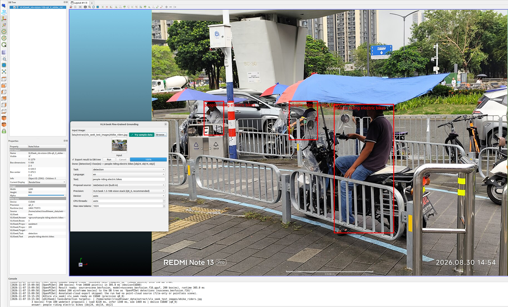
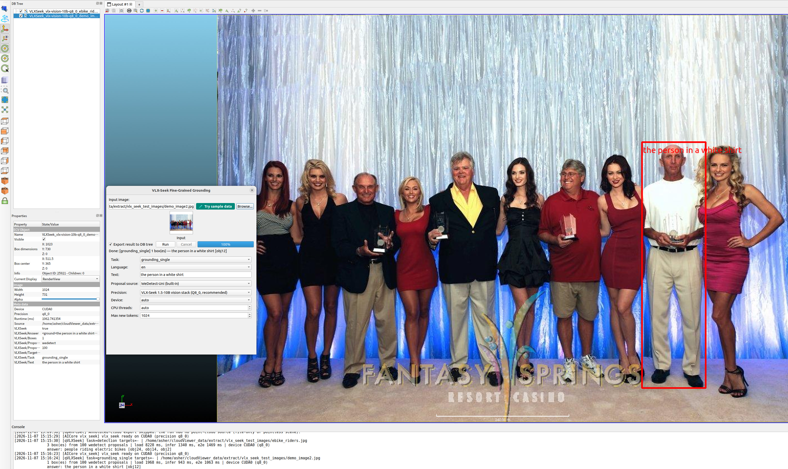
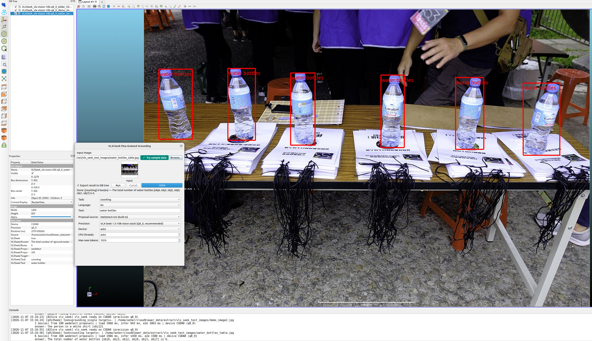
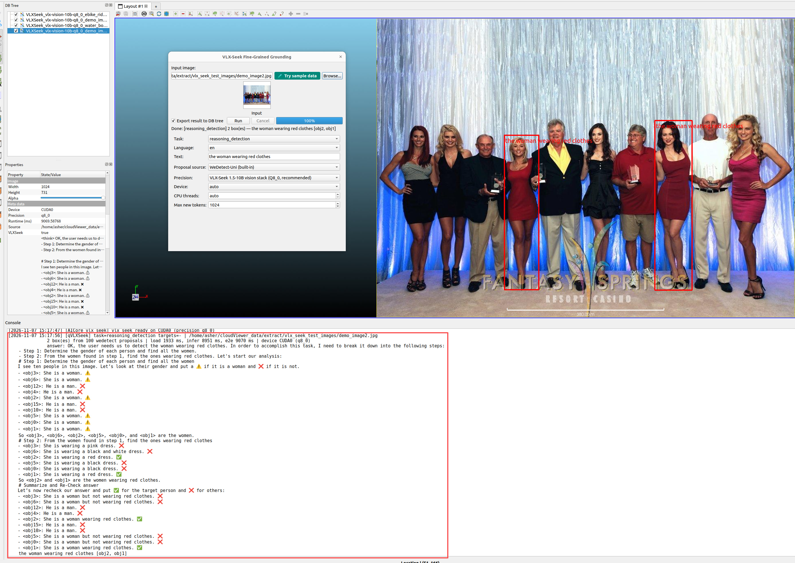
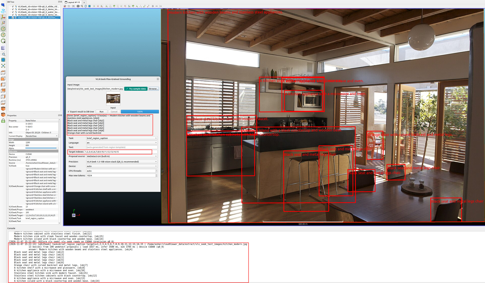
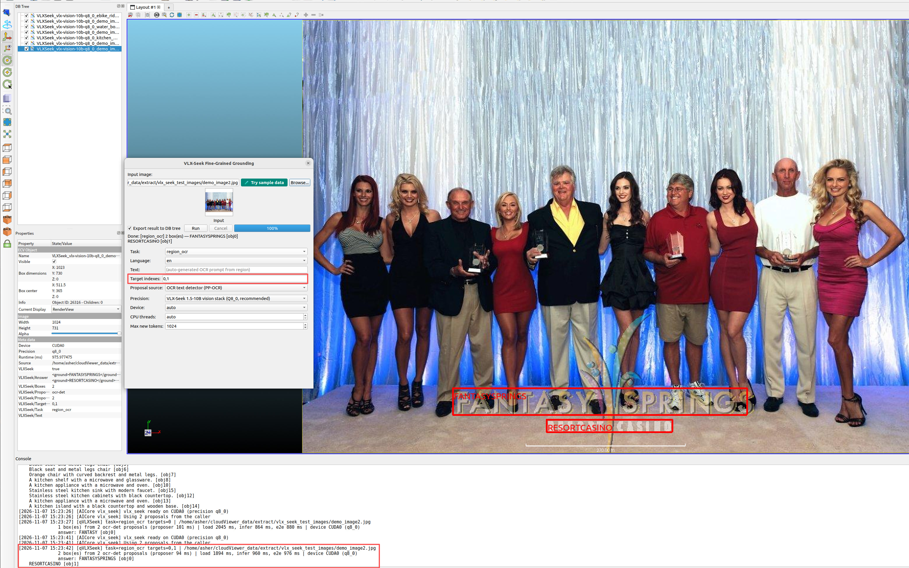
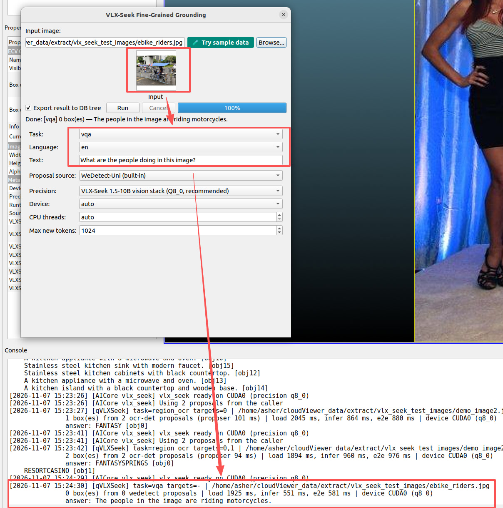

# qVLXSeek — VLX-Seek fine-grained grounding

Open-vocabulary, region-retrieval grounding on images, powered by
**VLX-Seek 1.5-10B** running through AICore's native GGML task
(`vlx_seek`):

```text
image ──► WeDetect-Uni proposals (f32) ──► 100 candidate boxes
image ──► Qwen3.5-VL tower + C-RADIOv4/SimpleFPN + HFRE ──► region tokens
region tokens + task prompt ──► Qwen3.5-10B (pinned llama.cpp qwen3_5)
        ──► `<ground>label</ground><objects><obj2><obj5></objects>`
        ──► boxes resolved from the proposal set

region_ocr (OCR text-detector proposals):
image ──► PP-OCR det (q8_0) ──► text-line boxes ──► target objN = a text line
        ──► Qwen3.5-10B reads the region ──► answer annotated on the text bbox
```

Because the model retrieves candidate regions instead of generating
coordinates, multi-object answers stay short, stable and fast to decode, and
absent targets are rejected with an explicit answer instead of a hallucinated
box.

## Actions

- **VLX-Seek grounding** — dialog with the seven upstream tasks
  (`detection`, `grounding_single`, `counting`, `reasoning_detection`,
  `brief_region_caption`, `region_ocr`, `vqa`), `en`/`zh` prompt templates,
  precision choice from the published catalog, a proposal-source combo
  (built-in WeDetect-Uni, 100 regions; an external boxes JSON file in
  the upstream `--bbox-list` format `[[x1,y1,x2,y2],...]` in image pixels,
  which skips the built-in proposer and verifies the given regions
  directly; or the OCR text detector, region_ocr only — see below), and a
  Try-sample-data action
  (shared teal button) that fills the rich multi-object street scene
  (`ebike_riders.jpg`, the validated detection-scenario input) from the
  shared data repository together with a showcase prompt ("people riding
  electric bikes" — plural so the model enumerates every matching
  instance, verified 3 boxes; only filled into an empty Text field). The
  input thumbnail previews in the dialog with
  click-to-enlarge; an "Export result to DB tree" checkbox (default
  checked) gates the annotated-image export, and the DB entry is selected
  after every export.
- **Region tasks** — `brief_region_caption` and `region_ocr` consume
  zero-based detector proposal indexes: the dialog shows a "Target
  indexes" field when one of those tasks is selected (e.g. `2, 3`), and
  the batch command takes `-TARGET_INDEXES 2,3`. The runtime rejects both
  tasks without targets.
- **OCR text-detector proposals (region_ocr)** — the WeDetect-Uni
  proposer generates object regions, which rarely align with text. When the
  proposal source is "OCR text detector (PP-OCR)" (only selectable for
  `region_ocr`), the dialog worker runs the PP-OCRv4 text detector
  (`ppocr-det-ch` + `ppocr-rec-ch`, q8_0 tier, resolved through the public
  AICore OCR catalog and downloaded with the shared pinned-digest
  pipeline) and feeds its text-line boxes as the proposal set: target
  indexes address actual text lines and the exported boxes are text
  bboxes. The proposal pass is reported in the console line as
  `from <n> ocr-det proposals (proposer <ms> ms)`. Target index N and the
  answer's `objN` references use the same proposal order, so the console
  text, the target indexes and the annotated boxes stay aligned (the
  runtime re-maps the model output back to proposal numbering).
- **Known model behavior (region OCR)** — the text comes from the
  VLX-Seek decode under the upstream prompt (`Please provide the ocr
  results of <objN> in the image.`, greedy decoding). On ornate/stylized
  text a single-region query may under-read: with demo_image2.jpg the
  obj0 box covers the whole "FANTASY SPRINGS" line (verified identical
  box coordinates across runs), yet a 1-target query decodes "FANTASY"
  while a 2-target query decodes "FANTASYSPRINGS" for the same box. The
  proposal boxes and obj numbering are unaffected; query several regions
  in one request when the full text matters.
- **-VLXSEEK_RUN** — headless batch command
  (`-VLXSEEK_RUN OUT_DIR <dir> IMAGE  [IMAGE <img2> ...] TASK detection
  TEXT "person" LANG en PRECISION q8_0 MAX_NEW_TOKENS 1024 DEVICE auto
  THREADS 0`; options are bare keywords inside the command — a `-WORD`
  token starts the next command, so do not prefix these options with `-`).
  Writes
  `<stem>_vlxseek.json` plus an annotated `<stem>_vlxseek_vis.png` per image
  and the shared `RESULT_JSON` manifest. `HELP:1` prints the option schema
  (including `-TARGET_INDEXES`). `-PROPOSAL_SOURCE ocr_det` composes the
  same OCR text-detector proposals as the dialog for `region_ocr` (models
  resolve through the public OCR catalog into the shared `ocr_models`
  cache; missing files download through the shared batch `ensureModel`
  path); `external` pairs with `-BBOX_LIST`.
- Sampling matches the upstream CLI defaults (temperature 0 / top-p 1,
  greedy) — the runtime exposes greedy decoding only, which is the
  documented upstream configuration. External `--bbox-list`-format boxes
  compose in the dialog through the "External boxes (JSON file)" proposal
  source.

## Demo gallery

Each of the seven upstream tasks produces an annotated output on the demo images. The examples below use the bundled test data (see *Actions* → *Try sample data*).

| Detection — “people riding electric bikes” | Grounding (single) — “the person in a white shirt” |
|:---:|:---:|
|  |  |
| *Enumerates every matching instance (3 riders detected).* | *Retrieves the single best region for the described target.* |

| Counting — “water bottles” | Reasoning detection — “the woman wearing red clothes” |
|:---:|:---:|
|  |  |
| *Counts all visible instances of the prompted object.* | *Composes object detection with attribute reasoning.* |

| Brief region caption (target index 1) | Region OCR (target index 0, PP-OCR proposals) |
|:---:|:---:|
|  |  |
| *Generates a short caption for a detector-proposal region.* | *Reads text at the target index using PP-OCR text-line proposals.* |

| VQA — “What are the people doing in this image?” |
|:---:|
|  |
| *Visual question answering: produces a text answer only (no boxes exported).* |

## Models

All GGUFs come from the pinned revision of
[Asher-1/VLX-Seek-1.5-10B-GGUF](https://huggingface.co/Asher-1/VLX-Seek-1.5-10B-GGUF)
through the AICore task catalog (`aicore_vlx_seek_model_*`): the f32
WeDetect-Uni proposal network (the official `.pth` dtype), the merged vision
stack (Qwen3.5-VL tower + CAbstractor + RADIOv4 + SimpleFPN), and the
Qwen3.5-10B hybrid LLM. One family = one detector + one vision + one LLM row;
`f32`/`f16`/`q8_0` digests live in `core/AICore/include/aicore/asset_digests.h`.
The q8_0 set is the recommended default (~11.5 GiB VRAM; f16 needs ~21 GiB).

First Run downloads the three files of the selected family into
`~/cloudViewer_data/extract/vlx_seek_models` through the shared
`ecvModelDownloader` with pinned SHA-256 verification.

The official test images (two upstream demos + seven benchmark originals)
ship as `vlx_seek_test_images.zip` on the same model repository; the
**Use test data** action fetches and extracts them through
`ecvTestDataRepository::ensureDatasetReady` into
`~/cloudViewer_data/extract/vlx_seek_test_images`. The demo image and
prompt are selected per the current task mode, matching the upstream
VLX-Seek inference guide examples:

| Task | Demo image | Prompt | Lang | Target indexes |
|------|-----------|--------|------|----------------|
| detection | ebike_riders.jpg | people riding electric bikes | en | |
| grounding_single | demo_image2.jpg | the person in a white shirt | en | |
| counting | water_bottles_table.jpg | water bottles | en | |
| reasoning_detection | demo_image2.jpg | the woman wearing red clothes | en | |
| brief_region_caption | kitchen_modern.jpg | (auto) | en | 1 |
| region_ocr | demo_image2.jpg | (auto) | en | 0 |
| vqa | ebike_riders.jpg | What are the people doing in this image? | en | |

The `region_ocr` demo row also switches the proposal source to the OCR
text detector so the target index addresses a real text line of the
watermark text (the run downloads the two small PP-OCR files on first use).

Browse opens in the filled image's directory.
Headless runs inject external proposals with `BBOX_LIST <file>`.

## Notes

- Results land in the DB tree as an annotated image
  (`VLXSeek_<model>_<stem>`) carrying the answer, task and timing metadata.
  VQA mode is the exception: it produces text answers only (no boxes), so
  the Q&A goes to the console/log without a DB tree export.
- Inference runs on a worker thread; heavy inference never touches the GUI
  thread. All messages go to the application console.
- Accuracy/performance evidence: run the `test_vlx_probe` probe against the
  upstream `vlx-cli` reference (see
  `core/AICore/tests/vlx/prepare_vlx_upstream_reference.py`) — greedy-token
  identity and box deltas are the release gates.
