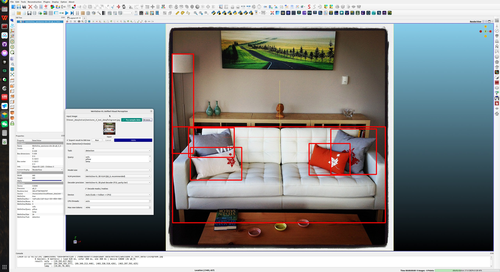
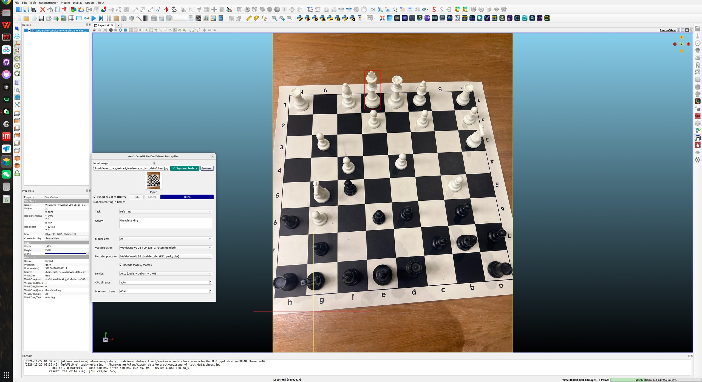
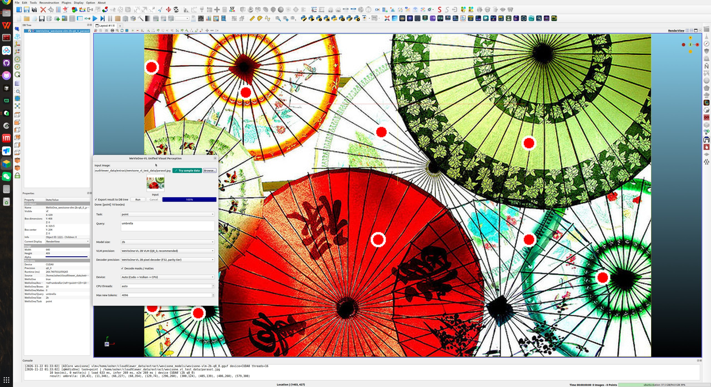
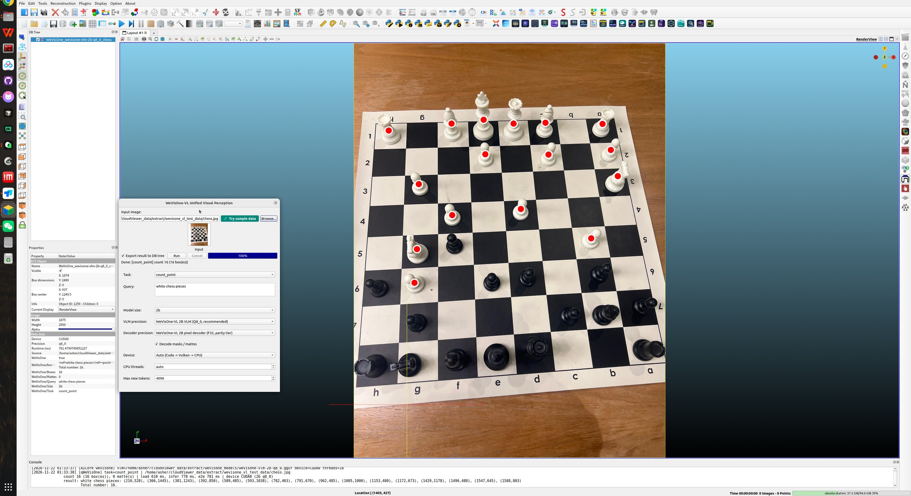
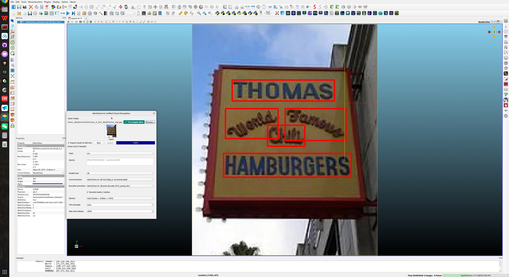
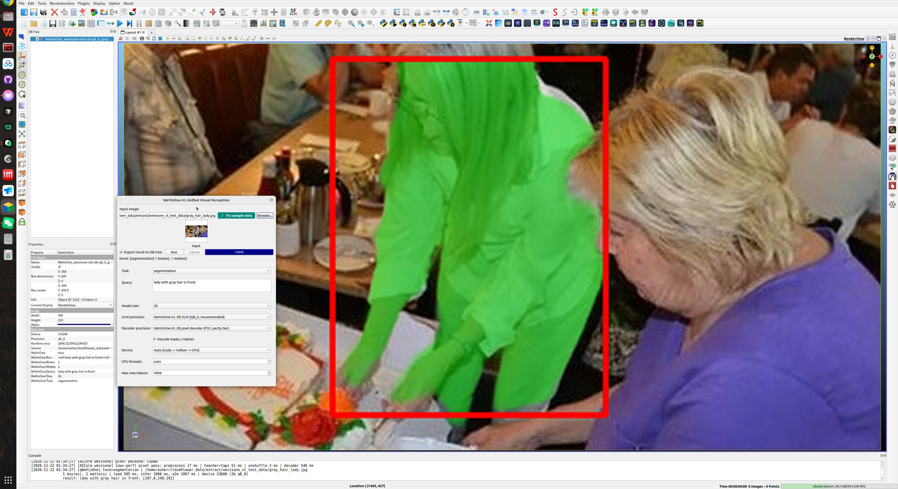
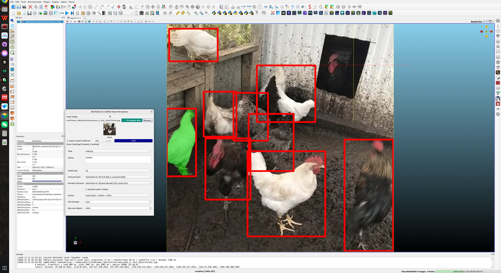
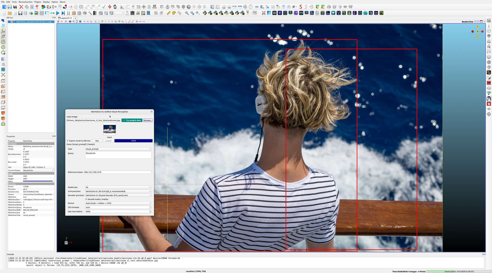
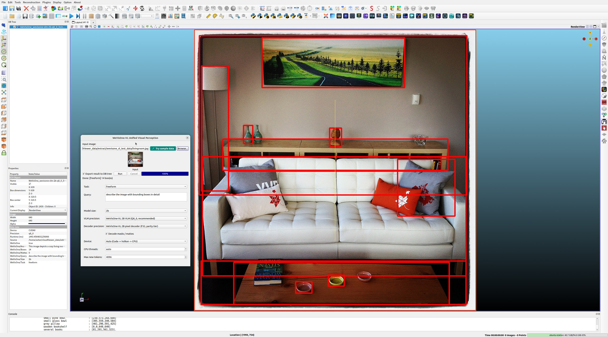

# qWeVisOne — WeVisOne-VL unified visual perception

Eleven perception tasks on images through one model, powered by
**WeVisOne-VL** (2B / 4B, Qwen3-VL based) running through AICore's native
GGML task (`wevisone`):

```text
image ──► Qwen3-VL ViT (mmproj, f16) ──► vision embeddings
embeddings + task prompt ──► Qwen3-VL LLM (pinned llama.cpp qwen3vl + mtmd)
        ──► `<box><x1><y1><x2><y2>label<OBJ></box>` structured answer
        ──► boxes / points / counts parsed from coordinate tokens (<0>..<1000>)
        ──► optional pixel decoder (9.6M params) over every <OBJ>
        ──► per-object alpha mattes (first matte retained, upstream contract)
```

The model generates normalized coordinate tokens instead of proposal
retrieval, and absent targets are rejected with an explicit `None` answer
instead of a hallucinated box. Segmentation and matting answers carry
`<OBJ>` markers whose hidden states drive the pixel decoder.

## Actions

- **WeVisOne-VL perception** — dialog with the eleven upstream tasks
  (`detection`, `referring`, `point`, `count_box`, `count_point`, `ocr`,
  `ocr_grounding`, `segmentation`, `matting`, `visual_prompt`, `freeform`),
  a multi-line query field (the detection task consumes a
  newline-separated category list), a reference-boxes field shown only for
  `visual_prompt` (upstream `--ref-boxes` format
  `x1,y1,x2,y2[;x1,y1,x2,y2...]` in image pixels), checkpoint family
  (2b/4b) and precision combos from the published catalog, a decoder-tier
  combo (f32 default — the checkpoint dtype — or f16), a "Decode masks /
  mattes" toggle (uncheck for a pure object-level detector), and a
  Try-sample-data action (shared teal button) that fills the task-optimal
  demo image **plus the manifest-verbatim query** (and the visual_prompt
  reference box) from the shared data repository. The input thumbnail
  previews in the dialog with click-to-enlarge; an "Export result to DB
  tree" checkbox (default checked) gates the annotated-image export, and
  the DB entry is selected after every export.
- **Task prompt semantics** (upstream `prompts.py`, mirrored by the
  runtime): `ocr` runs a fixed prompt (the query field is unused);
  `visual_prompt` grounds from the reference boxes (the query is unused —
  the model locates all objects similar to the referenced regions);
  `freeform` passes the query through verbatim; every other task fills its
  template slot with the query.
- **-WEVISONE_RUN** — headless batch command
  (`-WEVISONE_RUN OUT_DIR <dir> IMAGE  [IMAGE <img2> ...] TASK detection
  QUERY "sofa\npillow\nlamp" SIZE 2b PRECISION q8_0 DECODER_PRECISION f32
  DECODE_MASKS 1 MAX_NEW_TOKENS 4096 DEVICE auto THREADS 0`; options are
  bare keywords inside the command — a `-WORD` token starts the next
  command, so do not prefix these options with `-`). A literal `\n` in
  `QUERY` is the documented newline escape for the category list. Writes
  `<stem>_wevisone.json` (answer, typed boxes, matte metadata, token
  counts), an annotated `<stem>_wevisone_vis.png` and — when the decoder
  ran — the raw row-major f32 `<stem>_wevisone_matte.bin`
  (`numpy.fromfile(..., dtype=float32).reshape(h, w)`), plus the shared
  `RESULT_JSON` manifest. `HELP:1` prints the option schema;
  `LIST_MODELS:1` prints the catalog with cache state. `REF_BOXES` is
  required for `visual_prompt`; `QUERY` is required for every task except
  `ocr` and `visual_prompt`.
- Sampling matches the upstream CLI defaults (greedy decoding) — the
  runtime exposes greedy decoding only, which is the documented upstream
  configuration.

## Demo gallery

Each of the eleven upstream tasks is captured as a full GUI screenshot:
the dialog filled by *Try sample data* (the manifest-selected demo image
and task-specific query), the annotated result exported to the DB tree
and shown in the 3D view, and the console summary line. Overlays use the
production renderer shared with the DB-tree export and the batch
`_vis.png`: red width-3 box strokes, filled point dots with a white
outline ring, and the green alpha-matte composite. Examples: 2b q8_0 on
CUDA, decoder f32.

| Detection — “sofa / pillow / lamp” | Referring — “the white king” |
|:---:|:---:|
|  |  |
| *Enumerates every matching instance per category (6 boxes).* | *Retrieves the single best region on the classic chessboard case.* |

| Point — “umbrella” | Count (boxes) — “chess pieces” |
|:---:|:---:|
|  |  |
| *Grounds all 10 umbrellas as visible dots with white outline rings.* | *One box per counted piece (31 boxes).* |

| Count (points) — “white chess pieces” | OCR — fixed prompt |
|:---:|:---:|
|  |  |
| *One dot per counted white piece; the stated total is 16.* | *Reads every text line and grounds each one (5 boxes).* |

| OCR grounding — “THOMAS” | Segmentation — “lady with gray hair in front” |
|:---:|:---:|
|  |  |
| *Grounds only the queried text line.* | *Box plus the pixel-decoder alpha matte composited in green.* |

| Matting — “chicken” | Visual prompt — reference box on seabreeze.jpg |
|:---:|:---:|
|  |  |
| *Per-object boxes and mattes; the first matte is retained (upstream RunResult contract).* | *Grounds every object similar to the referenced region (2 people).* |

| Freeform — “describe the image with bounding boxes in detail” |
|:---:|
|  |
| *Free-form query answered with prose plus grounded boxes (14).* |

## Models

All GGUFs come from the pinned revision of
[Asher-1/WeVisOne-VL-GGML](https://huggingface.co/Asher-1/WeVisOne-VL-GGML)
through the AICore task catalog (`aicore_wevisone_model_*`). One family =
one VLM + one mmproj + one decoder row:

| Role | 2b | 4b | Tiers |
|------|----|----|-------|
| VLM (Qwen3-VL LLM) | `wevisone-vlm-2b-*` | `wevisone-vlm-4b-*` | f16 / q8_0 / q4_K_M |
| Vision projector | `mmproj-wevisone-vlm-2b-f16` | `mmproj-wevisone-vlm-4b-f16` | f16 only |
| Pixel decoder | `wevisone-mask-decoder-2b-*` | `wevisone-mask-decoder-4b-*` | f32 (parity default) / f16 |

Digests live in `core/AICore/include/aicore/asset_digests.h`. The 2b q8_0
set is the recommended default; the f16 4b set needs the largest VRAM.
First Run downloads the three files of the selected family into
`~/cloudViewer_data/extract/wevisone_models` through the shared
`ecvModelDownloader` with pinned SHA-256 verification.

The official test images (25 demo/evaluation photos plus the task-sample
`manifest.json`) ship as `wevisone_vl_test_data.zip` on the same model
repository; the **Use test data** action fetches and extracts them through
`ecvTestDataRepository::ensureDatasetReady` into
`~/cloudViewer_data/extract/wevisone_vl_test_data`. The demo image, query
and reference box are read from the dataset's own `manifest.json` for the
current task mode. Selection priority: the classic chessboard case
(`chess.jpg`) whenever the manifest offers it for the task (referring,
count_box, count_point); otherwise the first WeVisOne-specific case-study
original (an image outside the seven shared official demo photos) so the
first fill showcases WeVisOne's own data; tasks with neither use the
manifest's first sample. When the manifest is absent (offline
synthetic cache) a built-in fallback table mirroring the first samples is
used:

| Task | Demo image | Query (manifest-verbatim) | Ref boxes |
|------|-----------|---------------------------|-----------|
| detection | livingroom.jpg | sofa\npillow\nlamp | |
| referring | chess.jpg | the white king | |
| point | parasol.jpg | umbrella | |
| count_box | chess.jpg | chess pieces | |
| count_point | chess.jpg | white chess pieces | |
| ocr | thomas_sign.jpg | (fixed prompt) | |
| ocr_grounding | thomas_sign.jpg | THOMAS | |
| segmentation | gray_hair_lady.jpg | lady with gray hair in front | |
| matting | chicken.jpg | chicken | |
| visual_prompt | seabreeze.jpg | the person | 880,120,1500,1070 |
| freeform | livingroom.jpg | describe the image with bounding boxes in detail | |

Browse opens in the filled image's directory.

## Notes

- Results land in the DB tree as an annotated image
  (`WeVisOne_<model>_<stem>`) carrying the answer, task, query, box/matte
  counts and timing metadata. A `None` rejection or a text-only freeform
  answer is the exception: no boxes and no masks means no visual change,
  so the answer goes to the console/log without a DB tree export.
- The annotated overlay mirrors the official renderer pixel-for-pixel:
  red width-3 rectangles plus a green (0,220,0) alpha composite of the
  first matte at `a*0.55` (threshold 0.01, nearest-neighbor mapping).
  Degenerate `[x,y,x,y]` point boxes (count_point / point grounding) are
  drawn as visible filled dots with a white outline ring, mirroring the
  official python overlay geometry (`visualization.py`: radius
  `max(6, round(w/85))`, outline `max(2, round(radius/3))`) — the C++
  export helper's width-3 rectangle would collapse to a 3x3 speck on
  large images.
- Inference runs on a worker thread; heavy inference never touches the GUI
  thread. All messages go to the application console.
- The console result block prints one aligned line per detected label
  (original-image pixel coordinates) and keeps free-text tails such as the
  counting "Total number: N.". For count_box/count_point the headline count
  is that stated total (upstream demo/app.py semantics); the box count is
  shown as localization evidence and may be shorter. llama WARN notices
  split into two classes: families verified benign against the pristine
  upstream CLI on identical inputs (vocab control-token override, the
  Qwen-VL >=1024 image-token advice — upstream pins the 16/2025 window —
  and the ~llama_context compute-buffer mismatch, which the upstream CLI
  emits with identical MiB values whenever a large image's non-causal
  vision span reallocs the reserve buffer) are demoted to DEBUG and stay
  silent at the default console level; any other WARN is surfaced once
  per process.
- Accuracy/performance evidence: run the `test_wevisone_probe` probe
  against the upstream `wevisone-cli` reference — greedy-answer identity,
  box deltas and matte statistics are the release gates, on every claimed
  backend (CUDA/Vulkan), family (2b/4b) and quantization. The probe accepts
  a test-only `--log-level` (0=DEBUG) that exposes the llama reserve/ubatch
  traces and the demoted benign notices for root-causing.
- Cross-version greedy parity is preserved by ordered llama patches:
  `0033-acv-llama-cuda-norm-parity.patch` keeps llama LLM RMS-norm nodes on
  the pinned scalar accumulation order (the newer float4 vectorized kernel
  reorders the sum and flips near-tied greedy argmax),
  `0034-acv-wevisone-qwen3vl-pinned-resize.patch` restores the pinned
  qwen3vl mtmd resize semantics (`PAD_CEIL` + `std::round`) that predate the
  upstream HF-aligned resize change, and
  `0035-acv-llama-cuda-q6k-mmvq-parity.patch` keeps the pinned VDR-1 q6_K
  mmvq dot for the q4_K_M family (whose output/ffn_down tensors are q6_K).
  The norm revert is owner-scoped by task, not by node name alone: every llama
  LLM emits the same `norm-<il>` naming, so `0036-acv-rms-norm-hint-api.patch`
  adds a public `ggml_rms_norm_set_hint` and the WeVisOne/VLX-Seek runtimes tag
  their LLM norm nodes through `cp.cb_eval` (their upstream pins the old scalar
  kernel). The `llm` task references the pristine-new vectorized kernel and
  leaves its norms untagged, so it keeps the newer behavior; clip/mtmd ViT norms
  are unnamed and never matched.
- The runtime binds `mtmd_context_params.device` to the lease-resolved GPU.
  AICore registers CUDA and Vulkan in one process, and mtmd's default GPU
  pick returns the first registered GPU (CUDA0) even for a Vulkan request;
  without the explicit binding the ViT silently ran on a different backend
  than the LLM and the upstream single-backend reference, breaking Vulkan
  greedy parity.